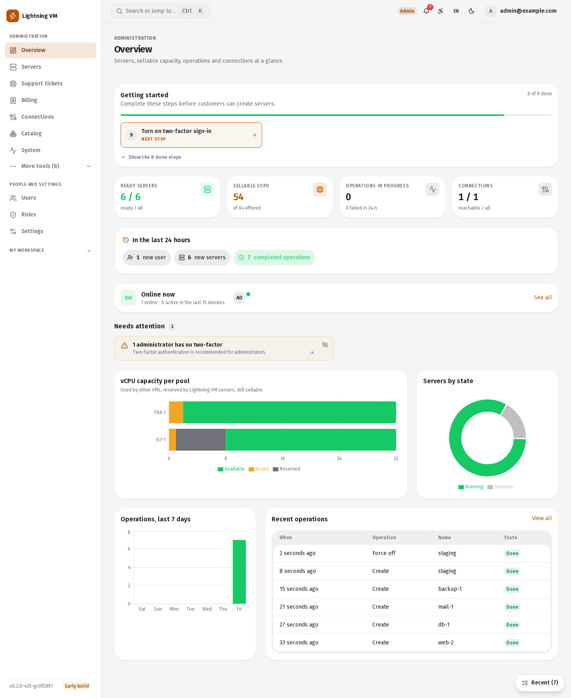
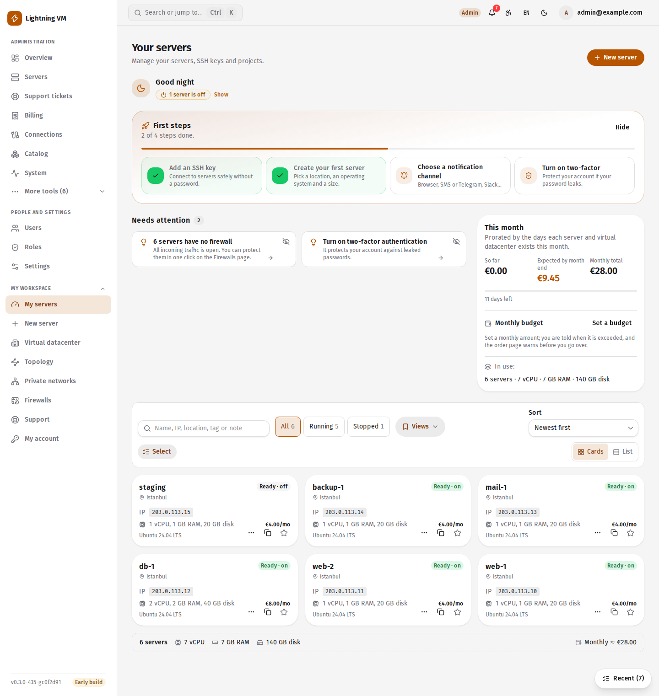
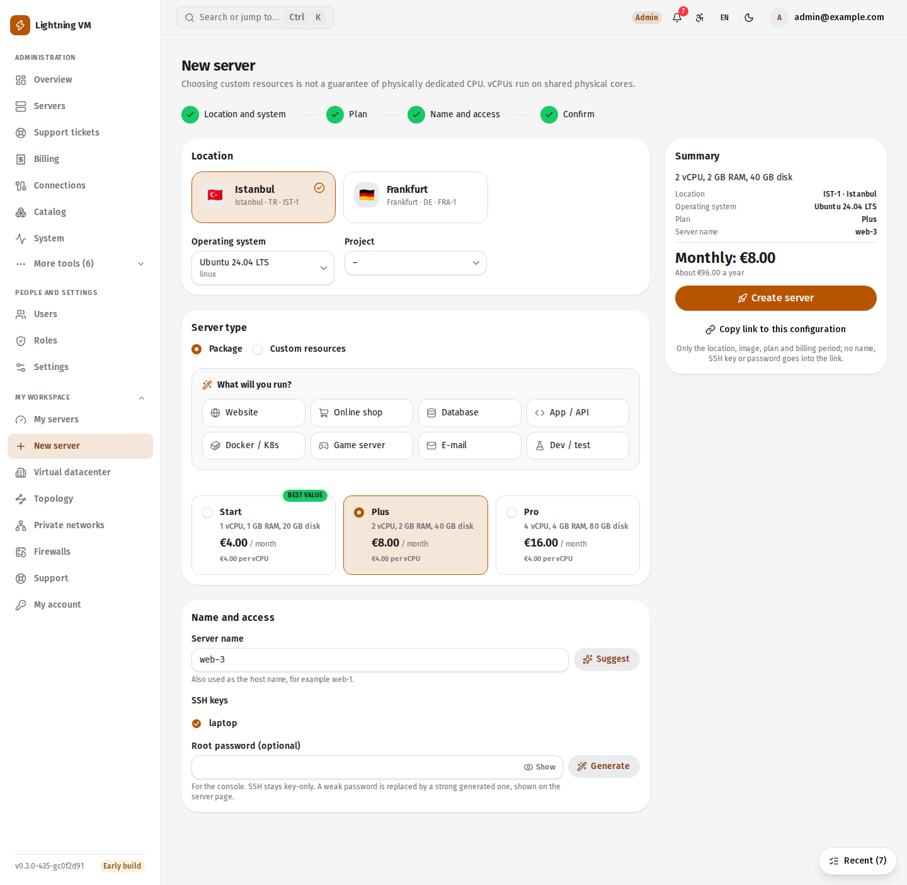
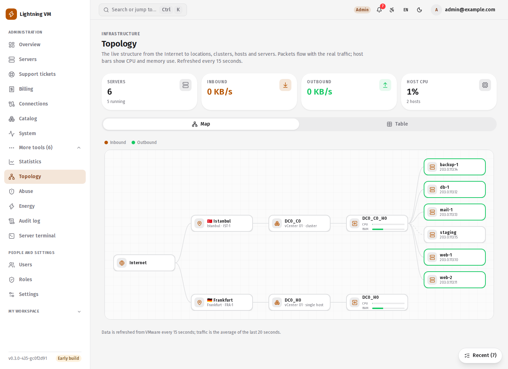
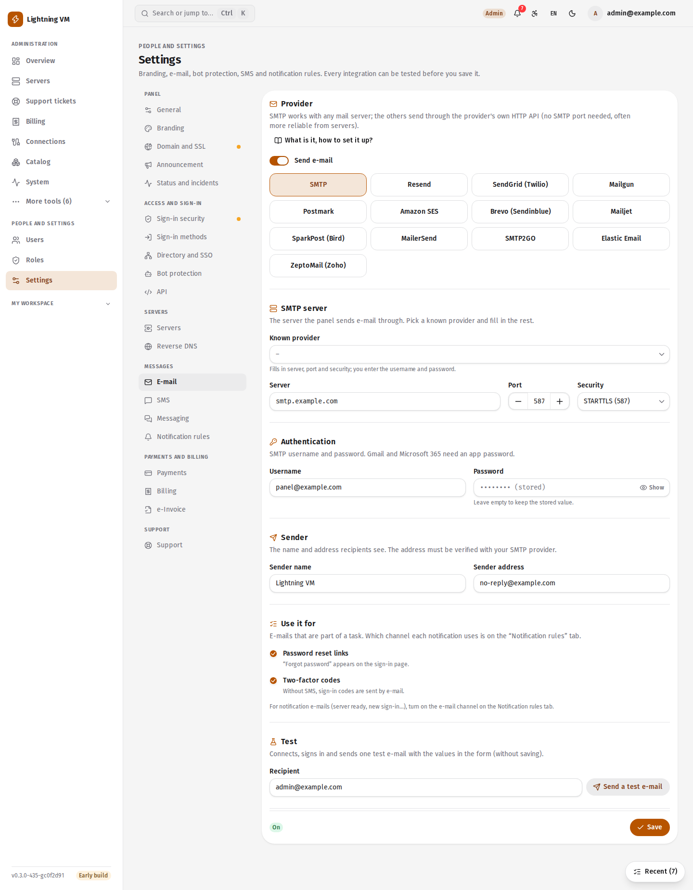
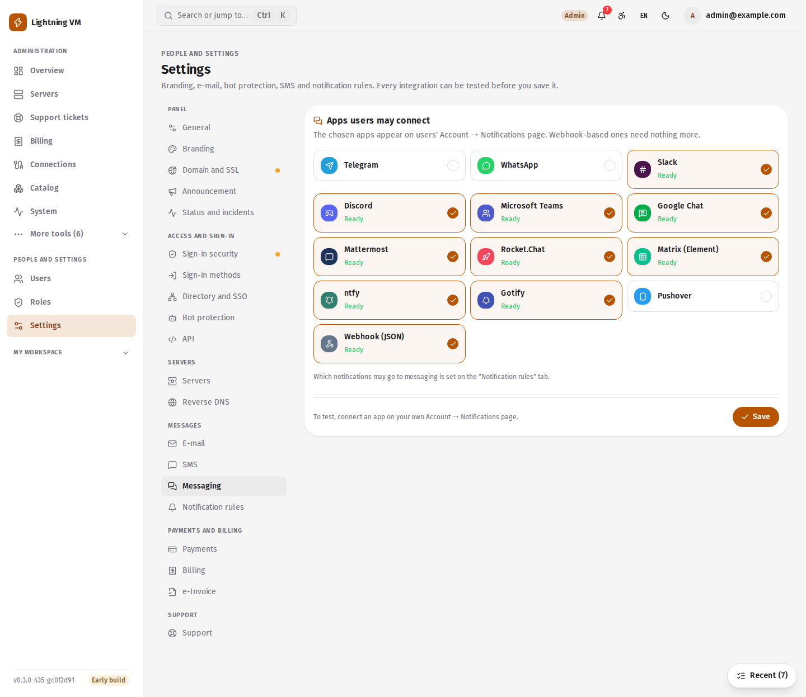
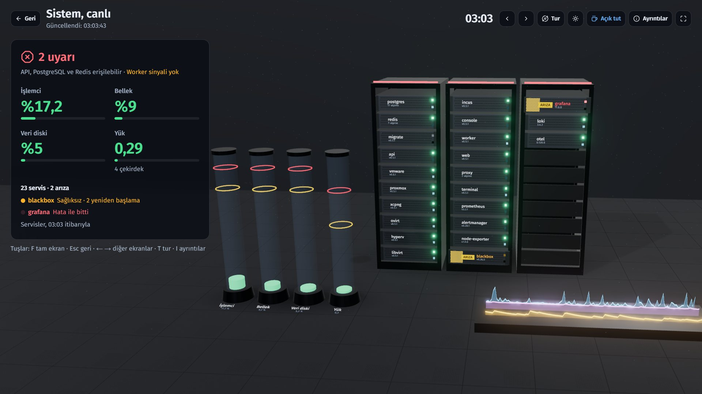
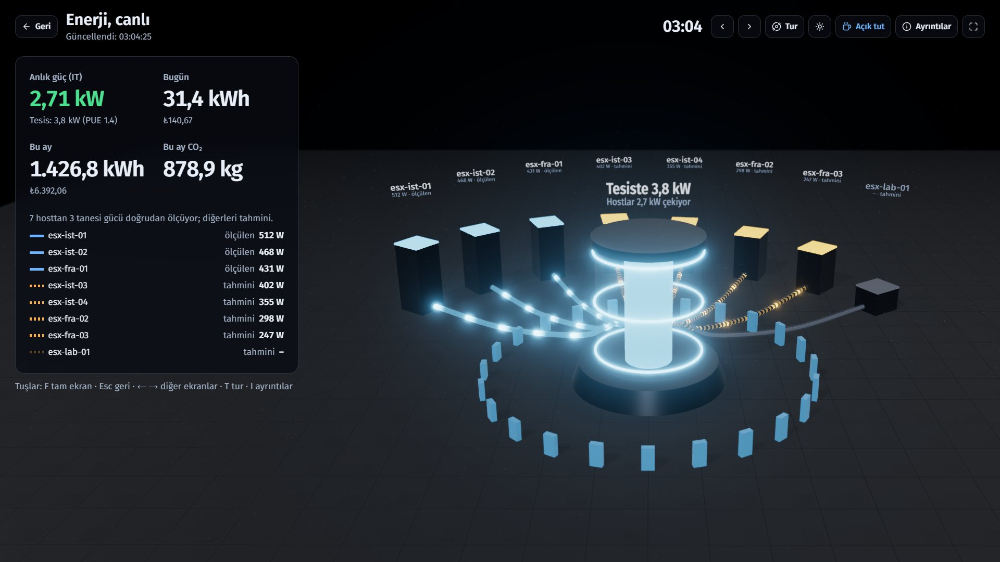

<div align="center">


# Lightning VM

**Free, open-source, self-hosted panel for selling and managing virtual servers on VMware vSphere, Proxmox VE, XCP-ng, oVirt, Hyper-V, KVM (libvirt) and Incus / LXD**

[Türkçe](README.md) · **English** · [Website](https://lightningvm.app) · [Demo](https://demo.lightningvm.app) · [Releases](https://github.com/syildirim689/lightning-vm/releases) · [Discussions](https://github.com/syildirim689/lightning-vm/discussions)

[](https://github.com/syildirim689/lightning-vm/actions/workflows/ci.yaml)
[](https://github.com/syildirim689/lightning-vm/releases)
[](LICENSE)
[](#releases)
[](https://github.com/syildirim689/lightning-vm/discussions)

</div>

```bash
curl -fsSL https://lightningvm.app/install.sh | sudo sh
```

One command installs it on Ubuntu 22.04 / 24.04 / 26.04. Free and open source (Apache-2.0), **in beta**. A running
installation: [demo.lightningvm.app](https://demo.lightningvm.app) (registration is closed: you can see the sign-in
page and both interface languages, no account is handed out).

> [!WARNING]
> **This project was written with AI ("vibe coding").** Almost all of the code was produced with
> [Anthropic's Claude Code](https://claude.com/claude-code), directed, requested and tested by the project's owner.
> Every change went through unit, integration and end-to-end (Playwright) tests and was tried on a demo server;
> **there can still be bugs, gaps and security holes.** It has not been audited by an independent third party; an
> AI-driven, partial security review was run in two rounds and its findings were fixed
> ([SECURITY.md](SECURITY.md)). The VMware side was tested mostly against the govmomi simulator rather than a real
> vCenter / ESXi. Try it in your own environment, take backups and read the code before you use it in production
> with real customers and real money. Bug reports are very welcome:
> [issues](https://github.com/syildirim689/lightning-vm/issues).

This page is the English counterpart of the Turkish [README.md](README.md), which is the more detailed of the two
(feature lists per screen, the full list of known limits). The documents under [`docs/`](docs) are mostly Turkish.

**Lightning VM** is an open-source hosting panel for VMware (ESXi / vCenter 6.0–9.x) and, as first releases, Proxmox VE, XCP-ng / XenServer, oVirt / RHV, Microsoft Hyper-V, plain KVM hosts (libvirt over SSH) and Incus / LXD. Customers order and manage
virtual servers. Administrators manage capacity, IP pools, pricing, notifications and the panel
itself from the browser, including updates and backups. It ships with a one-command installer and
automatic HTTPS. The UI is in Turkish and English.

Highlights: smart ordering, rule-based helpers computed inside the panel from its own data (a usage watch that compares each
server with its own history, a month-end cost forecast that counts hourly usage and measures the budget against it, a power schedule suggested
from the hours a server is idle every week, the quietest hours of the servers' own history offered for the update window and for host maintenance, a periodic digest (weekly or daily, off unless turned on) for staff and, where the administrator allows it, for customers, payment risk said before a renewal and listed for staff, similar resolved tickets for support and suggestions while a
customer writes one, and everyday helpers (how long an operation usually takes, "Undo" instead of a confirmation, a
warning before the session ends, pasted SSH keys checked at once; not yet in a release: "what next" hints on a server's page,
"while you were away" on the dashboard and a command palette that forgives a typo);
[docs/smart-features.md](docs/smart-features.md), Turkish), reinstall, resize and clone, snapshots, extra disks, billing and invoices (monthly and
hourly), resellers, support desk, 17 notification channels (in-app, browser push, e-mail, SMS and 13 messaging
apps and webhooks), customer webhooks, LDAP / OIDC sign-in, passkeys and two-factor, e-mail address verification
for registered accounts (a mailed code, entered while signed in; an optional rule that only verified accounts may
order, off by default), an API reference whose requests can be run from the browser (shown first, confirmed when
they change something, secrets hidden), quotas per account and per project (with what is used shown to staff and on the order page), live state of the panel host
(CPU, memory, disk, services with their version, detail and a restart from the panel, logs), **live walls** (full-screen,
real-time 3D views of Admin → System, Statistics and Energy for a TV or a second screen, with a designed 2D wall
where 3D would not run well), **proposed names** in forms (a passkey, API token, SSH key, snapshot or firewall rule
starts with an editable name instead of an empty field), operating system updates for the host and for customers' servers, window-style
dialogs (move, put aside, snap to halves and quarters, centre, resize, keyboard shortcuts), and accessibility controls.

Screenshots (the same six screens in Turkish are in [README.md](README.md#-ekran-görüntüleri); each pair is taken from one page
with the same data, on a throwaway stack with the VMware simulator and invented names, by
`apps/web/e2e/showcase.spec.ts`):

| Admin overview | Customer's servers |
|---|---|
|  |  |
| **Smart ordering** | **Topology** |
|  |  |
| **E-mail providers** | **Messaging apps** |
|  |  |
| **Live wall: System** (CPU, memory, load and history measured for real; the service list is a prepared snapshot) | **Live wall: Energy** (example data) |
|  |  |

The live-wall pictures are not from the showcase run: they were taken by hand on a development machine with no
graphics card, on a software renderer (the high tier's look), and they show the Turkish interface; the figures on
the Statistics and Energy walls are example data. English phone (390 px), 2D and day-look pictures of all three
are in [`docs/screenshots/walls`](docs/screenshots/walls).

What is not the same everywhere (the table under "Platform kapsamı" above has every platform):

- **Only on VMware:** browser console, firewalls, private networks, backups and restore, personal images, ISO
  library, live migration and host evacuation, throttling a server that used up its traffic allowance. The six newer
  adapters answer these with "not supported on this platform".
- **Usage graphs and traffic counting:** VMware and Proxmox VE only. **CPU usage per server** is not measured on
  XCP-ng, oVirt, KVM (libvirt) and Incus, so idle / oversized / mining findings, the health score and the energy
  report mean nothing there.
- **Browser console:** needs VMware's HTML Console SDK, which is not in this repository, and was never tried with
  the real SDK.
- **Payments:** only iyzico, PayTR, Craftgate, Param and Stripe (plus the built-in sandbox) can take a payment. The
  other 41 listed providers are credential forms, most with a check that moves no money. None was tried with a real
  merchant account. Stripe has a webhook (signature checked on the raw body, old signatures refused, recorded once
  together with the browser's return and the billing run; the settings screen shows the address to enter at
  Stripe), tested with events signed locally and not against Stripe itself. Without it a payment whose customer
  never returns to the panel is settled when the billing run asks Stripe again (the only way for iyzico and
  Craftgate; not available for PayTR and Param). **Param does not settle by
  itself:** its return cannot be confirmed with Param, so the payment stays pending as "awaiting confirmation" and
  staff mark the invoice paid after checking the Param panel. Param is offered for TRY invoices only, and the flow
  was not confirmed with the provider. Payments waiting for staff (Param's unconfirmed returns, another amount,
  held by the provider) have their own filter under Admin → Billing → Payments, with the reason, the waiting time
  and a link to the invoice; staff with `billing.manage` are notified once when a payment enters review. While a
  payment waits, for at most `reviewHoldDays` days from when the review began (Settings → Billing; 0 to 90, default
  7, 0 switches it off), its invoice is not suspended, deleted, expired or reminded, and the customer cannot pay it
  a second time (409 `PAYMENT_IN_REVIEW`); after that, with the review still open, the invoice is collected again
  and can be paid again. The hourly power-off for a negative balance is not covered by this.
- **e-Invoice (Turkey):** of seven integrators only İzibiz and Uyumsoft were sent a real e-Arşiv invoice, in their
  test systems.
- **IPv6:** an optional prefix on an IPv4 pool, one address per server; there are no separate IPv6 pools.
- **Monitoring** (Prometheus, Grafana, Loki, Alertmanager) is switched from the panel in the setup wizard and, after
  installation, on Admin → System (the request goes to the host agent like a backup or an update), or with
  `install.sh monitoring on|off`. That the panel hands the request over correctly is tested; the agent stopping and
  starting the components through it was not run on a server in this work.
- **Services on Admin → System (2026-11-23, in 0.6.0):** each service shows its state in one word (a one-shot job such as migrate that
  ended with exit code 0 is "Completed", not a fault; told from the compose definition) and its version (the
  panel's version and commit for its own services, the image tag or the version the service reports for the
  others). A click opens the detail: health, exit code, start and end, restarts, image, ports, what the state means
  and what to do (Turkish and English), and the last 200 log lines (administrators only, secrets masked on the
  server). **Restart** asks first and goes to the host agent like a backup (`system.update`, one task at a time,
  audited); PostgreSQL and Redis are refused with the reason, migrate can be run again. **Updates → Versions** lists
  every published version of the channel, newest first, with the running one marked and its changelog section; the
  list is rewritten after every update and once a day. The server-state charts slide with each new sample and show
  the value on hover, without motion when the browser asks for reduced motion.
- **Live walls (2026-11-23, in 0.6.0).** Admin → System, Statistics and Energy each open a
  full-screen, real-time 3D view for a TV or a second screen (also on a laptop or a phone) from a small button
  beside the page's status (`/wall/system`, `/wall/stats`, `/wall/energy`; a session and the page's own permission
  are needed, there is no public address). Every figure, colour and motion comes from the panel's own data; old or
  missing data is shown as such, and a failed service is marked by more than colour (it sticks out of its rack with
  a "FAULT" plate). Quality adapts to the device while it runs, a designed 2D wall with the same figures takes over
  without WebGL 2 or on a software renderer, and three.js loads only on these pages. **Measured only on a virtual
  machine with no graphics card, on a software renderer** (1–3 frames a second at 1080p; on its own choice that
  machine shows the 2D wall): the 60 fps target, 4K, a real GPU, a TV left on for hours, a remote control, Safari /
  iOS, Firefox and Android were not tried ([docs/live-walls.md](docs/live-walls.md), Turkish;
  [docs/validation.md](docs/validation.md)).
- **Proposed names (2026-11-23, in 0.6.0).** The panel never leaves a name field empty
  when creating something: it proposes browser, system and device for a passkey, access and date for an API token,
  the key's comment for an SSH key, and the server and time for a snapshot (also firewalls and their rules, private
  networks, projects, catalogue entries and more). A proposal is only a starting point; what you type replaces it,
  nothing that exists is renamed, and proposals follow the panel's language. Where filling in would be wrong (a
  ticket's subject) the field stays empty and the proposal is one click away. Authenticator apps and passkey
  managers now show the installation's own name and the account's e-mail address
  ([docs/proposals.md](docs/proposals.md), Turkish).
- **Stability, accessibility and new helpers (2026-11-23, not yet in a release).** Round two of the usability review
  (15 candidates: 9 done, 1 in part, 5 left with the reason; 14 defects found and fixed on the way). A server's page
  says what to do next from its real state (no recent backup, no firewall, the panel still keeping the root password,
  old snapshots), each leading to where it is done and hideable; the dashboard lists what happened while you were away
  (finished and failed operations, invoices, ticket answers) with links, marked seen only on a click; the command
  palette forgives a slip in a word; addresses, server ids, invoice and ticket numbers copy in one click, and a Windows
  server's connect box shows Remote Desktop. A second press no longer sends a second request and an overtaken answer
  no longer overwrites a newer one. The API's duplicate-request guard kept a request for two minutes when its browser
  left before the answer (the cause of the setup wizard test's occasional failure); fixed. The main pages are checked
  with axe-core in both themes and what it found is fixed; smoke tests also run in Firefox and WebKit. One migration
  (a nullable column), no new runtime dependency; 71 of 71 browser tests in CI and on the demo server (Chromium 65,
  Firefox 3, WebKit 3) ([docs/ux-review.md](docs/ux-review.md), Turkish;
  [docs/smart-features.md](docs/smart-features.md#kararlılık-ve-yeni-yardımcılar-ikinci-tur); [CHANGELOG.md](CHANGELOG.md)).
- **Everyday helpers (2026-11-23, in 0.7.0).** From a usability review of the customer, reseller and
  admin sides (34 findings; 22 fixed, 1 in part, 11 left with the reason). Running operations say how long they
  usually take on this panel ("usually about 2 minutes"), and when one is taking longer. Removing an SSH key,
  project, schedule, firewall attachment or canned reply asks nothing and offers "Undo" for a few seconds. Five
  minutes before the session ends the panel warns; "Stay signed in" extends it only on a click. While the panel does
  not answer, lists pause, it retries with growing waits and resumes without a reload. The admin setup list also
  checks mail delivery, backup schedule, monitoring, updates, payment method and staff two-factor. The order form
  starts from your last server's choices and says so. Pasted SSH keys are joined and named, private keys are flagged
  at once, and lists pasted one per line stay separate. Error messages give the cause and the next step. All of it is
  computed inside the panel from its own data and nothing acts without a click; no migration
  ([docs/ux-review.md](docs/ux-review.md), Turkish; [docs/smart-features.md](docs/smart-features.md#günlük-işi-kolaylaştıranlar);
  [CHANGELOG.md](CHANGELOG.md)).
- **Real hardware:** only the Incus adapter (containers, Incus 6.0) ran against a real server. VMware was tested
  mostly against the govmomi simulator; Proxmox VE, XCP-ng, oVirt, Hyper-V and libvirt against imitations only.
- **Upgrading:** the last rounds changed behaviour an operator can notice: a full audit of the API, worker,
  web UI, adapters and installer (49 changes, most of them in billing), then round one of the security audit below
  (Param payments confirmed by hand, signed backups, closed sign-in routes) and round two (the panel is on hold
  after a restore until released, `install.sh behind-proxy` needs `--public-url`, the billing integration matches
  only accounts it created, new send limits; restart the proxy and the log collector after upgrading), and the
  security follow-up of 2026-11-18 below (directory and single sign-on users sign in again every
  `SESSION_TTL_HOURS`, the first password reset by mail on an unproven account removes credentials and saved cards once;
  migration `085` marks the existing accounts staff vouched for as proven, self-registered and reseller-created
  ones stay unproven), and the round of 2026-11-19 (API tokens of directory and single sign-on accounts work only
  while the account was confirmed by its source within `DIRECTORY_TOKEN_DAYS`, counted from the upgrade for the
  accounts that exist; servers of a customer who leaves a reseller are billed at the list price from the next
  invoice where that price is certain; start the API before or together with the worker). Read
  [docs/upgrade-notes.md](docs/upgrade-notes.md) (Turkish) before you update.
- **Tests:** unit tests for the API, the worker, the web UI and each adapter. The full integration test runner
  (`npm run test:integration:full`) sets up PostgreSQL, Redis, the simulator, the VMware adapter and the worker in
  Docker; it includes the security tests of both rounds (`security-*.test.mjs`), the tests of the follow-up of
  2026-11-18 and those of the round of 2026-11-19 (`security-leftovers-2.test.mjs`), which run against real
  PostgreSQL and Redis. Most of the billing behaviour changed in the full-audit round has no integration test of
  its own. The end-to-end suite (Playwright) runs against its own throwaway Compose stack, with a fresh database
  and the VMware simulator, never against a panel with real data. **The current counts and the commit and result
  of the last runs are kept in one place in this file:** the test table under "Geliştirme ve testler" above (its
  rows, in order: API unit tests, API integration tests, the full integration run, Go services, the adapters, web
  unit tests, the worker, end to end). The database schema is 87 migrations (`001`–`087`).
  CI runs a dependency audit after the unit tests (`scripts/audit.mjs`): any high or critical advisory fails,
  except entries in `scripts/audit-allowlist.json`, each with a scope, a reason and an expiry date (none today:
  the one for `picomatch` in `apps/web`, GHSA-fc5q-39xc-vjpf, was removed when the advisory was withdrawn on
  2026-11-18); an entry stops excusing as soon as an unaffected release exists, and fails the audit once its
  advisory is no longer reported.
- **Private repository installs:** give `get.sh` the access token with `--token-file FILE` or `GIT_TOKEN` in the
  environment (`sudo --preserve-env=GIT_TOKEN sh`); `--token` works but is visible in the process list.
- **Backups** are encrypted and signed with `secrets/backup.key` (`NAME.tar.enc` plus `NAME.tar.enc.hmac`). Restore
  refuses a backup whose signature, name or key does not match; backups made by older versions restore only with
  `--allow-unsigned`. Restore works on a root-only copy of the archive, signs everyone out and puts the panel **on
  hold**: no operations, schedules, deletions or billing until an administrator has reviewed what changed since the
  backup and released it (Admin → System, or `docker compose exec api node dist/cli.js release-restore-hold`);
  `--no-hold` skips the hold only.
- **Behind another proxy:** `install.sh behind-proxy` needs the panel's public address
  (`--public-url https://panel.example.com`); mailed links are built from it.
- **Added on 2026-11-17 (no operator action; migration `081` runs by itself).** Staff: the review filter and search
  on the payments page (kept in the address), a notice on the billing overview, the `billing.payment_review`
  notification, counts in the menu next to Billing (payments in review), Servers (operations failed in 24 hours)
  and Abuse (open findings; since 2026-11-18 only unacknowledged ones) from `GET /admin/attention`, the restore-hold bar on every page, three new findings
  (payments in review, restore hold, operations that ended as `OUTCOME_UNKNOWN` or `VM_MISMATCH` and need a
  decision), abuse and subscription filters kept in the address. Customers: an "upcoming charges" block on the
  first page (invoices overdue or due within 7 days, the next renewal, when the hourly balance runs out); the
  command palette finds invoices, remembers recent tickets and invoices and has quick actions (new ticket, top up,
  new server, add SSH key, reset a server after confirmation); a shareable order link (`/order?loc=&pkg=…`, checked
  against the catalog, no name or key in it); rename, lock / unlock and delete in the server card's menu; copy
  buttons that also work over plain HTTP and say so when nothing was copied; a before / after summary in the
  reinstall dialog; a finding for snapshots older than 30 days; the `auth.credentials_reset` notification.
- **What was open after the second security round is closed, one item in part:** staff are notified when a payment
  enters review and the admin payments page lists such payments; a user is notified when the first proof of an
  unverified address (first sign-in by e-mail link or code or, since 2026-11-18, the first password reset by mail) removed something
  from the account. The reinstall
  dialog gained only the summary of what stays and what is erased.
- **Added on 2026-11-18 (no operator action; migration `082` runs by itself).** Staff: saved views ("Görünümler")
  on the server list, users, the support queue, the audit log and the invoice and payment lists: save, apply,
  rename, delete, make one the default (at most 12 per list); rows can be ticked for the bulk action under Admin →
  Servers (or, said explicitly, everything the filters show; 200 at a time); a ticket opened with a server keeps
  the server's state of that moment, read from the database and shown to staff only; the command palette's recent
  list also holds the users staff looked up and admin invoices; holders of `system.update` get the
  `admin.restore_hold` notification once when the panel is found on hold after a restore; the Abuse count in the
  menu now counts only findings nobody has acknowledged. Customers: after a failed operation the server page
  suggests one next step (try again only for power on, shutdown, reset and taking a snapshot, and only for
  transient errors; the invoices; the quota; otherwise a ticket with the details filled in; never a retry when
  staff must look first); the notification bell joins repeated notifications about the same thing into one row
  with a count; saved views on their own server list; the renewal in "upcoming charges" is now the API's own figure
  (`nextRenewal` in the billing summary).
- **Saved views are kept with the account** (since the follow-up of 2026-11-18; migration `083`, API
  `/saved-views`): every device shows them and only their owner sees them; staff signed in as a user can apply that
  person's views but not change them. Views an earlier version left in a browser are uploaded once when their owner
  opens the list and then removed there; those not uploaded are removed when a session ends in that browser. In a
  browser where the panel is never opened again, the old copy stays until then.
- **Security follow-up on 2026-11-18 (read the upgrade notes; migrations `083` to `085` run by themselves).** What
  round two had left unreviewed or unchanged was worked through **by source review with tests, not by an audit
  round**; these are not independently validated findings. Directory and single sign-on: the ID-token refusal
  holds; three fixes were incomplete and are finished (such sessions end `SESSION_TTL_HOURS` after sign-in; an
  address without an account is put to the directory in one plain spelling and the settings test counts against the
  per-address limit; saving directory or single sign-on settings needs permissions covering every account behind
  that source, and a deleted role leaves the mappings). Unproven addresses: the first password reset by mail now
  counts as the first proof, which also removes saved SSH keys, saved cards (automatic renewal needs a card again),
  the billing e-mail and phone, a pending second step, trusted browsers and open server offers; accepting a
  transferred server needs a proven address; the setup administrator and staff-created accounts are proven from the
  start, reseller-created ones are not. Migration `085` marks the accounts staff had already vouched for as proven
  (any role other than `user`, or created under Admin → Users according to the audit log); self-registered and
  reseller-created accounts stay unproven, and for those the first password reset by mail removes saved cards, SSH
  keys, API tokens and the rest once. Payments under review: "mark paid" closes the invoice's held payments, a
  new staff action closes a review without settling anything, automatic charging skips such an invoice, PayTR's
  amount check uses the signed total; the sandbox card `4000 0000 0000 4954` yields a payment held for review
  (`FRAUD_REVIEW`, in sandbox mode only). Operations
  queue: one account can run only `OPERATIONS_PER_OWNER` operations at once (default half of
  `OPERATIONS_CONCURRENCY`, 0 off); staff and billing operations are never held. Messaging connections: budgets for
  creating and testing, and no remote text from self-hosted connectors. Resellers: a customer sees who manages the
  account, is notified once and can leave; when a customer leaves or is taken out, or the reseller is removed, the
  subscriptions move to the customer, the reseller's untouched renewal invoices are cancelled, other open invoices
  stay with the reseller and prices do not change; `GET /admin/resellers/:id` lists a reseller's customers and
  staff release one from the user summary dialog. Installer: private creation and rename into place for the files
  written for the panel, stricter lock file rules, takeover of a maintenance directory that is not root's
  (`W_MAINT_DIR`). Browser storage: drafts, recent items and the order being composed are removed at every end of a
  session, when another account opens the panel in the same browser and at both ends of "sign in as"; once at the
  first load after upgrading.
- **Added on 2026-11-19 (read the upgrade notes; migrations `086` and `087` run by themselves; start the API before
  or together with the worker, which needs `087`).** The 65 review units round one had closed without a finding were
  read again on the current source, **by one reviewer and by source reading only**; what that found is fixed and is
  described under Security below. Payments under review: for at most `reviewHoldDays` days from when the review
  began (Settings → Billing, 0 to 90, default 7, 0 off) the invoice is not suspended, deleted or expired and no
  reminders go out for it; the overdue notice is still sent once and says the payment is being checked; a second
  payment by the customer is refused on every method (409 `PAYMENT_IN_REVIEW`: balance, saved card, card), and the
  invoice page switches its pay buttons off with the reason. After the window the invoice is collected again and
  can be paid again. An account can start 20 card payments an hour (429). API tokens of directory (LDAP) and single
  sign-on accounts: accepted only while the account was confirmed by its source within `DIRECTORY_TOKEN_DAYS`
  (default 30, 0 off; `users.source_confirmed_at`, migration `086`); otherwise 401 `TOKEN_ACCOUNT_UNCONFIRMED`, and
  both token lists mark the token "asleep". A sign-in the directory or the provider accepts confirms the account.
  With LDAP and a working service account the directory is also asked when a token is used (at most once an hour
  per account): found renews the confirmation, a clean "not found" puts the account's tokens asleep, an error
  changes nothing (audit event `auth.directory_user_missing`). Single sign-on accounts have to sign in at least that
  often. Accounts that exist at the upgrade count as confirmed then. The lookup in the directory has no test of its
  own and was not tried against a real LDAP server; the tests cover the age rule only.
  Operations queue: the time an operation is held back by its account's share is given back to its deadline, at
  most `OPERATIONS_HELD_HOURS` (default 6; 0: the wait counts, as before; `operations.held_since`, migration `087`).
  Resellers: the customer's activity also shows what a reseller did on their servers besides operations (console,
  schedules, labels, disks, images, rename, lock), with the reseller's name or brand. When a customer leaves or is
  released, the servers whose subscription moved are billed at the list price from the next invoice, but only where
  that price is certain (today's catalog price less the reseller's current discount must give the server's price to
  the cent); the others keep their price and are listed for staff (`pricesKept` in the answer and in the
  `reseller.customer_released` audit event). The customer sees the new monthly amounts before confirming and in the
  notice. Staff acting as a customer can no longer leave a reseller or accept a transferred server (403
  `NOT_WHILE_IMPERSONATING`). Web: saved views an earlier version left in the browser are sent to the signing-out
  account before the browser is cleared; the sandbox help and the API reference in the panel name all four test
  cards, the `4954` "held for review" one included. The invoice answer (`GET /billing/invoices/:id` and the staff
  one) carries `invoice.payBlockedUntil`, an ISO date or null, computed by the same function as the
  `PAYMENT_IN_REVIEW` refusal; the invoice page keeps the pay buttons off until then. Keyboard: when a confirming
  button disappears after its action (for example "No longer a reseller" in the user summary), the keyboard stays
  with the window in front, so Escape still closes it; this holds for every window.
- **Screenshot review on 2026-11-19 (no operator action).** The pictures the end-to-end suite takes were looked at
  by eye for the first time: 115 of 187 were looked at, 72 were not. What was seen is fixed: on phones dialog
  buttons stack and never leave the dialog, the command palette fits the screen, invoice lines read as label and
  value blocks, and the background-work button shrinks to an icon; pages keep room under the selection bar; a held
  payment is called "awaiting review" ("inceleme bekliyor") everywhere; percentages, memory sizes and hourly prices
  follow the reader's language; customers see why an operation failed without the error code (the code goes into
  the pre-filled ticket) and the inbox names operations in words (push, e-mail and chat texts still carry the raw
  operation name); wide tables between 640 and 1280 px show a cue that they scroll sideways; the product feature is
  "firewall" throughout the Turkish interface. Known and left: the "token created" toast can cover the Remove
  button of the new token; the new-sign-in notification shows the raw browser string.
- **What remains after the two follow-ups:** a directory account's token is put to the directory only once its last
  confirmation is a day old, and is refused from the request after the one that found the account gone; when the
  directory cannot be reached, without a working service account, and for single sign-on accounts, the age limit
  alone decides. After the review window an invoice with an undecided payment is reminded and suspended like any
  other. An operation held longer than `OPERATIONS_HELD_HOURS` past its deadline ends as `TIMEOUT`, and accounts
  acting together are not limited. A reseller merely looking at a customer's servers is not in the customer's
  activity, and leaving can race with an order placed at that moment. A server whose list price cannot be told for
  certain keeps the reseller's discounted price until staff look.
- **Limits of the new parts:** the upcoming renewal amount now includes tax and is no longer shown twice once the
  renewal has its invoice. What remains: when the buyer's tax rule cannot be read the amount is before tax (and is
  not labelled as including tax); when one day has renewals in several currencies only one is shown (the first by
  its code); while only some of that day's renewals are invoiced, the line sums those not yet invoiced; for an
  invoiced renewal `nextRenewal` gives the invoice line in full, not what is left on a partly paid invoice (the
  block shows the invoice then, not this line); where invoices are made more than 7 days before the period ends
  (the default is 7), an invoiced renewal is not in the block until its invoice is due within 7 days. None of the
  screens added on 2026-11-17, 2026-11-18 and 2026-11-19 was used by hand in a browser. On 2026-11-19 the suite's
  screenshots were looked at by eye for the first time: 115 of 187, **72 were not looked at**. Beyond that the
  screens were seen only as far as the end-to-end suite looks (its last result: the test table). On these screens it covers: reading an order link; finding
  an invoice, the quick actions (top up, new ticket) and a looked-up user in the recent list of the command
  palette; the answer of `/admin/attention` (200 for staff, 403 for customers, no badge for a count of zero);
  rename and lock in the server card's menu; the reinstall summary; copying an IP address; ticking rows for the
  admin bulk action; saving, applying and deleting a saved view against the account's copy (on the admin server
  list only); the ticket's server-state panel (there for staff, absent for the customer); grouping in the bell; an
  invoice in "upcoming charges"; the review filter and search on the payments page staying in the address; and the
  path of a payment held for review (paid with the sandbox review card, the customer's "awaiting review" notice, the
  Billing entry in the menu with a count of one, the notice on the overview, the row in the list, staff closing
  the review and the count going away).
  Since 2026-11-19 also: the restore-hold bar on every page and the release from the System page; the next step
  after a failed operation; a badge above zero on the Servers and Abuse entries; the renewal and hourly lines of
  "upcoming charges"; a recorded payment ("mark paid") closing a held one; the reseller card and leaving; staff
  releasing a customer from a reseller; the removal of browser content when the account changes (sign in as,
  another session in the same browser, sign-out); the pay buttons switched off on a held invoice and the API
  refusing a second payment; the default of the review-hold setting. **In three of these the state is injected into
  the page**, because this stack cannot produce it from a browser: the restore hold (the page is handed the "held"
  answer; the release goes to the real route), the billing and retry answers of the next step (the same failed
  operation with another kind and error code; the support answer comes from a real failure), and the count on the
  Abuse entry (the Servers count is real). The other steps run against real state.
  No end-to-end test: the "asleep" mark in the two token lists and the note saying until when an account's tokens
  work, the new monthly amounts in the question before leaving a reseller, the staff notice about servers whose
  price was kept, and the reseller's name or brand in the activity list. The rules behind them are in integration
  tests; the three integration tests for the ticket's server state, the restore-hold notification and
  `nextRenewal` are in the full run and passed. The snapshot finding was not tried against a real platform.

> [!WARNING]
> This project was **vibe-coded**: almost all of the code was written by Anthropic's Claude Code, steered and
> tested by the maintainer. It has unit, integration and Playwright end-to-end tests and was tried on a demo
> server. It has **not** been audited by an independent third party (an AI-driven, partial security review was run
> in two rounds and its findings fixed; see Security below), and the VMware side was mostly tested against the govmomi
> simulator. **Expect bugs.** Review it and test in your own environment before using it with real customers or
> money.

**Security.** An AI-driven security review was run in two rounds in November 2026, on commits `641aa4d` and
`d9f90d3`: source review plus bounded checks in a sandbox without network access, with dummy data; nothing was sent
to a live system. Round one covered the whole repository and confirmed 22 weaknesses (1 high, 10 medium, 11 low):
the Param return is no longer proof of payment, several under-billing paths around resize and externally billed
servers, credentials that stayed on a transferred server, directory and single sign-on accounts signing in by other
routes, a role mapping that could create an administrator, request size limits, backups signed with the backup key,
and others. Round two covered the areas round one had left unreviewed (the maintenance channel through which the
panel manages its own host among them: no finding) and re-checked every round-one fix: 17 of the 22 hold on real
PostgreSQL, 4 (directory and single sign-on sign-in) could not be re-checked because the reviewer was stopped by the
model's safeguards (the project's integration tests cover them), and five places where a fix was incomplete were
found and fixed. Round two confirmed 26 more weaknesses (10 medium, 15 low, 1 informational), among them an
impersonation session that outlived the staff member's rights, requests and a booked cancellation that crossed a
server hand-over, reused Proxmox VM numbers, a reset token in request logs, unlimited SMS sends, and a restore that
acted on old orders. All 48 are fixed. Round one found no way for one customer to reach another customer's servers
through the customer routes; round two found such paths behind preconditions a customer cannot choose (a hand-over
in progress, a reused Proxmox VM number), and they are fixed. Both rounds were **partial passes**: in round two the
directory and single sign-on re-check and six further areas were not reviewed, three leads were left to the
operator (all three changed), and four candidates got no independent verdict (two were changed then, the two about
resellers in the follow-up). The fixes were verified by unit tests and by integration tests on real PostgreSQL and
Redis, not against real hypervisors, a real Proxmox cluster, a real Param merchant account or a real directory
server, and the installer paths were exercised with dummy files only. On 2026-11-18 the items round two had left
open (the directory and single sign-on re-check, the six further areas, the two reseller candidates) were worked
through by source review with tests. That follow-up is **not an audit round**: no hunting wave, no independent
verifier, nothing reproduced in the audit sandbox; its items are not validated findings and are not among the 48.
On 2026-11-19 the 65 review units round one had closed without a finding were taken up again on the current source:
10 were unchanged, 18 had changed trivially, 37 had changed materially and were read again (9 of them in part).
That was **one reviewer reading source**, with nothing reproduced independently, and it is not an audit round
either. It found, and the same round fixed: a customer could write entries into another account's activity through
the request body of the subscription route; a server billing had already marked for deletion could get a fresh
subscription when its owner left a reseller; API tokens of directory and single sign-on accounts kept working after
the account was closed at its source; and a customer could send billing staff any number of "payment under review"
notifications by paying the same invoice again. Not read again line by line: the two fix rounds inside
`billing.ts`, `better-auth.ts`, `support.ts`, `notify.ts`, `chat-apps.ts`; the backup, update, domain, host and
uninstall paths of `install.sh`; the adapters other than Proxmox; the clearing of browser storage and the
saved-views component. Nothing of either follow-up was tried on a real hypervisor, a real Proxmox cluster, a real
Param account or a real directory server.
The unit tests and integration tests of both follow-ups pass (the test table above).
Details: [docs/security-audit.md](docs/security-audit.md). To report a vulnerability, do not
open a public issue; follow [SECURITY.md](SECURITY.md).

Quick start on Ubuntu 22.04 / 24.04 / 26.04:

```bash
curl -fsSL https://lightningvm.app/install.sh | sudo sh -s -- -- --domain panel.example.com --lang en
```

The command downloads the source to `/opt/lightning-vm`, picks the latest stable release and runs the installer;
the panel later updates itself from there. Cloning the repository and running `sudo sh scripts/install.sh` works too.

## What the installation looks like

On a terminal the command first **asks for the language** (`1) Türkçe  2) English`; the default follows the
server's locale, Enter or 30 seconds of silence take it, `--lang tr|en` skips the question). Before it touches
anything it prints a **pre-flight report** (operating system, CPU, memory, disk, ports, Docker, clock, the DNS
record of the name, whether something is installed already) and **what it is about to do**, and asks to continue
(`--yes` skips that). The installation is eight numbered steps; each says what it does, shows the elapsed time and
the progress while it waits (images built, services ready) and ends with `✓` or `✗`. A summary closes it: the
panel's address, the administrator account, versions, where data and logs live, the commands you will need and the
total time.

- **With no terminal nothing is ever asked.** cloud-init, CI, `nohup … > file` or output into a pipe: the default
  language applies, there is no confirmation, and the output is plain lines (`LEVEL CODE text`) without colours or
  cursor codes. `--plain` or `TERM=dumb` give the same form on a terminal; `NO_COLOR` only drops the colours.
- **When a step fails** the last lines of the failed command, the error code, what to do next and the path of the
  full log (`data/logs/`, root only) are printed. Running the same command again is safe.
- `sh get.sh --help` and `sh scripts/install.sh help` list every option in either language.

<details>
<summary>The opening of an installation on a terminal (English)</summary>

Real terminal output captured from the scripts' test harness, colour codes removed. The harness has a stand-in for
Docker and clones from a local repository, which is why the addresses are `/src` and `/opt/g2` and the version is
the harness's own tag (`v0.2.1`). On a real server the same screens show real values.

```text
  Lightning VM

  Dil / Language
    1) Türkçe
    2) English

  Seçiminiz / Your choice [1]: English

  Lightning VM  beta
  Server sales and management panel: free and open source (Apache-2.0)
  ────────────────────────────────────────────────────────────────
  This script downloads the source and picks the version; the installation itself, with its
  pre-flight report and its plan, is then done by scripts/install.sh.
  Source     /src
  Directory  /opt/g2
  Version    the latest stable release (0.x: beta)
  Log        /tmp/lightning-vm-get.QlQ9SK (kept only when something fails)

[1/3] git
      The source is fetched with git, so that the installation can update itself
      the same way later (from the panel or with install.sh update).
  ✓ git 2.43.0 is present (1s)

[2/3] Downloading the source
      The repository is cloned to /opt/g2 (git clone); which version gets
      installed is chosen in the next step.
  ✓ Source downloaded (0s)

[3/3] Choosing the version
      The default is the newest stable release tag (vX.Y.Z); versions before 1.0
      are beta. --version picks a given release, --branch a branch.
  ✓ Source: v0.2.1 (0s)

  Lightning VM  beta
  Server sales and management panel: free and open source (Apache-2.0)
  ────────────────────────────────────────────────────────────────
  Version      v0.2.1 (channel: stable)
  Directory    /opt/g2
  Logs         /opt/g2/data/logs/ (root only)
  Status       beta: try it before production use; problems: github.com/syildirim689/lightning-vm/issues
  ────────────────────────────────────────────────────────────────

  Pre-flight checks
  ✓ OS               Ubuntu 24.04
  ✓ ARCH             aarch64
  ✓ CPU              8 vCPU
  ✓ RAM              15576 MB
  ✓ DISK             98 GB free
  ✓ TOOLS            openssl
  ✓ TOOLS            curl
  ✓ DOCKER           29.9.3
  ✓ COMPOSE          5.7.1
  ✓ PORT             127.0.0.1:8080
  ✓ PORT             127.0.0.1:8443
  ✓ NET              registry-1.docker.io
  ✓ NET              registry.npmjs.org
  • STATE            Nothing is installed here: this is a fresh installation

  What this will do on this server
    1. Docker Engine is present and is left as it is
    2. .env and secrets/: random passwords and encryption keys (existing ones are never replaced)
    3. The images are built on this server from the source (a few minutes the first time)
    4. The services are started: PostgreSQL, Redis, API, worker, web, the platform adapters, Caddy
    5. Panel address: http://127.0.0.1:8080 (local only; SSH tunnel)
    6. The first administrator is created with a random password (left alone if there is one)
    7. No timer and no panel agent (they need root and systemd)
    8. A first encrypted backup is taken (backups/)
  Not touched: the firewall, SSH, other web servers, other system packages.

  Continue? [Y/n] yes

[1/8] Docker Engine
      Every service runs as a container. Docker is already on this server and is
      used as it is.
  ✓ Docker 29.9.3, Compose 5.7.1 (1s)

[2/8] Settings and keys
      Random passwords for the database, Redis and Grafana go to .env (mode 600),
      the encryption and backup keys to secrets/. No existing password or key is
      ever replaced.
  ! BACKUP_KEY       secrets/backup.key created: copy it somewhere safe off this server, backups cannot be opened without it
  ✓ .env and secrets/ are in place (0s)

[3/8] Building the images
      The panel, the API, the worker and the platform adapters are built on this
      server from the source; no ready-made image is pulled. A few minutes the
      first time, from the cache afterwards.
  ✓ The images are built (3s)
```

</details>

## Releases

Releases are listed on [GitHub Releases](https://github.com/syildirim689/lightning-vm/releases); what changed in
each is in [CHANGELOG.md](CHANGELOG.md), and what an operator has to do when upgrading is in
[docs/upgrade-notes.md](docs/upgrade-notes.md) (Turkish). **Versions below 1.0 are beta** and are marked as
pre-releases on GitHub. Their tags are plain `vX.Y.Z`, so the one-line install picks the newest one and the `stable`
update channel follows them; `vX.Y.Z-rc.1`-style tags are seen only by the `beta` channel, and `edge` follows a
branch. The installer and the panel read the repository's git tags, not GitHub's release list, and an update by
itself only ever moves forward. A given release: `… | sudo sh -s -- --version v0.7.0`; on an installed panel
`sudo sh scripts/install.sh update --to v0.7.0`.

## Contributing, support and licence

Issues and pull requests are welcome: [CONTRIBUTING.md](CONTRIBUTING.md), [CODE_OF_CONDUCT.md](CODE_OF_CONDUCT.md).
Questions and ideas: [GitHub Discussions](https://github.com/syildirim689/lightning-vm/discussions)
([SUPPORT.md](SUPPORT.md)). Security reports go through GitHub's private vulnerability reporting
([SECURITY.md](SECURITY.md)). Licence: [Apache-2.0](LICENSE); third-party material: [NOTICE](NOTICE). Docs (mostly
Turkish) are in [`docs/`](docs).
