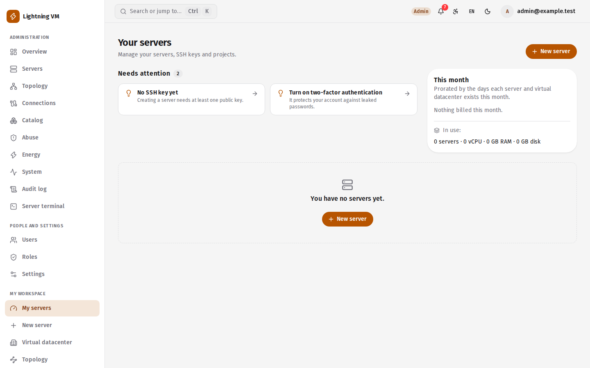
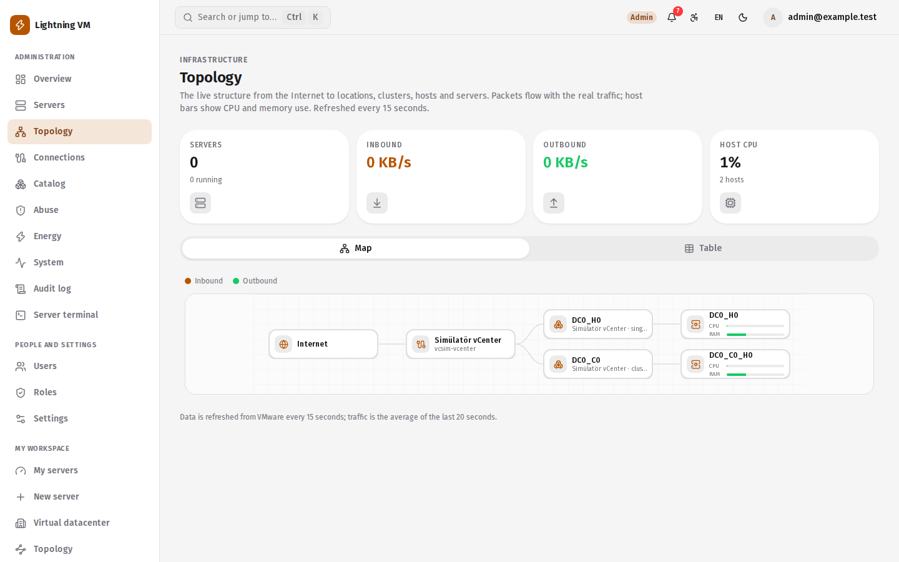
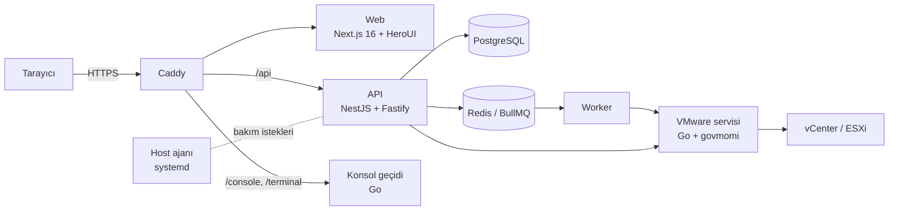

<div align="center">


# Lightning VM

**VMware (ESXi / vCenter) için açık kaynak sunucu satış ve yönetim paneli**

Müşteriler sunucu sipariş eder, açar, kapatır, konsoluna bağlanır; yönetici kapasiteyi, IP'leri, fiyatları,
bildirimleri ve sistemin kendisini tek panelden yönetir. Kurulumdan sonra sunucuya SSH ile girmeniz gerekmez.


[Özellikler](#-özellikler) · [Ekran görüntüleri](#-ekran-görüntüleri) · [Kurulum](#-kurulum) · [Kullanım](#-ilk-adımlar) ·
[Mimari](#-mimari) · [Geliştirme](#-geliştirme-ve-testler) · [Bilinen sınırlar](#-bilinen-sınırlar) · [English](#-english-summary)

</div>

---

> [!WARNING]
> **Bu proje "vibe coding" ile, yapay zekâ ile birlikte yazıldı.** Kodun neredeyse tamamı
> [Anthropic'in Claude Code](https://claude.com/claude-code) aracıyla, proje sahibinin yönlendirmesi, istekleri ve
> testleriyle üretildi. Her değişiklik birim, entegrasyon ve uçtan uca (Playwright) testlerden geçirilip bir
> demo sunucuda denendi; yine de **hatalar, eksikler ve güvenlik açıkları olabilir.** Bağımsız bir güvenlik
> denetiminden geçmedi; VMware tarafı gerçek vCenter/ESXi yerine çoğunlukla govmomi simülatörüyle test edildi.
> Üretimde, gerçek müşterilerle ve gerçek parayla kullanmadan önce kendi ortamınızda deneyin, yedek alın ve
> kodu inceleyin. Bulduğunuz hataları [issue](https://github.com/syildirim689/lightning-vm/issues) olarak
> bildirmeniz çok değerli.

## ✨ Özellikler

<table>
<tr><td valign="top" width="50%">

### Müşteri paneli
- **Akıllı sipariş:** paket veya özel kaynak, uygun olmayan paketler gerekçesiyle, en uygun paket, ad önerisi,
  canlı fiyat ve kota kontrolü
- **Sunucu yönetimi:** aç / kapat / yeniden başlat, silme onayı, işlem geçmişi, canlı CPU-RAM-disk-ağ grafikleri
- **Tarayıcı konsolu**, ISO bağlama, root parolası, uygulama kurulumu (cPanel, Plesk…)
- **Anlık görüntüler** (snapshot), **güç zamanlaması**, etiketler ve notlar
- **Firewall** şablonları, ters DNS (PTR), SSH anahtarları (GitHub'dan içe aktarma)
- **Sanal veri merkezi (VDC)** ve ağ topolojisi görünümü
- Sunucu sağlık puanı, aylık maliyet tahmini, hızlı bağlantı bilgileri

</td><td valign="top" width="50%">

### Yönetici paneli
- **ESXi / vCenter bağlantıları:** envanter keşfi, kapasite, lisans ve yetki kontrolü
- **Katalog:** kaynak havuzları, fazla tahsis oranları, paketler, imajlar, konumlar, IPv4/IPv6 havuzları
- **İçgörüler:** dolan havuz tahmini, azalan IP, boşta / büyük / küçük sunucular, takılan işler
- **Kullanıcılar ve roller:** izin tabanlı roller, kişiye özel izinler, kullanıcı adına giriş, yasaklama
- **Kötüye kullanım:** açık riskli port taraması, madencilik şüphesi (uzun süreli tam CPU)
- **Enerji raporu:** kWh, maliyet ve karbon tahmini
- **Denetim kaydı**, duyuru bandı, toplu sunucu işlemleri
- **Sunucu terminali** (iki adımlı doğrulama zorunlu) ve **panelden güncelleme**

</td></tr>
<tr><td valign="top">

### Bildirimler
- Panel içi, tarayıcı (Web Push), e-posta, SMS ve **mesajlaşma uygulamaları:**
  Telegram, WhatsApp, Slack, Discord, Microsoft Teams, Google Chat, Mattermost, Rocket.Chat, Matrix, ntfy,
  Gotify, Pushover ve imzalı JSON webhook
- Önce yöneticinin kuralı, sonra kullanıcının seçimi; her kanal test edilebilir
- Prometheus/Alertmanager alarmları panel bildirimi olarak gelir

</td><td valign="top">

### Entegrasyonlar
- **E-posta:** SMTP ve 12 API sağlayıcısı (Resend, SendGrid, Mailgun, Postmark, Amazon SES, Brevo, Mailjet,
  SparkPost, MailerSend, SMTP2GO, Elastic Email, ZeptoMail)
- **SMS:** Türkiye'deki 18 sağlayıcı + Twilio, Vonage, Infobip, Plivo, Sinch, Telnyx, Clickatell, MessageBird
  ve özel HTTP API
- **Ödeme altyapıları:** Türkiye'deki ödeme kuruluşları, banka sanal POS'ları ve Stripe, PayPal, Mollie, Adyen,
  Checkout.com, Razorpay, Square, Paddle (bilgiler para hareketi olmadan doğrulanır)
- **CAPTCHA:** Cloudflare Turnstile, reCAPTCHA v2/v3, hCaptcha · **Ters DNS:** PowerDNS

</td></tr>
<tr><td valign="top">

### Güvenlik
- better-auth: parola, passkey, iki adımlı doğrulama (uygulama, SMS, e-posta, yedek kodlar)
- CSRF koruması, hız sınırları, şifreli sırlar (ana anahtar), oturum yönetimi
- **Mükerrer işlem koruması:** Idempotency-Key, sunucu başına tek açık işlem ve çift tıklamada ikinci isteğin reddi
- Kullanıcının verdiği webhook adresleri yalnızca herkese açık HTTPS olabilir (iç ağa istek atılamaz)

</td><td valign="top">

### İşletim
- **Tek komutla kurulum**, otomatik HTTPS (alan adı veya `<ip>.sslip.io`)
- Şifreli yedek ve kontrollü geri yükleme, zamanlanmış yedek
- **Güvenli güncelleme:** yalnızca daha yeni sürümler, önce yedek, migration uyumluluğu, başarısızlıkta geri dönüş
- İsteğe bağlı Prometheus, Grafana, Loki, Alertmanager; panelden açılıp kapatılır
- Türkçe / İngilizce arayüz, koyu / açık tema, erişilebilirlik ayarları, telefondan geniş ekrana tam uyumlu

</td></tr>
</table>

## 📸 Ekran görüntüleri

| Yönetici genel bakış | Müşteri sunucuları |
|---|---|
|  |  |
| **Akıllı sipariş** | **Topoloji** |
|  |  |
| **E-posta sağlayıcıları** | **Mesajlaşma uygulamaları** |
|  |  |

## 🚀 Kurulum

### Gereksinimler

| | En az | Önerilen |
|---|---|---|
| İşletim sistemi | Ubuntu 22.04 / 24.04 / 26.04 (amd64 veya arm64) | Ubuntu 24.04 LTS |
| Bellek / disk | 2 GB RAM, 10 GB boş disk | 4 GB RAM, 40 GB disk (izleme açıkken) |
| Ağ | 80 ve 443 portları dışarıya açık (HTTPS için) | Bir alan adı (A kaydı sunucuyu göstermeli) |
| VMware | ESXi veya vCenter 6.0 – 9.x | Sunucu oluşturmak için **vCenter** |

Docker kurulu değilse betik resmî deposundan kurar. Paneli VMware host'unun kendisine değil, ayrı bir Linux
sunucuya (sanal da olabilir) kurun.

### 1. Kaynağı indirin

```bash
git clone https://github.com/syildirim689/lightning-vm.git
```

```bash
cd lightning-vm
```

### 2. Kurun

```bash
sudo sh scripts/install.sh
```

Betik sırasıyla sistemi kontrol eder, Docker'ı kurar, sırları üretir, servisleri derleyip başlatır, HTTPS
sertifikasını alır, izlemeyi ve günlük yedeği ayarlar. Sonunda **panel adresini ve ilk yönetici bilgilerini**
yazar (parola `secrets/initial-admin.txt` dosyasında da durur; ilk girişten sonra değiştirip dosyayı silin).

Sık kullanılan seçenekler:

| Seçenek | Ne yapar |
|---|---|
| `--domain panel.example.com` | Kendi alan adınızla Let's Encrypt sertifikası |
| `--acme-staging` | Önce test sertifikasıyla dener (limitlere takılmamak için) |
| `--setup-wizard` | Yönetici hesabı yerine tarayıcıda kurulum sihirbazı açar |
| `--admin-email adres@ornek.com` | İlk yöneticinin e-postası |
| `--local` | Genel IP yoksa: panel yalnızca sunucuda, SSH tüneliyle açılır |
| `--no-monitoring` / `--no-schedule` | İzlemeyi / zamanlanmış yedeği kurmaz |
| `--lang en` | Kurulum çıktısı İngilizce |

Yalnızca kontrol etmek (hiçbir şeyi değiştirmez):

```bash
sh scripts/install.sh check
```

Kurulum yarıda kalırsa aynı komutu tekrar çalıştırın; mevcut sırlar, veriler ve hesaplar korunur.

<details>
<summary><b>Genel IP'si olmayan sunucu (<code>--local</code>)</summary>

Panel yalnızca sunucunun kendisinde açılır. Kendi bilgisayarınızdan SSH tüneliyle bağlanın:

```bash
ssh -L 8080:127.0.0.1:8080 KULLANICI@SUNUCU
```

Ardından tarayıcıda `http://127.0.0.1:8080` adresini açın. Paneli HTTPS olmadan internete açmayın:
parolalar düz metin gider.
</details>

<details>
<summary><b>Alan adını sonradan eklemek / değiştirmek, başka bir proxy arkasında çalıştırmak</b></summary>

Alan adı panelin Ayarlar → Alan adı ve SSL sekmesinden de değiştirilebilir. Komut satırından:

```bash
sudo sh scripts/install.sh domain panel.example.com --acme-staging
```

```bash
sudo sh scripts/install.sh domain panel.example.com
```

Mevcut bir Nginx / Caddy / Traefik arkasında çalıştırma: [docs/domain-https.md](docs/domain-https.md).
</details>

## 🧭 İlk adımlar

1. **Giriş yapın** ve parolanızı değiştirin; Hesap → Güvenlik'ten iki adımlı doğrulamayı açın.
2. **VMware bağlantısı ekleyin** (Yönetim → Bağlantılar): vCenter veya ESXi adresi, kullanıcı ve parola. Panel
   host'ları, datastore'ları, ağları ve VM'leri keşfeder; TLS sertifikası parmak iziyle doğrulanır.
3. **Kataloğu hazırlayın** (Yönetim → Katalog): konum, kaynak havuzu, IP havuzu, şablon imajı ve paketler.
4. **E-posta / SMS / ödeme / mesajlaşma** ayarlarını yapın (Yönetim → Ayarlar); her biri kaydetmeden önce test
   edilebilir.
5. **Bildirim kurallarını** belirleyin; kullanıcılar kendi kanallarını Hesap → Bildirimler'den seçer.
6. Müşteri hesabıyla **bir sunucu sipariş edip** uçtan uca deneyin.

Güncellemeler, yedekler, izleme ve terminal **panelden** yönetilir (Yönetim → Sistem). Ayrıntılı kılavuz:
[docs/setup.md](docs/setup.md).

## 🔄 Güncelleme ve yedek

Panelden: **Yönetim → Sistem → Güncellemeler**. Komut satırından:

```bash
sudo sh scripts/install.sh update
```

```bash
sudo sh scripts/install.sh backup
```

```bash
sudo sh scripts/install.sh restore backups/DOSYA.tar.enc --yes-replace-data
```

- Güncelleme yalnızca çalışan sürümden **daha yeni** bir sürüme geçer, önce yedek alır, migration uyumluluğunu
  denetler ve başarısız olursa container'ları geri alır (veritabanı otomatik geri alınmaz; yedek oradadır).
- Yedekler `secrets/backup.key` ile şifrelenir. **Bu anahtarı sunucu dışında saklayın**; o olmadan yedek açılmaz.
- Parolasını unutan yönetici için: `sudo sh scripts/install.sh reset-password eposta@ornek.com`.

Ayrıntılar: [docs/operations.md](docs/operations.md), [docs/updates.md](docs/updates.md).

## 🏗 Mimari



| Bileşen | Teknoloji | Görev |
|---|---|---|
| `apps/web` | Next.js 16, React, HeroUI v3, next-intl, React Query | Müşteri ve yönetici paneli |
| `apps/api` | NestJS (Fastify), better-auth, PostgreSQL, BullMQ | REST API, kimlik, ayarlar, bildirimler |
| `apps/worker` | Node.js, BullMQ | Sunucu oluşturma ve işlemler, adım adım ve kaldığı yerden |
| `services/vmware` | Go, govmomi | vCenter/ESXi ile konuşan adaptör |
| `services/console` | Go | Tarayıcı konsolu ve sunucu terminali için WebSocket geçidi |
| `scripts/install.sh` | POSIX sh, Docker Compose | Kurulum, güncelleme, yedek, host ajanı |

Daha fazlası: [docs/architecture.md](docs/architecture.md).

## 🧪 Geliştirme ve testler

```bash
docker compose -f compose.yaml -f compose.simulator.yaml up -d --build
```

Simülatör (govmomi `vcsim`) gerçek bir vCenter olmadan tüm akışı çalıştırır. Testler:

| Test | Komut |
|---|---|
| API birim testleri | `cd apps/api && npm test` |
| API entegrasyon testleri (PostgreSQL + Redis) | `cd apps/api && npm run test:integration` |
| Go servisleri | `cd services/vmware && go test ./...` |
| Uçtan uca (Playwright; 390 / 768 / 1920 px) | `cd apps/web && npx playwright test` |

CI bilerek elle tetiklenir (GitHub Actions → *Run workflow*). Katkı kuralları: [CONTRIBUTING.md](CONTRIBUTING.md).

## ⚠️ Bilinen sınırlar

- **Yapay zekâ ile yazıldı:** yukarıdaki uyarıya bakın. Hatalar olabilir; üretim öncesi inceleyin.
- **VMware:** testlerin çoğu govmomi simülatörüyle yapıldı. Gerçek vCenter/ESXi'de farklı davranışlar
  görülebilir. Sunucu oluşturma vCenter ister (standalone ESXi'de yalnızca okuma ve güç işlemleri).
- **Konsol:** VMware HTML Console SDK lisansı gereği depoda yok; kurulumu yapan kişi ekler
  ([docs/console.md](docs/console.md)).
- **Faturalama yok:** ödeme altyapıları ayarlanıp doğrulanabilir ama otomatik tahsilat, fatura ve bakiye henüz
  yok. Bayi (reseller) yapısı ve e-posta adresi doğrulama da yok.
- **WhatsApp:** Meta Cloud API ve onaylı bir mesaj şablonu gerekir. **Telegram:** botta webhook tanımlı olmamalı.
- Sürümlü, imzalı kurulum paketi (GHCR imajlarıyla) henüz yok; kurulum ve güncelleme kaynak koddan derler.

Yol haritası: [docs/roadmap.md](docs/roadmap.md).

## 🔒 Güvenlik

Bir güvenlik açığı bulursanız lütfen herkese açık issue açmayın; [SECURITY.md](SECURITY.md) dosyasındaki yolu
izleyin.

## 🤖 Bu proje nasıl yazıldı?

Lightning VM, **vibe coding** yaklaşımıyla geliştirildi: proje sahibi ne istediğini Türkçe anlattı, ekran
görüntüleriyle geri bildirim verdi; kodu, testleri, belgeleri ve kurulum betiklerini
[Claude Code](https://claude.com/claude-code) (Anthropic) yazdı. Her adımda şu kurallara uyuldu:

- Her özellik için birim / entegrasyon / uçtan uca test; her arayüz değişikliği telefon, tablet ve geniş ekranda
  ekran görüntüsüyle kontrol edildi.
- Her commit öncesi bağımlılık açıkları (npm audit, govulncheck, Dependabot) kontrol edildi.
- Kullanıcının sunucuya girmesi gerekmeyecek şekilde her işlem panelden yapılabilir tasarlandı.

Bu yöntem hızlıdır ama insan gözünden geçmemiş kod barındırır. Kodu okuyup katkı vermeniz, hata bildirmeniz
projeyi güvenilir kılacak olan şeydir.

## 📄 Lisans

[Apache License 2.0](LICENSE)

---

## 🌍 English summary

**Lightning VM** is an open-source hosting panel for VMware (ESXi / vCenter 6.0–9.x). Customers order, manage
and console into virtual servers. Administrators manage capacity, IP pools, pricing, notifications and the panel
itself from the browser, including updates, backups and monitoring. It ships with a one-command installer and
automatic HTTPS. The UI is in Turkish and English.

> [!WARNING]
> This project was **vibe-coded**: almost all of the code was written by Anthropic's Claude Code, steered and
> tested by the maintainer. It has unit, integration and Playwright end-to-end tests and was tried on a demo
> server. It has **not** been independently audited, and the VMware side was mostly tested against the govmomi
> simulator. **Expect bugs.** Review it and test in your own environment before using it with real customers or
> money.

Quick start on Ubuntu 22.04 / 24.04 / 26.04:

```bash
git clone https://github.com/syildirim689/lightning-vm.git
```

```bash
cd lightning-vm && sudo sh scripts/install.sh --domain panel.example.com --lang en
```

Docs (mostly Turkish) are in [`docs/`](docs). Issues and pull requests are welcome.
