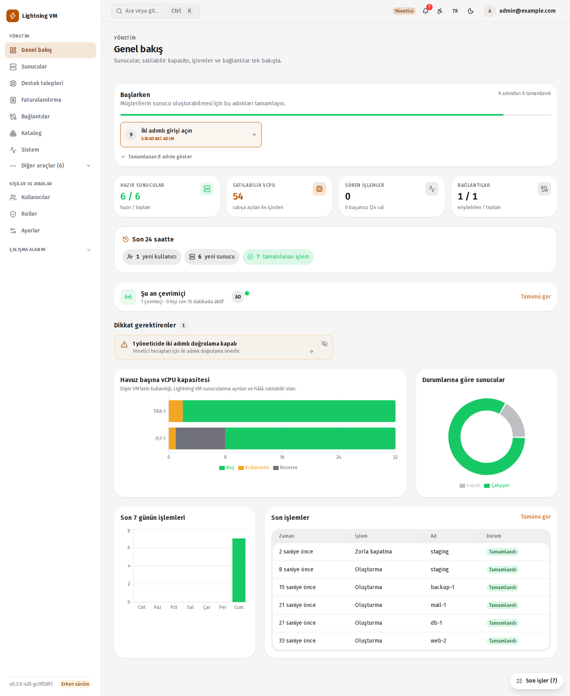
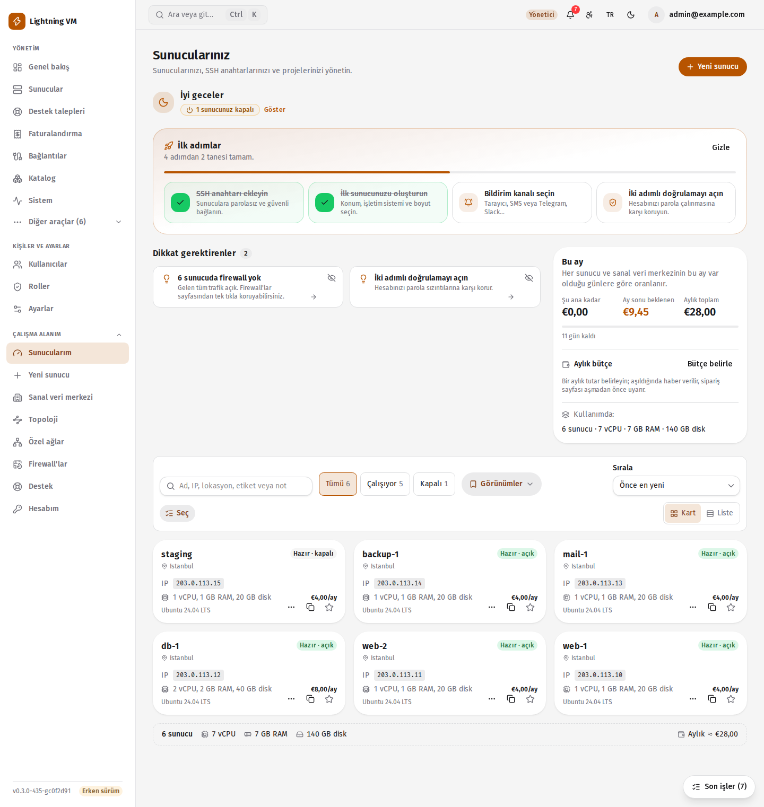
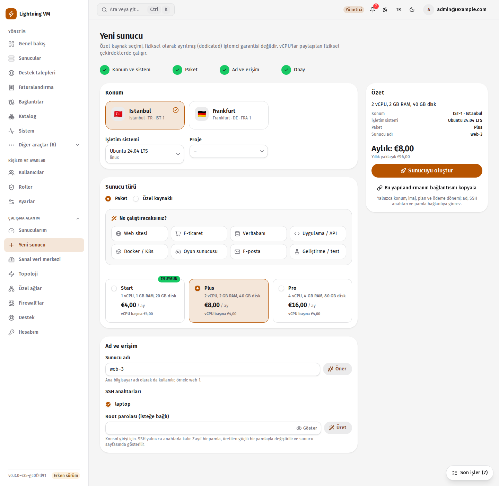
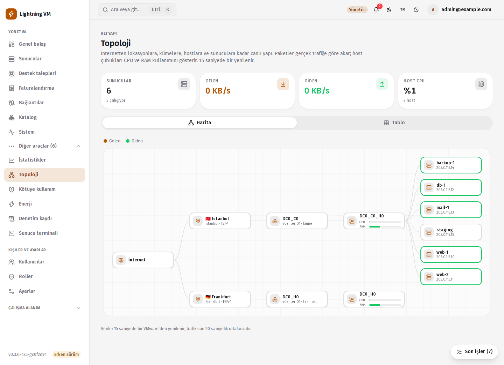
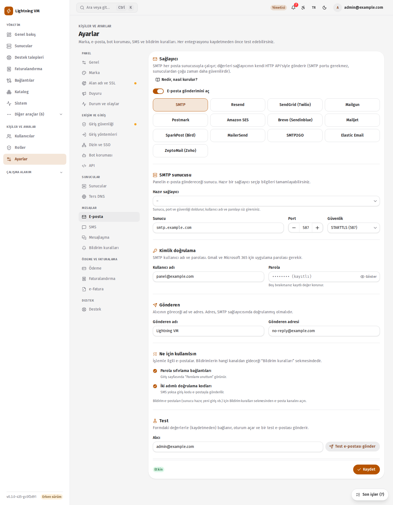
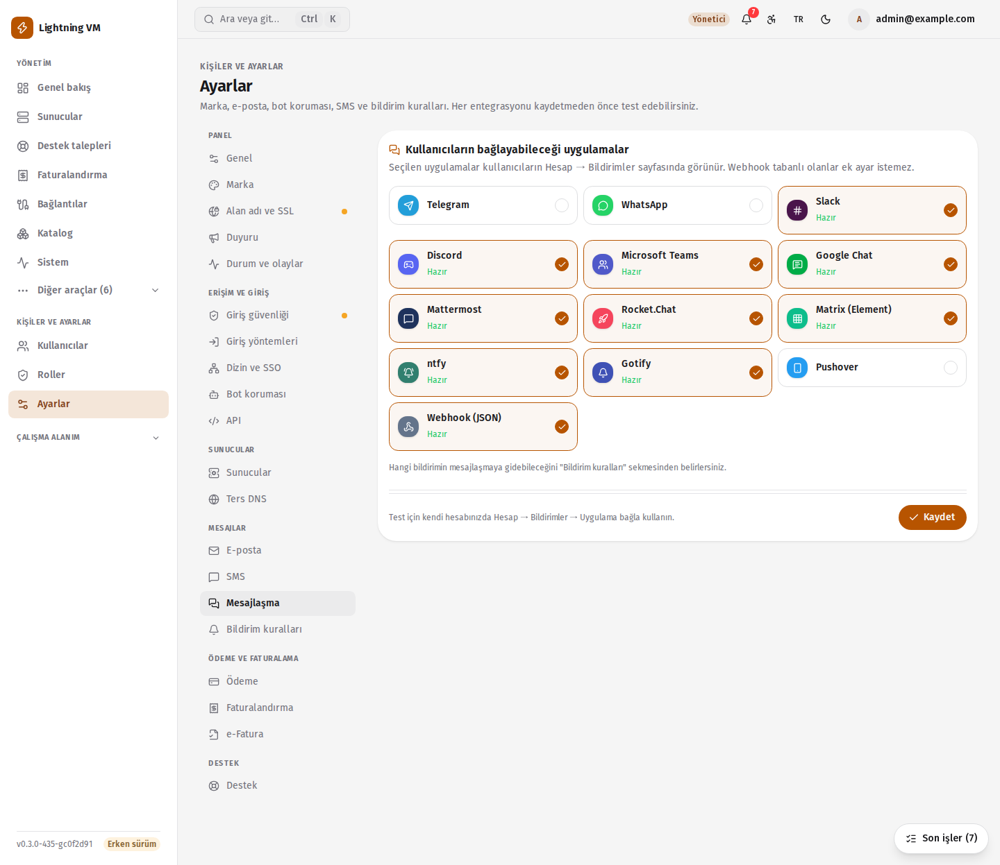
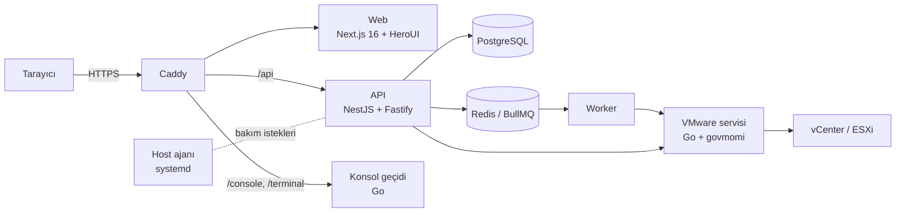

<div align="center">


# Lightning VM

**VMware, Proxmox VE, XCP-ng, oVirt, Hyper-V, KVM (libvirt) ve Incus / LXD için açık kaynak sunucu satış ve yönetim paneli**

*Free, open-source, self-hosted panel for selling and managing virtual servers on VMware vSphere, Proxmox VE, XCP-ng, oVirt, Hyper-V, KVM (libvirt) and Incus / LXD · in beta*

**Türkçe** · [English](README.en.md) · [Site](https://lightningvm.app) · [Demo](https://demo.lightningvm.app) · [Sürümler / Releases](https://github.com/syildirim689/lightning-vm/releases) · [Tartışmalar / Discussions](https://github.com/syildirim689/lightning-vm/discussions)

[](https://github.com/syildirim689/lightning-vm/actions/workflows/ci.yaml)
[](https://github.com/syildirim689/lightning-vm/releases)
[](LICENSE)
[](#-sürümler--releases)
[](https://github.com/syildirim689/lightning-vm/discussions)


</div>

```bash
curl -fsSL https://lightningvm.app/install.sh | sudo sh
```

Tek komutla kurulur (Ubuntu 22.04 / 24.04 / 26.04; ayrıntı: [Kurulum](#-kurulum)). Ücretsiz ve açık kaynaktır
(Apache-2.0); **beta** aşamasındadır. Tanıtım ve ekran görüntüleri: [lightningvm.app](https://lightningvm.app).
Çalışan bir kurulum: [demo.lightningvm.app](https://demo.lightningvm.app) (kayıt kapalıdır; giriş sayfası ve
arayüzün iki dili görülebilir, hesap verilmez).

Müşteriler sunucu sipariş eder, açar, kapatır, yeniden kurar; yönetici kapasiteyi, IP'leri, fiyatları,
bildirimleri ve sistemin kendisini tek panelden yönetir. Kurulumdan sonraki günlük işlerin çoğu için sunucuya SSH ile
girmeniz gerekmez. Özelliklerin tamamı yalnızca VMware'de vardır; diğer altı platformun neyi yapıp neyi yapmadığı
[Platform kapsamı](#-platform-kapsamı) tablosundadır.


<div align="center">

[Özellikler](#-özellikler) · [Platform kapsamı](#-platform-kapsamı) · [Son eklenenler](#-son-eklenenler) · [Ekran görüntüleri](#-ekran-görüntüleri) · [Kurulum](#-kurulum) · [Kullanım](#-ilk-adımlar) ·
[Mimari](#-mimari) · [Geliştirme](#-geliştirme-ve-testler) · [Bilinen sınırlar](#-bilinen-sınırlar) · [Sürümler](#-sürümler--releases) · [Güvenlik](#-güvenlik) · [English](README.en.md)

</div>

---

> [!WARNING]
> **Bu proje "vibe coding" ile, yapay zekâ ile birlikte yazıldı.** Kodun neredeyse tamamı
> [Anthropic'in Claude Code](https://claude.com/claude-code) aracıyla, proje sahibinin yönlendirmesi, istekleri ve
> testleriyle üretildi. Her değişiklik birim, entegrasyon ve uçtan uca (Playwright) testlerden geçirilip bir
> demo sunucuda denendi; yine de **hatalar, eksikler ve güvenlik açıkları olabilir.** Bağımsız (üçüncü taraf) bir
> güvenlik denetiminden geçmedi; yapay zekâ destekli, kısmi bir güvenlik denetimi iki tur hâlinde yapıldı ve
> bulguları düzeltildi ([Güvenlik](#-güvenlik)). VMware tarafı gerçek vCenter/ESXi yerine çoğunlukla govmomi simülatörüyle test edildi.
> Üretimde, gerçek müşterilerle ve gerçek parayla kullanmadan önce kendi ortamınızda deneyin, yedek alın ve
> kodu inceleyin. Bulduğunuz hataları [issue](https://github.com/syildirim689/lightning-vm/issues) olarak
> bildirmeniz çok değerli.

## ✨ Özellikler

<table>
<tr><td valign="top" width="50%">

### Müşteri paneli
- **Akıllı sipariş:** paket veya özel kaynak, uygun olmayan paketler gerekçesiyle, en uygun paket, ad önerisi,
  canlı fiyat ve kota kontrolü (sipariş özeti, hesabın ya da seçilen projenin kotasını bu sunucuyla varacağı
  durumla gösterir); yapılandırmanın **paylaşılabilir bağlantısı** (yalnız konum, imaj, plan ve ödeme
  dönemi; ad, SSH anahtarı ve parola bağlantıya girmez, değerler katalogla denetlenir)
- **Sunucu yönetimi:** aç / kapat / yeniden başlat, silme onayı, işlem geçmişi, CPU-RAM-disk-ağ grafikleri
  (grafikler yalnız VMware ve Proxmox'ta dolar); listedeki kartın menüsünden ad değiştirme, kilitleme / kilidi açma
  ve silme
- **Yeniden kurulum, boyut değiştirme, kopyalama:** aynı adresler ve anahtarlarla başka imaj; paket ya da özel boyut
  (disk yalnızca büyür, fark gün hesabıyla, çok aylı dönemlerde kalan ayların tamamı için faturalanır); bir sunucunun
  diskiyle birlikte kopyası. Yeniden kurulum penceresi imajın neye dönüşeceğini, neyin kalacağını ve neyin
  silineceğini önceden özetler
- **Tarayıcı konsolu** ve **ISO bağlama** (ikisi de yalnız VMware'de), root parolası, uygulama kurulumu (cPanel, Plesk…)
- **Anlık görüntüler** (snapshot), **ek diskler**, **güç zamanlaması**, etiketler ve notlar; **yedekler** ve geri
  yükleme ile **kişisel imajlar** (sunucuyu imaj olarak kaydedip ondan sipariş verme) yalnız VMware'de
- **Silmede bekleme süresi:** silinen sunucu önce kapatılır ve ayarlanan süre (varsayılan 24 saat) sonunda silinir;
  o zamana kadar geri alınabilir. **Sunucu kilidi** silmeyi, zorla kapatmayı, yeniden kurmayı, boyut değiştirmeyi ve
  geri yüklemeleri engeller. **Favoriler** sık kullanılan sunucuları işaretler
- **Sunucuyu başka hesaba devretme:** e-postayla teklif edilir, karşı taraf 7 gün içinde kabul ederse aboneliğiyle
  geçer. Devirde kayıtlı SSH anahtarları, root parolası, etiketler, notlar ve zamanlamalar temizlenir; önceki
  sahibin abonelikte kaydettiği dönem sonu iptali ve otomatik yenileme tercihi sıfırlanır; yedekler yeni sahibe geçer
- **Trafik kotası:** günlük giriş-çıkış sayımı, %80 ve %100'de uyarı (sayım VMware ve Proxmox'ta); kota dolunca hız
  sınırlama yalnız VMware'de (dağıtık anahtar)
- **İşletim sistemi güncellemeleri:** sunucunun içindeki bekleyen ve güvenlik güncellemeleri, "yalnız haber ver / güvenliği kur /
  hepsini kur" politikası, seçilen saatte otomatik yeniden başlatma (Linux: apt, dnf, yum)
- Faturalar ve ödeme, **saatlik kullanım** (bakiyeden; bakiye bitince bekletme, ay sonunda kullanım faturası),
  **aylık bütçe uyarısı** (aylık gidiş bütçeyi aşınca ayda bir bildirim; siparişte önceden uyarı), **ay sonu tahmini**
  (saatlik kullanım kaydedildiği kadarıyla ve kalan saatlerin fiyatıyla sayılır; tahmin bütçeye yaklaşınca ya da
  aşacak görününce kart, içgörü ve ayda bir bildirim), destek talepleri.
  Genel bakışta **Yaklaşan ödemeler:** vadesi geçmiş ya da 7 gün içinde dolacak faturalar, sıradaki yenileme
  (faturada alınacak tutarla; vergi hesaplanabildiyse "vergi dahil" notuyla) ve saatlik kullanımda bakiyenin ne
  zaman biteceği
- **Kullanım takibi:** sunucunun işlemci ve ağ kullanımı saatte bir kendi geçmişiyle karşılaştırılır; olağandan
  keskin ayrılma sayılarıyla birlikte sunucu sayfasında ve içgörülerde görünür, gizlenebilir, istenirse bildirilir.
  Ölçüm vermeyen platformlarda "yeterli veri yok" denir ([docs/smart-features.md](docs/smart-features.md))
- **Zamanlama önerisi:** sunucu haftalardır her hafta aynı saatlerde boşta kalıyorsa (geceler, hafta sonları)
  bu saatlerde kapalı tutacak güç zamanlaması gerekçesiyle önerilir ve tek tıkla oluşturulur. Kapalı sunucu aynı
  ücretle faturalandığı için para vaat edilmez; kazanılan enerji söylenir
- **Talep yazarken öneriler:** yeni destek talebi gönderilmeden önce, yanıtı olabilecek kendi eski talepleriniz ve
  durum sayfasındaki olaylar gösterilir (başka müşterilerin talepleri asla)
- **Ödeme riski uyarısı:** sıradaki yenilemeden önce süresi dolan kayıtlı kart ya da yenilemeyi karşılamayan
  bakiye, tarih ve tutarlarıyla önceden söylenir (otomatik tahsilat açıksa)
- **Başarısız işlemden sonra sıradaki adım:** sunucu sayfasının üstünde neyin ters gittiği ve tek bir öneri. Geçici
  hatalarda "Yeniden dene" (yalnızca açma, düzgün kapatma, reset ve anlık görüntü alma için), ödeme engelinde
  faturalar, kota engelinde kota, diğerlerinde ayrıntıları doldurulmuş destek talebi; ekibin bakması gereken
  durumlarda yeniden deneme hiç önerilmez
- **Bildirim zili** aynı konudaki art arda bildirimleri sayısıyla tek satırda toplar; satır açılıp tek tek okunabilir
- **Komut paleti (Ctrl+K):** sayfa, sunucu, destek talebi ve fatura arama; son açılan sunucular, talepler ve
  faturalar; hızlı işlemler (yeni destek talebi, bakiye yükleme, yeni sunucu, SSH anahtarı ekleme, onay sorarak
  sunucuyu sıfırlama)
- **Kayıtlı görünümler:** sunucu listesindeki süzgeç ve sıralama adla kaydedilir, tek tıkla geri çağrılır; biri
  varsayılan yapılabilir. Hesapla birlikte saklanır: her cihazda görünür, yalnızca sahibi görür
- **API anahtarları ve API belgeleri:** arama, süzgeçler, örnek istekler, OpenAPI ve PDF indirme (istekler tarayıcıdan
  çalıştırılamaz). **Webhook'lar:** imzalı, yeniden denenen, teslimat kaydı ve sınama düğmesiyle
- **Verilerimi indir:** hesabın panelde tutulan verileri tek JSON dosyası olarak (parola, oturum ve gizli anahtarlar hariç)
- **Özel ağlar** ve **firewall** şablonları (ikisi de yalnız VMware'de, dağıtık anahtarla), ters DNS (PTR), SSH
  anahtarları (GitHub'dan içe aktarma)
- **Sanal veri merkezi (VDC)** ve ağ topolojisi görünümü
- Sunucu sağlık puanı, aylık maliyet tahmini, hızlı bağlantı bilgileri; adres ve PTR için kopyalama düğmeleri
  (kopyalama düz HTTP'de de çalışır, kopyalanamadıysa bunu söyler); 30 günden eski anlık görüntüler için öneri

</td><td valign="top" width="50%">

### Yönetici paneli
- **Incus / LXD bağlantıları (ilk sürüm, gerçek Incus 6.0'da konteynerlerle denendi):** sanal makineler ve sistem konteynerleri, imaj deposundan; Incus'un kendi cloud-init desteğiyle ([docs/incus.md](docs/incus.md))
- **KVM (libvirt) bağlantıları (ilk sürüm):** düz bir Linux KVM hostu, SSH üzerinden `virsh` ile; hosta hiçbir şey kurulmaz ([docs/libvirt.md](docs/libvirt.md))
- **Microsoft Hyper-V bağlantıları (ilk sürüm):** WinRM üzerinden PowerShell ile; cloud-init yapılandırma diskiyle ([docs/hyperv.md](docs/hyperv.md))
- **oVirt / RHV bağlantıları (ilk sürüm):** Engine'in kendi cloud-init desteğiyle ([docs/ovirt.md](docs/ovirt.md))
- **XCP-ng / XenServer bağlantıları (ilk sürüm):** havuz ya da tek host; cloud-init'in tamamı yapılandırma diskiyle ([docs/xcpng.md](docs/xcpng.md))
- **Proxmox VE bağlantıları (ilk sürüm):** düğüm ya da küme; keşif, şablondan sunucu oluşturma, güç, boyut, anlık görüntü, ek disk ([docs/proxmox.md](docs/proxmox.md))
- **ESXi / vCenter bağlantıları:** envanter keşfi, kapasite, lisans ve yetki kontrolü; IP bloğu tarayarak ağdaki ESXi/vCenter'ları bulma, tek tıkla ekleme ve günlük/haftalık otomatik tarama
- **Katalog:** kaynak havuzları, fazla tahsis oranları, paketler, imajlar, konumlar (bakım modundaki konum yeni
  sunucu almaz), IPv4 havuzları. IPv6 ayrı bir havuz değildir: IPv4 havuzuna isteğe bağlı bir önek eklenir ve her
  sunucu o önekten **tek** adres alır
- **Mevcut VM'leri devralma:** panel dışında oluşturulmuş bir VM, bir müşterinin sunucusu olur (çalışmaya devam eder)
- **Taşıma ve host boşaltma** (yalnız VMware): sunucuyu çalışırken başka hosta ya da veri deposuna taşıma, bakım
  öncesi bir hosttaki tüm sunucuları taşıma
- **Destek yardımı:** talep sayfasında en çok benzeyen çözülmüş talepler, kapatan yanıtları ve ortak sözcükleriyle
  (Türkçe harflere duyarlı eşleştirme; kendiliğinden hiçbir şey gönderilmez)
- **Risk altındaki hesaplar:** vadesi geçmiş faturası ya da tekrarlayan başarısız tahsilatı olan hesaplar, risk
  altındaki tutara göre sıralı (Faturalandırma → Risk altında); yalnızca listeler, kimseye bir şey göndermez
- **İçgörüler:** dolan havuz tahmini, azalan IP, boşta / büyük / küçük sunucular, takılan işler, inceleme bekleyen
  ödemeler, geri yükleme beklemesi, sonucu belirsiz kalıp karar bekleyen işlemler (boşta / büyük /
  küçük sunucu ve sağlık puanı işlemci ölçümüne dayanır; XCP-ng, oVirt, KVM ve Incus'ta işlemci ölçülmediği için
  oralarda anlamlı değildir)
- **Kullanıcılar ve roller:** izin tabanlı roller, kişiye özel izinler, kullanıcı adına giriş, yasaklama. **Rol
  sınırları:** kota (varsayılan, kullanıcıya özel ve **projeye özel**; listede kullanılan / sınır), snapshot / firewall / SSH anahtarı sayısı, saatlik işlem sayısı, oturum süresi, iki adım
  zorunluluğu, izinli konumlar ve izinli IP adresleri. Kullanıcıya **ekip notları** (müşteri görmez, sabitlenebilir)
- **Kötüye kullanım:** açık riskli port taraması, madencilik şüphesi (uzun süreli tam CPU; işlemcinin ölçüldüğü
  platformlarda); sekme, arama ve süzgeç adreste tutulur
- **Menüde sayaçlar:** Faturalandırma (inceleme bekleyen ödemeler), Sunucular (son 24 saatte başarısız işlemler) ve
  Kötüye kullanım (henüz kimsenin onaylamadığı açık bulgular) girişlerinin yanında; geri yükleme beklemesi personele
  her sayfanın üstünde görünür ve panel beklemede bulunduğunda `system.update` izni olanlara bir kez bildirilir
- **Kayıtlı görünümler ("Görünümler"):** Sunucular, Kullanıcılar, Destek kuyruğu, Denetim kaydı ile
  Faturalandırma'daki fatura ve ödeme listelerinde süzgeç ve sıralamayı adla kaydetme, uygulama, yeniden adlandırma,
  silme ve varsayılan yapma (liste başına en çok 12). **Hesapta** saklanır (her cihazda görünür, yalnızca sahibi
  görür); kullanıcı adına oturum açan personel o kişinin görünümlerini uygular ama değiştiremez
- **Komut paletinde son açılanlar** personel için bakılan kullanıcıları ve yönetimdeki faturaları da tutar
- **Enerji raporu:** kWh, maliyet ve karbon tahmini (işlemci kullanımından hesaplanır; XCP-ng, oVirt, KVM ve
  Incus'ta anlamlı değildir)
- **Genel bakışta özet:** son bakışınızdan beri yeni kullanıcı, sunucu, başarısız işlem, kötüye kullanım bulgusu,
  alarm ve reddedilen / başarısız giriş sayıları
- **Herkese açık durum sayfası** (`/status`): panelin parçalarının ve konumların durumu; yönetici olay (incident)
  açar ve güncelleme yazar
- **İstatistikler:** önceki döneme göre eğilimli KPI’lar, zaman serileri, konum/işletim sistemi/paket kırılımı, en büyük müşteriler ve gün × saat işlem haritası (animasyonlu)
- **Denetim kaydı**, duyuru bandı, toplu sunucu işlemleri (satır başındaki kutularla seçilen sunuculara ya da,
  açıkça seçilirse, süzgecin gösterdiklerinin tümüne; bir seferde en çok 200)
- **Destek sistemi:** öncelik ve SLA, departmanlar, iç notlar, değişkenli hazır yanıtlar, puanlama ve kapanışta memnuniyet isteği; müşteri yanıtlarında hız sınırı, art arda yanıtlar için tek bildirim; bir sunucuyla açılan talepte sunucunun **talep açıldığı andaki durumu** (veritabanındaki haliyle; yalnızca personel görür)
- **Sunucu terminali** (iki adımlı doğrulama zorunlu) ve **panelden güncelleme**
- **Sunucu durumu:** panelin çalıştığı sunucunun canlı işlemci, bellek, yük ve disk grafikleri; servisler, dosya
  sistemleri, en çok kaynak kullanan süreçler ve her servisin günlükleri (arama, yalnız sorunlar, indirme; günlükleri
  yalnızca yöneticiler görür, URL'deki belirteçler maskelenir)
- **İşletim sistemi güncellemeleri:** panel sunucusunda güvenlik / tüm güncellemeleri kurma, otomatik güvenlik
  güncellemeleri, yeniden başlatma; adım adım ilerleme penceresi. Tüm müşteri sunucularının güncelleme durumu tek listede
- **Kullanıcı ayrıntısı:** doğrulamalar, parola, iki adımlı doğrulama sıfırlama, geçiş anahtarları, bağlı hesaplar,
  oturumlar ve giriş geçmişi
- **İnceleme bekleyen ödemeler:** Faturalandırma → Ödemeler'de "İnceleme bekleyen" süzgeci ve arama (ikisi de
  adreste tutulur); her ödemede gerekçe, bekleme süresi ve faturaya bağlantı; özet sayfasında uyarı; ödeme incelemeye
  girdiğinde personele bildirim. Faturayı "Ödeme kaydet" ile kapatmak bekleyen ödemeyi de kapatır; parası gelmeyen
  ödemenin incelemesi "İncelemeyi kapat" ile, hiçbir şey ödenmiş sayılmadan kapatılır. İnceleme sürerken, en çok
  `reviewHoldDays` gün (Ayarlar → Faturalandırma; varsayılan 7, 0 kapatır), fatura için askıya alma, silme, sipariş
  iptali ve hatırlatma bekler ve müşteri aynı faturayı ikinci kez ödeyemez
- **Bayiler:** bayi müşteri hesabı açar, müşterisi adına sunucu sipariş eder ve ücretini öder. Müşteri hesabını kimin
  yönettiğini görür, bir kez bilgilendirilir, bayinin yaptıklarını etkinlik listesinde izler ve ayrılabilir; ayrılan
  müşterinin abonelikleri kendisine geçer ve bayinin indirimi, liste fiyatı kesin bulunabilen sunucularda, bir sonraki
  faturadan itibaren kalkar (müşteri yeni aylık tutarları ayrılmadan önce görür)
- Faturalama, kuponlar, itiraz yönetimi ve e-Fatura / e-Arşiv (yedi entegratörden yalnızca İzibiz ve
  Uyumsoft'a, kendi test ortamlarında gerçek e-Arşiv faturası gönderildi; diğer beşi belgelere göre yazıldı, denenmedi)
- **WHMCS / WISECP modülleri** (`integrations/`): satışı o sistem yapar, panel bu sunuculara fatura kesmez; sahibi
  bu sunucuları panelden büyütemez, disk ekleyemez ya da kopyalayamaz (paket değişikliği o sistemden yapılır) ve
  panelin faturalaması kapalıyken panelden yeni sunucu sipariş edemez. Entegrasyon yalnızca kendi açtığı müşteri
  hesaplarını eşler; aynı e-postayla önceden var olan bir hesabı personel devralma (claim) rotasıyla bağlar
  ([integrations/README.md](integrations/README.md)). WISECP modülü bir WISECP kurulumunda denenmedi

</td></tr>
<tr><td valign="top">

### Bildirimler
- Panel içi, tarayıcı (Web Push), e-posta, SMS ve **mesajlaşma uygulamaları:**
  Telegram, WhatsApp, Slack, Discord, Microsoft Teams, Google Chat, Mattermost, Rocket.Chat, Matrix, ntfy,
  Gotify, Pushover ve imzalı JSON webhook
- Önce yöneticinin kuralı, sonra kullanıcının seçimi; her kanal test edilebilir (hesap başına saatte 6 test,
  mesajlaşma adresi başına da saatte 6)
- Prometheus/Alertmanager alarmları panel bildirimi olarak gelir

</td><td valign="top">

### Entegrasyonlar
- **E-posta:** SMTP ve 12 API sağlayıcısı (Resend, SendGrid, Mailgun, Postmark, Amazon SES, Brevo, Mailjet,
  SparkPost, MailerSend, SMTP2GO, Elastic Email, ZeptoMail)
- **SMS:** Türkiye'deki 18 sağlayıcı + Twilio, Vonage, Infobip, Plivo, Sinch, Telnyx, Clickatell, MessageBird
  ve özel HTTP API
- **Ödeme:** kartla tahsilat yalnızca **iyzico, PayTR, Craftgate, Param ve Stripe** ile (ve panelin kendi test
  sağlayıcısıyla) yapılır. **Stripe webhook'u:** imzası ham gövde üzerinden doğrulanan, eski imzayı reddeden ve
  ödemeyi dönüş ve yeniden sormayla aynı yoldan bir kez kaydeden bildirim adresi; ayar ekranı Stripe'a girilecek
  adresi gösterir. Bunlardan **Param'da ödeme kendiliğinden işlenmez:** müşteri Param'ın sayfasında öder,
  ödeme "onay bekliyor" kalır ve personel tahsilatı Param panelinde görüp faturayı elle kapatır (Yönetici
  paneli, "İnceleme bekleyen ödemeler"); Param yalnızca TRY faturalar için sunulur. Listedeki diğer 41 sağlayıcının (Türkiye'deki ödeme kuruluşları, banka sanal POS'ları,
  Papara, PayPal, Mollie, Adyen, Checkout.com, Razorpay, Square, Paddle) yalnızca hesap bilgileri kaydedilir ve çoğu
  para hareketi olmayan bir sorguyla sınanır; **bunlarla ödeme alınamaz** ([docs/payments.md](docs/payments.md))
- **CAPTCHA:** Cloudflare Turnstile, reCAPTCHA v2/v3, hCaptcha · **Ters DNS:** PowerDNS

</td></tr>
<tr><td valign="top">

### Güvenlik
- better-auth: parola, passkey, iki adımlı doğrulama (uygulama, SMS, e-posta, yedek kodlar)
- **E-posta adresi doğrulama:** kayıttan sonra postayla altı haneli kod; kod yalnızca o hesabın oturumunda geçer,
  Hesabım → Profil'de durum ve yeniden gönderme (hesap başına sınırlı); işletmeci isterse doğrulanmamış hesabın
  sipariş vermesini kapatır (varsayılan açık bırakılmıştır); e-posta ayarlı değilse özellik görünmez
- **Kurumsal giriş:** LDAP / Active Directory ve OpenID Connect ile tek oturum açma (Keycloak, Entra ID, Okta, Google, authentik); gruplardan rol
- CSRF koruması, hız sınırları, istek gövdesi sınırları, şifreli sırlar (ana anahtar), oturum yönetimi
- Kimlik rotalarında izin listesi: panelin kullanmadığı giriş yolları kapalıdır; dizin ve SSO hesapları yalnızca kendi
  yollarından girer; iki adımlı doğrulaması olan hesap e-posta kodu ya da giriş bağlantısıyla giremez
- Dizin ve SSO oturumu, kullanılsa da, açıldıktan `SESSION_TTL_HOURS` saat sonra biter; dizin ya da SSO ayarını
  kaydeden kişinin izinleri o kaynaktan giren her hesabın izinlerini kapsamalıdır
- Dizin ve SSO hesabının kişisel API anahtarları yalnızca hesap, kaynağında son `DIRECTORY_TOKEN_DAYS` gün içinde
  (varsayılan 30) doğrulanmışsa kabul edilir; dizinin artık listelemediği hesabın anahtarları uykuya alınır (gerçek
  bir LDAP sunucusunda denenmedi)
- Kullanıcı adına oturum açan personel hesapta kalıcı iz bırakamaz (passkey, bağlı hesap, parola, iki adım, webhook,
  fatura e-postası), hesabı bayiden ayıramaz ve devredilen sunucuyu kabul edemez; bu oturum bir saat sonra ve onu açan personelin yetkisi kalktığında (rol düşürme, yasak) biter
- E-posta ve SMS ayarları, giriş bağlantısı / kod ile girişi açma, iki adım zorunluluğunu düşürme ve CAPTCHA'yı
  zayıflatma yalnızca yöneticiye açıktır
- SMS ve e-posta gönderen her yol hesap ve hedef başına sınırlıdır (doğrulama kodları, sıfırlama postası, bildirim
  testi, talep yanıtları)
- Adresi kanıtlanmamış bir hesap adresini ilk kez kanıtladığında (giriş bağlantısı, e-posta kodu ya da postayla
  parola sıfırlama) hesapta önceden kurulmuş parola, anahtarlar, kayıtlı kartlar ve bağlantılar silinir (hesabı
  adresin sahibi açmamış olabilir); sunucu devralmak kanıtlanmış adres ister
- Oturum bittiğinde ve aynı tarayıcıda panel başkası için açıldığında tarayıcıdaki taslaklar, son açılanlar ve yarım
  sipariş silinir
- Proxmox'ta her istek VM'in beklenen adını taşır: yeniden kullanılan bir VM numarası başka bir sunucuya işlem yaptırmaz
- İptalden (çıkış, yasak, devir) önce alınmış konsol ve terminal biletleri de reddedilir
- **Mükerrer işlem koruması:** Idempotency-Key, sunucu başına tek açık işlem ve çift tıklamada ikinci isteğin reddi
- Kullanıcının verdiği webhook ve tarayıcı bildirimi adresleri yalnızca herkese açık HTTPS olabilir (iç ağa istek
  atılamaz); tarayıcı bildirimi adresi bir DNS adı olmalıdır

</td><td valign="top">

### İşletim
- **Tek komutla kurulum**, otomatik HTTPS (alan adı veya `<ip>.sslip.io`)
- Şifreli ve yedek anahtarıyla imzalı (HMAC) yedek, zamanlanmış yedek; kontrollü geri yükleme: herkesin oturumu
  kapanır ve panel, yönetici serbest bırakana kadar **beklemede** kalır (işlem, zamanlama, silme ve tahsilat yapmaz)
- **Güncelleme:** önce yedek, migration uyumluluğu denetimi, başarısızlıkta container'ların geri dönüşü. Kendiliğinden
  yalnızca daha yeni sürüme geçer; açıkça bir sürüm verildiğinde eski bir sürüme dönüşü yalnızca migration denetimi durdurur
- **Kuyrukta hesap payı:** tek bir hesap worker'ın bütün işlem yerlerini dolduramaz (`OPERATIONS_PER_OWNER`,
  varsayılan yerlerin yarısı); personelin ve tahsilatın işlemleri bekletilmez. Payı beklerken geçen süre işlemin son
  tarihine geri eklenir (en çok `OPERATIONS_HELD_HOURS` saat, varsayılan 6)
- İsteğe bağlı Prometheus, Grafana, Loki, Alertmanager. Kurulumda açılır; sonradan yalnızca komut satırından açılıp
  kapatılır (`install.sh monitoring on|off`). Panelde bunun düğmesi yalnız kurulum sihirbazında vardır
- Türkçe / İngilizce arayüz, koyu / açık tema, telefondan geniş ekrana tam uyumlu
- **Pencere mantığı:** tüm iletişim kutuları başlık çubuğundan taşınır, kenara alınır, büyütülür; sola / sağa / üste / alta yaslanır, köşelere yerleşir, ortalanır, kenarından ve köşesinden boyutlandırılır. Kenara sürüklerken yerleşeceği alan önizlenir; düzen menüsü (başlıkta sağ tık ya da düzen düğmesi) ve Ctrl+Alt+← → ↑ ↓ / C kısayolları (telefonda alttan açılan sayfa)
- **Erişilebilirlik:** %75–%200 yazı boyutu ve metin aralığı kaydırıcıları, yüksek kontrast, okunaklı yazı tipi, azaltılmış hareket
- **Türkçe duyarlı arama** ("sirket" → "Şirket", "istanbul" → "İstanbul") ve sağ altta arka plan görevleri paneli

</td></tr>
</table>

## 🧩 Platform kapsamı

Yedi platform aynı sözleşmeyi konuşur, ama hepsi her şeyi yapmaz. Aşağıdaki tablo adaptörlerin kendi yol
tablolarından çıkarıldı: "yok" yazan işlemde adaptör `PLATFORM_NOT_SUPPORTED` yanıtı verir ve işlem "bu platformda
desteklenmiyor" hatasıyla biter. ✓ işareti kodun var olduğunu söyler, gerçek donanımda denendiğini değil; son satıra
bakın.

| | VMware (vCenter) | Proxmox VE | XCP-ng | oVirt | Hyper-V | KVM (libvirt) | Incus / LXD |
|---|---|---|---|---|---|---|---|
| Keşif, kapasite, topoloji | ✓ | ✓ | ✓ | ✓ | ✓ | ✓ | ✓ |
| Şablondan / imajdan sunucu oluşturma, yeniden kurulum | ✓ | ✓ | ✓ | ✓ | ✓ | ✓ ¹ | ✓ |
| Aç, kapat, yeniden başlat, sil | ✓ | ✓ | ✓ | ✓ | ✓ | ✓ | ✓ |
| Boyut değiştirme | ✓ | ✓ | ✓ ² | ✓ | ✓ ² | ✓ ² | ✓ ² |
| Anlık görüntü (al, geri dön, sil) | ✓ | ✓ | ✓ | ✓ | ✓ | ✓ | ✓ |
| Ek disk (ekle, kaldır) | ✓ | ✓ | ✓ | ✓ | ✓ | ✓ | ✓ |
| Mevcut VM'i devralma, tutarlılık denetimi | ✓ | ✓ | ✓ | ✓ | ✓ | ✓ | ✓ |
| Root parolası, uygulama kurulumu, güncelleme bildiricisi (cloud-init) | ✓ | guest agent ile ³ | ✓ | ✓ | ✓ | ✓ | ✓ |
| Kullanım grafikleri (geçmiş) | ✓ | ✓ (dakikada bir) | yok (boş) | yok (boş) | yok (boş) | yok (boş) | yok (boş) |
| Trafik sayımı ve kota uyarısı | ✓ | ✓ | yok | yok | yok | yok | yok |
| Sunucu başına işlemci ölçümü ⁴ | ✓ | ✓ | yok | yok | ✓ | yok | yok |
| Tarayıcı konsolu | ✓ ⁵ | yok | yok | yok | yok | yok | yok |
| Firewall | ✓ ⁶ | yok | yok | yok | yok | yok | yok |
| Kota dolunca hız sınırlama | ✓ ⁶ | yok | yok | yok | yok | yok | yok |
| Özel ağlar | ✓ ⁶ | yok | yok | yok | yok | yok | yok |
| Yedek ve geri yükleme | ✓ | yok | yok | yok | yok | yok | yok |
| Kişisel imaj | ✓ | yok | yok | yok | yok | yok | yok |
| ISO kitaplığı, CD takma, kurtarma | ✓ | yok | yok | yok | yok | yok | yok |
| Taşıma ve host boşaltma | ✓ | yok | yok | yok | yok | yok | yok |
| Ağı tarayarak host bulma | ✓ | yok | yok | yok | yok | yok | yok |
| Gerçek sunucuda denendi mi | çoğunlukla simülatör | hayır | hayır | hayır | hayır | hayır | evet: Incus 6.0, yalnız konteyner |

¹ Hostta `virt-clone` ve `virt-xml` varsa; yoksa bağlantı yalnızca envanter ve güç işlemleri içindir.
² Sunucu kapalıyken; panel kapatıp açmayı kendisi yapar.
³ Proxmox'un kendi cloud-init'i yalnızca ağı ve SSH anahtarlarını taşır; kalanı sunucu açıldıktan sonra QEMU guest
agent ile uygulanır. Şablonda agent yoksa bunlar uygulanmaz.
⁴ Boşta / büyük / küçük sunucu, madencilik şüphesi, sağlık puanı ve enerji raporu bu ölçüme dayanır; "yok" yazan
platformlarda anlamlı sonuç vermezler. oVirt'te yalnızca host kullanımı okunur.
⁵ VMware HTML Console SDK depoda yoktur ve gerçek SDK ile denenmedi ([docs/console.md](docs/console.md)).
⁶ Dağıtık sanal anahtar (vSphere Distributed Switch) gerekir.

VMware'de sunucu oluşturmak vCenter ister; tek başına ESXi'de yalnızca okuma ve güç işlemleri vardır. oVirt'te bir
sunucunun kopyası çıkarılamaz (kopya yalnızca şablondan). Her platformun ayrıntısı kendi belgesindedir:
[vmware](docs/vmware.md), [proxmox](docs/proxmox.md), [xcpng](docs/xcpng.md), [ovirt](docs/ovirt.md),
[hyperv](docs/hyperv.md), [libvirt](docs/libvirt.md), [incus](docs/incus.md).

## 🆕 Son eklenenler

| Ne | Nerede |
|---|---|
| **Stripe webhook'u (2026-11-21).** Stripe ödemenin sonucunu imzalı bildirimle panele kendisi söyler; imza ham gövde üzerinden doğrulanır, beş dakikadan eski imza reddedilir ve sonuç, tarayıcı dönüşü ve tahsilat çalıştırmasıyla aynı yoldan bir kez kaydedilir. Ayarlar ekranı Stripe'a girilecek adresi ve olayları gösterir. Kendi imzaladığımız olaylarla sınandı; gerçek Stripe'la denenmedi | Ayarlar → Ödemeler → Stripe · [docs/payments.md](docs/payments.md#stripe-webhooku) |
| **Proje başına kota (2026-11-21).** Personel bir projeye kendi kotasını verir; o projeye verilen siparişlerde sahibinin kotasının yerine geçer ve yalnızca o projenin sunucularını sayar. Kotalar listesinde kullanılan / sınır; müşteride projede ve sipariş özetinde kotanın bu sunucuyla varacağı durum; aşan sipariş `PROJECT_QUOTA_EXCEEDED` ile reddedilir | Katalog → Kotalar · Hesabım → Projeler · Sipariş · [docs/catalog.md](docs/catalog.md#kotalar-ve-projeler) |
| **E-posta adresi doğrulama (2026-11-21).** Kayıtla açılan hesaba altı haneli kod postalanır; kod yalnızca o hesabın oturumunda geçer ve hesapta hiçbir şeyi silmez. Profilde doğrulanmamış adres uyarısı ve yeniden gönderme; isteğe bağlı "doğrulanmamış hesap sipariş veremez" kuralı (varsayılan kapalı). E-posta ayarlı değilse görünmez | Hesabım → Profil · Ayarlar → Giriş güvenliği · [docs/auth.md](docs/auth.md#e-posta-adresi-doğrulama) |
| **0.4.0 (beta) sürümü, yeni kurulum ekranı ve proje sayfaları (2026-11-21).** İkinci yayımlanan sürüm ve "beta" olarak işaretlenen ilki; 0.1.0'dan bu yana birikenlerin tamamını içerir ve GitHub'da sürüm sayfasıyla yayımlanır. Kurulum betikleri (`get.sh`, `install.sh`) uçbirimde dili bir kez sorar (Türkçe / English), ön kontrol raporu ve yapılacakların listesini gösterir, numaralı adımları dönen işaret, geçen süre ve ilerlemeyle (kaç imaj derlendi, kaç servis hazır) yürütür, sonunda adresleri, komutları ve süreyi özetler; bir adım başarısız olursa komutun son satırlarını, ne yapılacağını ve kaydın yerini yazar. Uçbirim yoksa (CI, cloud-init, panelin ajanı) hiçbir şey sorulmaz ve çıktı satır satır kalır. Kontroller artık Docker kurulmadan **önce** yapılır. Yeni: `--yes`, `--plain`, `--help`; `CHANGELOG.md`, `README.en.md`, davranış kuralları, destek sayfası, özel güvenlik bildirimi. Denemeler: betik düzeneğinde dash ve busybox ash altında 103'er denetim, GitHub'ın temiz koşucusunda gerçek kurulum, yedek ve geri yükleme, demo sunucusunda yeni betikle gerçek güncelleme ve 33/33 tarayıcı testi; gerçek Docker ile etkileşimli kurulum ve Docker'ın kurulduğu adım **denenmedi** ([docs/validation.md](docs/validation.md)) | [Kurulum](#-kurulum) · [Sürümler](#-sürümler--releases) · [CHANGELOG.md](CHANGELOG.md) · [docs/setup.md](docs/setup.md#dil-çıktı-ve-kayıt) · [docs/upgrade-notes.md](docs/upgrade-notes.md) |
| **Ekran görüntülerine ilk kez gözle bakılması (2026-11-19).** Uçtan uca paketin aldığı 187 ekran görüntüsünün 115'ine ilk kez gözle bakıldı (72'sine bakılmadı) ve görülenler düzeltildi. Telefonda pencere düğmeleri alt alta dizilir ve pencerenin dışına çıkmaz, komut paleti ekrana sığar, fatura satırları etiket / değer blokları olarak okunur, arka plan işleri düğmesi yalnızca simgeye küçülür; sayfalar seçim çubuğunun altında yer bırakır; bekletilen ödeme her yerde "inceleme bekliyor" diye adlandırılır; yüzdeler, bellek boyutları ve saatlik fiyatlar okuyanın diline göre yazılır; müşteri bir işlemin neden başarısız olduğunu hata kodu olmadan görür (kod, hazır doldurulan destek talebine gider) ve gelen kutusu işlemleri sözle adlandırır (tarayıcı bildirimi, e-posta ve mesajlaşma metinleri hâlâ işlemin ham adını taşır); 640 ile 1280 px arasında geniş tablolar yana kaydığını gösteren bir işaret taşır; Türkçe arayüzde özelliğin adı her yerde "firewall"dur. Bilinen ve bırakılan: "anahtar oluşturuldu" bildirimi yeni anahtarın Kaldır düğmesini örtebilir; yeni giriş bildirimi tarayıcının ham kimlik metnini gösterir. İşletmecinin yapacağı bir şey yok | telefon görünümü · Ctrl+K · fatura sayfası · Yönetim → Faturalandırma → Ödemeler · sunucu sayfası · bildirimler · listeler |
| **Bekletilen ödemeler, dizin hesaplarının API anahtarları, kuyrukta bekleme süresi ve bayiden ayrılınca liste fiyatı (2026-11-19).** İlk güvenlik turunun bulgu çıkarmadan kapattığı 65 inceleme birimi yeniden okundu (tek inceleyici, yalnızca kaynak okuması; bağımsız doğrulanmış bulgular değildir) ve bulunan dört açık kapatıldı. İşletmeciyi en çok etkileyenler: dizin (LDAP) ve SSO hesaplarının API anahtarları, hesap kaynağında son `DIRECTORY_TOKEN_DAYS` gün (varsayılan 30) içinde doğrulanmadıysa reddedilir (`401 TOKEN_ACCOUNT_UNCONFIRMED`; mevcut hesaplar için süre yükseltme anından başlar); inceleme bekleyen ödemesi olan fatura en çok `reviewHoldDays` gün (varsayılan 7) askıya alınmaz, silinmez ve ikinci kez ödenemez (`409 PAYMENT_IN_REVIEW`); bir hesap saatte en çok 20 kart ödemesi başlatır; bayiden ayrılan müşterinin sunucuları, liste fiyatı kesin bulunabiliyorsa, bir sonraki faturadan itibaren liste fiyatıyla faturalanır; hesap payını bekleyen işlemin bekleme süresi son tarihine eklenir (`OPERATIONS_HELD_HOURS`, varsayılan 6); bayinin müşterinin sunucularında yaptığı konsol, zamanlama, etiket, disk, imaj, ad ve kilit işlemleri de müşterinin etkinlik listesindedir; kullanıcı adına oturum açan personel hesabı bayiden ayıramaz ve sunucu devralamaz; fatura, incelemenin ödemeyi ne zamana kadar engellediğini söyler (`payBlockedUntil`) ve fatura sayfası ödeme düğmelerini o zamana kadar kapatır. Klavye: onaylayan bir düğme işleminden sonra kaybolduğunda (örneğin kullanıcı özetindeki "Artık bayi değil") klavye öndeki pencerede kalır, yani Escape onu yine kapatır; bu her pencere için geçerlidir. Migration `086` ve `087` kendiliğinden uygulanır; yükseltmede API, worker'dan önce ya da onunla birlikte başlatılmalıdır. **Yükseltmeden önce okuyun** | Ayarlar → Faturalandırma · Ayarlar → API · Hesabım → Geliştirici · Hesabım → Profil · Etkinlik · fatura sayfası · `.env` · [docs/upgrade-notes.md](docs/upgrade-notes.md) · [docs/security-audit.md](docs/security-audit.md) |
| **Güvenlik turundan kalanların kapatılması ve hesapta saklanan görünümler (2026-11-18).** İkinci güvenlik turunun incelemeden ya da değiştirmeden bıraktığı konular kaynak incelemesi ve testlerle ele alındı (bağımsız doğrulanmış bulgular değildir). İşletmeciyi en çok etkileyenler: dizin ve SSO kullanıcıları her `SESSION_TTL_HOURS` saatte bir yeniden giriş yapar; adresi kanıtlanmamış hesapta ilk "Parolamı unuttum" sıfırlaması API anahtarlarını, SSH anahtarlarını ve **kayıtlı kartları** siler (otomatik yenileme için yeniden kart gerekir; personelin kefil olduğu mevcut hesapları migration `085` kanıtlanmış işaretler, kayıtla ya da bayi eliyle açılmış hesaplar kanıtlanmamış kalır); sunucu devralmak kanıtlanmış adres ister; tek bir hesap işlem kuyruğunu dolduramaz (`OPERATIONS_PER_OWNER`); ayar personeli dizin ayarını kaydederken reddedilebilir; faturayı "Ödeme kaydet" ile kapatmak inceleme bekleyen ödemeyi de kapatır ve yeni "İncelemeyi kapat" işlemi vardır; bayiden ayrılan müşterinin abonelikleri kendisine geçer ve bayi müşterileri bilgilendirilir; yükseltmeden sonraki ilk açılışta tarayıcıdaki taslaklar bir kez silinir. *Ayrıca:* kayıtlı görünümler artık hesapta saklanır (migration `083`), CI'da bağımlılık denetimi gerekçeli ve süreli istisna listesiyle çalışır. Entegrasyon paketi (196 testten 192'si geçti, 4'ü atlandı) ve uçtan uca paket (31 / 31) `eaa0a4e` commit'inde çalıştırıldı. **Yükseltmeden önce okuyun** | Hesabım → Profil · Etkinlik · Yönetim → Faturalandırma → Ödemeler · Kullanıcılar · Ayarlar → Dizin · `.env` · [docs/upgrade-notes.md](docs/upgrade-notes.md) · [docs/security-audit.md](docs/security-audit.md) |
| **Kayıtlı görünümler, sıradaki adım ve talepte sunucu durumu (2026-11-18).** *Personel:* Sunucular, Kullanıcılar, Destek kuyruğu, Denetim kaydı, fatura ve ödeme listelerinde kayıtlı görünümler (o sürümde tarayıcıda saklanıyordu; artık hesapta, üst satıra bakın); Yönetim → Sunucular'da toplu işlem için satır satır seçim; destek talebinde sunucunun talep açıldığı andaki durumu (yalnızca personel, migration `082`); komut paletinin son açılanlarında kullanıcılar ve yönetimdeki faturalar; panel geri yüklemeden sonra beklemede bulunduğunda `admin.restore_hold` bildirimi; Kötüye kullanım sayacı artık yalnızca kimsenin onaylamadığı bulguları sayar. *Müşteri:* başarısız işlemden sonra önerilen sıradaki adım; bildirim zilinde yinelenen bildirimlerin tek satırda toplanması; "Yaklaşan ödemeler"de yenileme tutarı artık API'nin hesabıdır (hesaplanabildiyse vergi dahil, faturası kesildiyse iki kez gösterilmez); sunucu listesinde kayıtlı görünümler. İşletmecinin yapacağı bir şey yok | Yönetim → Sunucular · Kullanıcılar · Destek · Denetim kaydı · Faturalandırma · Ctrl+K · sunucu sayfası · bildirim zili · Genel bakış · [docs/upgrade-notes.md](docs/upgrade-notes.md) |
| **Günlük işleri kısaltan eklemeler (2026-11-17).** *Personel:* inceleme bekleyen ödemeler için süzgeç, arama, gerekçe, bekleme süresi ve faturaya bağlantı; özet sayfasında uyarı ve `billing.payment_review` bildirimi; menüde sayaçlar; geri yükleme beklemesi her sayfada; üç yeni içgörü (inceleme bekleyen ödemeler, geri yükleme beklemesi, karar bekleyen işlemler); kötüye kullanım ve abonelik süzgeçleri adreste. *Müşteri:* "Yaklaşan ödemeler"; komut paletinde fatura arama, son açılan talepler ve faturalar, hızlı işlemler; siparişte paylaşılabilir yapılandırma bağlantısı; sunucu kartı menüsünde ad değiştirme, kilit ve silme; düz HTTP'de de çalışan kopyalama düğmeleri; yeniden kurulumda önce / sonra özeti; 30 günden eski anlık görüntüler için öneri; adresin ilk kanıtında giriş bilgileri silindiğinde `auth.credentials_reset` bildirimi. İşletmecinin yapacağı bir şey yok | Yönetim → Faturalandırma → Ödemeler · yönetim menüsü · Genel bakış (müşteri ve yönetim) · Ctrl+K · Yeni sunucu · Sunucular · sunucu sayfası · [docs/upgrade-notes.md](docs/upgrade-notes.md) |
| **Güvenlik denetimi, ikinci tur (2026-11-17):** ilk turun incelemediği alanlar ve ilk turun düzeltmelerinin yeniden denetimi; 26 doğrulanmış bulgu (10 orta, 15 düşük, 1 bilgi amaçlı) düzeltildi. İşletmeciyi en çok etkileyenler: geri yüklemeden sonra panel beklemede açılır ve serbest bırakılması gerekir; `install.sh behind-proxy` artık `--public-url` ister; WHMCS / WISECP yalnızca kendi açtığı hesapları eşler (diğerleri için devralma rotası); bildirim e-postaları yeniden gönderiliyor (Node 22'de gönderilmiyordu); Proxmox'ta VM numarası sunucuya bağlanır; yeni hız sınırları. Yükseltmeden sonra proxy ve günlük toplayıcısı yeniden başlatılmalıdır. **Yükseltmeden önce okuyun** | [docs/upgrade-notes.md](docs/upgrade-notes.md) · [docs/security-audit.md](docs/security-audit.md) |
| **Güvenlik denetimi, ilk tur (2026-11-17):** 22 doğrulanmış bulgu (1 yüksek, 10 orta, 11 düşük) düzeltildi. İşletmeciyi en çok etkileyenler: Param ödemeleri artık elle onaylanır, yedekler imzalanır (eski yedekler yalnızca `--allow-unsigned` ile geri yüklenir), panelin kullanmadığı giriş rotaları kapandı, WHMCS / WISECP sunucuları panelden büyütülemez. Yükseltmeden sonra proxy yeniden başlatılmalıdır. **Yükseltmeden önce okuyun** | [docs/upgrade-notes.md](docs/upgrade-notes.md) · [docs/security-audit.md](docs/security-audit.md) |
| **Baştan sona denetim (önceki tur):** API, worker, web arayüzü, yedi adaptör ve kurulum betiği gözden geçirildi. İşletmeciyi etkileyen 49 davranış değişikliği var; en önemlileri faturalamada (otomatik yenilemesi kapalı aboneliklere artık fatura kesilir, ödenmeyen sipariş ve veri merkezi faturaları tahsilat adımlarına girer). **Yükseltmeden önce okuyun** | [docs/upgrade-notes.md](docs/upgrade-notes.md) |
| **Pencere düzenleri:** iletişim kutuları sola / sağa yaslanır, köşelere ve yarımlara yerleşir, ortalanır, kenarından boyutlandırılır; sürüklerken önizleme, düzen menüsü ve Ctrl+Alt+ok tuşları | Panelin tamamı |
| **Incus / LXD desteği (ilk sürüm):** aynı panelden sanal makine ve konteyner; istemci sertifikasıyla, küme desteğiyle. Gerçek bir Incus 6.0 sunucusunda konteynerlerle denendi | Yönetim → Bağlantılar → Incus / LXD · [docs/incus.md](docs/incus.md) |
| **KVM (libvirt) desteği (ilk sürüm):** vCenter ya da Proxmox olmadan, düz bir Linux KVM hostu; SSH ile, parola ya da anahtarla | Yönetim → Bağlantılar → KVM (libvirt) · [docs/libvirt.md](docs/libvirt.md) |
| **Microsoft Hyper-V desteği (ilk sürüm):** aynı panelden Hyper-V hostları | Yönetim → Bağlantılar → Hyper-V · [docs/hyperv.md](docs/hyperv.md) |
| **oVirt / RHV desteği (ilk sürüm):** aynı panelden oVirt Engine | Yönetim → Bağlantılar → oVirt · [docs/ovirt.md](docs/ovirt.md) |
| **XCP-ng / XenServer desteği (ilk sürüm):** aynı panelden XAPI havuzları | Yönetim → Bağlantılar → XCP-ng · [docs/xcpng.md](docs/xcpng.md) |
| **Proxmox VE desteği (ilk sürüm):** VMware ile aynı panelden Proxmox düğümleri ve kümeleri | Yönetim → Bağlantılar → Proxmox VE · [docs/proxmox.md](docs/proxmox.md) |
| Panel sunucusunun canlı durumu: işlemci, bellek, yük, disk, servisler, süreçler, günlükler | Yönetim → Sistem → Sunucu durumu |
| İşletim sistemi güncellemeleri (panel sunucusu): kurulum, otomatik güvenlik güncellemeleri, yeniden başlatma, ilerleme penceresi | Yönetim → Sistem |
| Müşteri sunucularının içindeki güncellemeler; yeni Linux sunuculara bildirici ilk açılışta kendiliğinden kurulur | Sunucu sayfası · Yönetim → Sunucular → Güncellemeler |
| Kullanıcının hesap ve giriş ayrıntıları, iki adımlı doğrulama sıfırlama, geçiş anahtarı ve bağlı hesap yönetimi | Yönetim → Kullanıcılar |
| Pencere gibi davranan iletişim kutuları (taşı, kenara al, büyüt, kapat) | Panelin tamamı |
| Yazı boyutu ve metin aralığı kaydırıcıları | Erişilebilirlik |
| Türkçe harflere duyarlı arama; zaman ve DNS sunucuları için önerilen varsayılanlar | Panelin tamamı · Yönetim → Sistem |

## 📸 Ekran görüntüleri

| Yönetici genel bakış | Müşteri sunucuları |
|---|---|
|  |  |
| **Akıllı sipariş** | **Topoloji** |
|  |  |
| **E-posta sağlayıcıları** | **Mesajlaşma uygulamaları** |
|  |  |

Aynı altı ekranın İngilizcesi [`docs/screenshots/en`](docs/screenshots/en) klasöründedir (aşağıda, İngilizce özetin içinde de
durur). İki dildeki görüntü aynı sayfadan, aynı veriyle ve aynı boyutta alınır: uçtan uca paketin ayrı bir adımı
(`apps/web/e2e/showcase.spec.ts`) VMware simülatörlü geçici bir kurulumu uydurma adlarla doldurur, her ekranı önce
Türkçe sonra İngilizce çeker. Bu adım olağan test çalıştırmasına dahil değildir; yalnızca istendiğinde çalışır
(`E2E_SHOWCASE=1` ya da başlık süzgecinde `showcase`).

## 🚀 Kurulum

### Gereksinimler

| | En az | Önerilen |
|---|---|---|
| İşletim sistemi | Ubuntu 22.04 / 24.04 / 26.04 (amd64 veya arm64) | Ubuntu 24.04 LTS |
| Bellek / disk | 2 GB RAM, 10 GB boş disk | 4 GB RAM, 40 GB disk (izleme açıkken) |
| Ağ | 80 ve 443 portları dışarıya açık (HTTPS için) | Bir alan adı (A kaydı sunucuyu göstermeli) |
| Sanallaştırma | ESXi / vCenter 6.0 – 9.x, Proxmox VE 7.x – 9.x, XCP-ng 8.x, oVirt 4.4+, Hyper-V (Windows Server 2016+), libvirt'li bir Linux KVM hostu ya da Incus 6.x / LXD 5.x | Sunucu oluşturmak için **vCenter**, **Proxmox VE**, **XCP-ng**, **oVirt**, **Hyper-V**, **KVM (libvirt)** ya da **Incus / LXD** |

Docker kurulu değilse betik resmî deposundan kurar. Paneli VMware host'unun kendisine değil, ayrı bir Linux
sunucuya (sanal da olabilir) kurun.

### Tek komutla kurulum (önerilen)

Yeni bir sunucuda yalnızca bu satırı çalıştırın; `git clone` gerekmez:

```bash
curl -fsSL https://lightningvm.app/install.sh | sudo sh
```

Komut kaynağı `/opt/lightning-vm` dizinine indirir, en yeni kararlı sürümü seçer ve kurulumu başlatır; panel
sonradan kendini bu dizinden günceller. Kendi alan adınızla:

```bash
curl -fsSL https://lightningvm.app/install.sh | sudo sh -s -- -- --domain panel.example.com
```

| `get.sh` seçeneği | Ne yapar |
|---|---|
| `--version v1.2.0` | Belirli bir sürümü kurar (varsayılan: en yeni kararlı sürüm) |
| `--branch main` | Sürüm yerine bir dalı izler (test sunucuları) |
| `--dir /srv/lightning-vm` | Kaynağın duracağı dizin (varsayılan `/opt/lightning-vm`) |
| `--lang tr` / `--lang en` | Dil; verilmezse uçbirimde bir kez sorulur |
| `--yes` | Ön kontrol raporundan sonra "Devam edilsin mi?" diye sorma |
| `--help` | Seçeneklerin tamamı, Türkçe ya da İngilizce |
| `--token-file DOSYA` | Özel (private) depo için salt okunur erişim anahtarı, dosyanın ilk satırından okunur (ya da `GIT_TOKEN` ortam değişkeni: `sudo --preserve-env=GIT_TOKEN sh`) |
| `--token TOKEN` | Aynısı, komut satırında. Çalışır, ama anahtar kurulum boyunca süreç listesinde görünür; yukarıdaki iki yolu yeğleyin |
| `-- …` | `--` sonrasındaki her şey aşağıdaki kurulum seçenekleridir |

> [!NOTE]
> Özel (private) bir depodan, örneğin kendi çatalınızdan (`--repo`) kurarken komutu bir erişim anahtarıyla
> çalıştırın: [docs/updates.md](docs/updates.md).

### Kurulum ekranı ve dil seçimi

Komut uçbirimde çalışıyorsa her şeyden önce **dili sorar** (`1) Türkçe  2) English`). Varsayılan sunucunun
yereline göredir; Enter ya da 30 saniye sessizlik onu seçer, `--lang tr|en` soruyu atlar. Ardından betik hiçbir
şeye dokunmadan bir **ön kontrol raporu** (işletim sistemi, işlemci, bellek, disk, portlar, Docker, saat, alan
adının DNS kaydı, dizinde kurulum olup olmadığı) ve **yapılacakların listesini** gösterir ve onay ister (`--yes`
sormaz). Kurulum sekiz numaralı adımdır: her biri ne yaptığını söyler, beklerken süreyi ve ilerlemeyi gösterir,
`✓` ya da `✗` ile biter. Sonunda bir özet gelir: panel adresi, yönetici hesabı, sürümler, verinin ve kayıtların
yeri, en sık gereken komutlar ve toplam süre.

- **Uçbirim yoksa hiçbir şey sorulmaz.** cloud-init, CI, `nohup … > dosya` ya da bir boruya giden çıktı:
  varsayılan dil kullanılır, onay beklenmez, çıktı renksiz ve satır satırdır (`DÜZEY KOD metin`). Aynı biçim
  uçbirimde `--plain` ya da `TERM=dumb` ile alınır; `NO_COLOR` yalnızca renkleri kapatır.
- **Bir adım başarısız olursa** başarısız komutun son satırları, hata kodu, ne yapılacağı ve tam kaydın yeri
  (`data/logs/`, yalnızca root okur) yazılır. Aynı komutu yeniden çalıştırmak güvenlidir.
- Yanıtlar `/dev/tty`'den okunur; bu yüzden `curl … | sudo sh` biçiminde de sorulabilir.

<details>
<summary>Uçbirimde kurulumun açılışı (Türkçe)</summary>

Aşağıdaki metin betiklerin test düzeneğinden alınmış gerçek uçbirim çıktısıdır (renk kodları ayıklandı). Düzenekte
Docker'ın yerinde bir taklidi durur ve kaynak yerel bir depodan gelir; bu yüzden adresler `/src` ve `/opt/g3`,
sürüm de düzeneğin kendi etiketidir (`v0.2.0`). Gerçek bir sunucuda aynı ekranlar gerçek değerlerle görünür.

```text
  Lightning VM

  Dil / Language
    1) Türkçe
    2) English

  Seçiminiz / Your choice [1]: Türkçe

  Lightning VM  beta
  Sunucu satış ve yönetim paneli: ücretsiz, açık kaynak (Apache-2.0)
  ────────────────────────────────────────────────────────────────
  Bu betik kaynağı indirir ve sürümü seçer; kurulumun kendisini, ön kontrol raporu ve
  yapılacakların listesiyle birlikte, ardından scripts/install.sh yapar.
  Kaynak     /src
  Dizin      /opt/g3
  Versiyon   v0.2.0
  Log        /tmp/lightning-vm-get.SU6hzJ (yalnızca hata olursa saklanır)

[1/3] git
      Kaynak git ile alınır: kurulum sonradan kendini aynı yoldan
      güncelleyebilsin diye (panelden ya da install.sh update ile).
  ✓ git 2.43.0 kurulu (0 sn)

[2/3] Kaynağın indirilmesi
      Depo /opt/g3 dizinine kopyalanır (git clone); hangi sürümün
      kurulacağı bir sonraki adımda seçilir.
  ✓ Kaynak indirildi (0 sn)

[3/3] Sürümün seçilmesi
      Varsayılan, son kararlı sürüm etiketidir (vX.Y.Z); 1.0 öncesi
      sürümler beta sayılır. --version belirli bir sürümü, --branch bir
      dalı seçer.
  ✓ Kaynak: v0.2.0 (0 sn)

  Lightning VM  beta
  Sunucu satış ve yönetim paneli: ücretsiz, açık kaynak (Apache-2.0)
  ────────────────────────────────────────────────────────────────
  Versiyon     v0.2.0 (kanal: stable)
  Dizin        /opt/g3
  Loglar       /opt/g3/data/logs/ (yalnızca root okur)
  Durum        beta: üretimde kullanmadan önce deneyin; sorunlar için github.com/syildirim689/lightning-vm/issues
  ────────────────────────────────────────────────────────────────

  Ön kontrol
  ✓ OS               Ubuntu 24.04
  ✓ ARCH             aarch64
  ✓ CPU              8 vCPU
  ✓ RAM              15576 MB
  ✓ DISK             98 GB boş
  ✓ TOOLS            openssl
  ✓ TOOLS            curl
  ✓ DOCKER           29.9.3
  ✓ COMPOSE          5.7.1
  ✓ PORT             127.0.0.1:8080
  ✓ PORT             127.0.0.1:8443
  ✓ NET              registry-1.docker.io
  ✓ NET              registry.npmjs.org
  • STATE            Bu dizinde kurulum yok: sıfırdan kurulacak

  Bu sunucuda yapılacaklar
    1. Docker Engine kurulu, dokunulmaz
    2. .env ve secrets/: rastgele parolalar ve şifreleme anahtarları (var olanlar değiştirilmez)
    3. İmajlar bu sunucuda kaynak koddan derlenir (ilk seferde birkaç dakika)
    4. Servisler başlatılır: PostgreSQL, Redis, API, worker, web, platform bağdaştırıcıları, Caddy
    5. Panel adresi: http://127.0.0.1:8080 (yalnızca yerel; SSH tüneli)
    6. İlk yönetici rastgele bir parolayla oluşturulur (varsa dokunulmaz)
    7. Zamanlayıcı ve panel ajanı kurulmaz (root ve systemd gerekir)
    8. İlk şifreli yedek alınır (backups/)
  Dokunulmayanlar: güvenlik duvarı, SSH, başka web sunucuları, diğer sistem paketleri.

  Devam edilsin mi? [E/h] evet

[1/8] Docker Engine
      Bütün servisler kapsayıcı olarak çalışır. Docker bu sunucuda
      kurulu; olduğu gibi kullanılır.
  ✓ Docker 29.9.3, Compose 5.7.1 (0 sn)

[2/8] Ayarlar ve anahtarlar
      Veritabanı, Redis ve Grafana için rastgele parolalar .env dosyasına
      (izin 600), şifreleme ve yedek anahtarları secrets/ altına yazılır.
      Var olan hiçbir parola ya da anahtar değiştirilmez.
  ! BACKUP_KEY       secrets/backup.key oluşturuldu: bu sunucunun dışında güvenli bir yere kopyalayın, o olmadan yedekler açılamaz
  ✓ .env ve secrets/ hazır (0 sn)

[3/8] İmajların derlenmesi
      Panel, API, worker ve platform bağdaştırıcıları bu sunucuda kaynak
      koddan derlenir; hazır imaj indirilmez. İlk seferde birkaç dakika
      sürer, sonrakiler önbellekten gelir.
  ✓ İmajlar hazır (3 sn)
```

</details>

İngilizce karşılığı: [README.en.md](README.en.md#what-the-installation-looks-like).

### Elle kurulum

```bash
git clone https://github.com/syildirim689/lightning-vm.git
```

```bash
cd lightning-vm
```

```bash
sudo sh scripts/install.sh
```

Betik sırasıyla sistemi kontrol eder, Docker'ı kurar, sırları üretir, servisleri derleyip başlatır, HTTPS
sertifikasını alır, izlemeyi ve günlük yedeği ayarlar. Sonunda **panel adresini ve ilk yönetici bilgilerini**
yazar (parola `secrets/initial-admin.txt` dosyasında da durur; ilk girişten sonra değiştirip dosyayı silin).

Sık kullanılan seçenekler:

| Seçenek | Ne yapar |
|---|---|
| `--domain panel.example.com` | Kendi alan adınızla Let's Encrypt sertifikası |
| `--acme-staging` | Önce test sertifikasıyla dener (limitlere takılmamak için) |
| `--setup-wizard` | Yönetici hesabı yerine tarayıcıda kurulum sihirbazı açar |
| `--admin-email adres@ornek.com` | İlk yöneticinin e-postası |
| `--local` | Genel IP yoksa: panel yalnızca sunucuda, SSH tüneliyle açılır |
| `--no-monitoring` / `--no-schedule` | İzlemeyi / zamanlanmış yedeği kurmaz |
| `--lang en` | Kurulum çıktısı İngilizce |

Yalnızca kontrol etmek (hiçbir şeyi değiştirmez):

```bash
sh scripts/install.sh check
```

Kurulum yarıda kalırsa aynı komutu tekrar çalıştırın; mevcut sırlar, veriler ve hesaplar korunur.

<details>
<summary><b>Genel IP'si olmayan sunucu (<code>--local</code>)</summary>

Panel yalnızca sunucunun kendisinde açılır. Kendi bilgisayarınızdan SSH tüneliyle bağlanın:

```bash
ssh -L 8080:127.0.0.1:8080 KULLANICI@SUNUCU
```

Ardından tarayıcıda `http://127.0.0.1:8080` adresini açın. Paneli HTTPS olmadan internete açmayın:
parolalar düz metin gider.
</details>

<details>
<summary><b>Alan adını sonradan eklemek / değiştirmek, başka bir proxy arkasında çalıştırmak</b></summary>

Alan adı panelin Ayarlar → Alan adı ve SSL sekmesinden de değiştirilebilir. Komut satırından:

```bash
sudo sh scripts/install.sh domain panel.example.com --acme-staging
```

```bash
sudo sh scripts/install.sh domain panel.example.com
```

Mevcut bir Nginx / Caddy / Traefik arkasında çalıştırma (panelin dış adresi verilmelidir; postayla gönderilen
bağlantılar bu adresi kullanır):

```bash
sudo sh scripts/install.sh behind-proxy --public-url https://panel.example.com
```

Ayrıntılar ve proxy yapılandırması: [docs/domain-https.md](docs/domain-https.md).
</details>

## 🧭 İlk adımlar

1. **Giriş yapın** ve parolanızı değiştirin; Hesap → Güvenlik'ten iki adımlı doğrulamayı açın.
2. **VMware bağlantısı ekleyin** (Yönetim → Bağlantılar): vCenter veya ESXi adresi, kullanıcı ve parola. Panel
   host'ları, datastore'ları, ağları ve VM'leri keşfeder; TLS sertifikası parmak iziyle doğrulanır.
3. **Kataloğu hazırlayın** (Yönetim → Katalog): konum, kaynak havuzu, IP havuzu, şablon imajı ve paketler.
4. **E-posta / SMS / ödeme / mesajlaşma** ayarlarını yapın (Yönetim → Ayarlar); her biri kaydetmeden önce test
   edilebilir.
5. **Bildirim kurallarını** belirleyin; kullanıcılar kendi kanallarını Hesap → Bildirimler'den seçer.
6. Müşteri hesabıyla **bir sunucu sipariş edip** uçtan uca deneyin.

Güncellemeler, yedekler ve terminal **panelden** yönetilir (Yönetim → Sistem). İzleme (Prometheus, Grafana, Loki,
Alertmanager) panelden yalnızca kurulum sihirbazında açılıp kapatılabilir; sonrasında komut satırından:

```bash
sudo sh scripts/install.sh monitoring on
```

Ayrıntılı kılavuz: [docs/setup.md](docs/setup.md).

## 🔄 Güncelleme ve yedek

Panelden: **Yönetim → Sistem → Güncellemeler**. Komut satırından:

```bash
sudo sh scripts/install.sh update
```

```bash
sudo sh scripts/install.sh backup
```

```bash
sudo sh scripts/install.sh restore backups/DOSYA.tar.enc --yes-replace-data
```

- Sürüm verilmeden çalışan güncelleme yalnızca çalışan sürümden **daha yeni** bir sürüme geçer. Açıkça bir sürüm
  verildiğinde (`update --to v1.2.0`, ya da panelin gönderdiği "bu sürüme geç" isteği) betik herhangi bir sürüm
  etiketini ya da commit'i kabul eder; eski bir sürüme dönüşü yalnızca migration denetimi durdurur (veritabanında
  uygulanmış bir migration o sürümde yoksa reddeder).
- Her güncelleme önce yedek alır ve başarısız olursa container'ları geri alır (veritabanı otomatik geri alınmaz;
  yedek oradadır).
- Yedekler `secrets/backup.key` ile şifrelenir ve imzalanır: her yedek `AD.tar.enc` ile yanındaki `AD.tar.enc.hmac`
  dosyasından oluşur (sunucu dışı kopyaya ikisi de gider). **Bu anahtarı sunucu dışında saklayın**; o olmadan yedek
  açılmaz.
- Geri yükleme `.hmac` dosyasını yedeğin yanında, yedeği özgün adıyla ve aynı `backup.key` ile ister; tutmazsa
  `E_RESTORE_SIGNATURE` verir ve hiçbir şey değişmez. Eski sürümlerin aldığı yedekler (yalnızca `.sha256`) yalnızca
  `--allow-unsigned` ile geri yüklenir. Arşiv, denetlenmeden önce yalnızca root'un açabildiği bir klasöre kopyalanır
  ve o kopya kullanılır (geçici klasörde bir kopyalık daha yer gerekir).
- **Geri yüklemeden sonra panel beklemede açılır.** Geri yükleme herkesin oturumunu kapatır ve paneli beklemeye
  alır: serbest bırakılana kadar işlem başlatılmaz, zamanlamalar ve zamanlanmış silmeler çalışmaz, tahsilat
  çalışmaz (işlem başlatan rotalar `409 RESTORE_HOLD` döner). Yedekten sonra oluşturulan ya da silinen sunuculara,
  yapılan ödemelere ve silinen API anahtarlarına, yasaklara, rol değişikliklerine baktıktan sonra **Yönetim →
  Sistem**'deki şeritten ya da `docker compose exec api node dist/cli.js release-restore-hold` ile serbest bırakın.
  `--no-hold` yalnızca bekletmeyi atlar (az önce alınmış bir yedek için).
- Parolasını unutan yönetici için: `sudo sh scripts/install.sh reset-password eposta@ornek.com`.
- **Yükseltmeden önce** [docs/upgrade-notes.md](docs/upgrade-notes.md) sayfasını okuyun: sürümler arasında değişen
  davranışları, mevcut veriye etkisini ve kimlerin etkileneceğini gösteren sorguları içerir.

Ayrıntılar: [docs/operations.md](docs/operations.md), [docs/updates.md](docs/updates.md).

## 🏷 Sürümler / Releases

- Sürümler [GitHub Releases](https://github.com/syildirim689/lightning-vm/releases) sayfasında listelenir; her
  birinde neyin değiştiği [CHANGELOG.md](CHANGELOG.md) dosyasındadır, işletmecinin yapması gerekenler
  [docs/upgrade-notes.md](docs/upgrade-notes.md) sayfasında.
- **0.x sürümleri betadır**: GitHub'da "pre-release" olarak işaretlenir. Etiketleri yine düz `vX.Y.Z` biçimindedir;
  bu yüzden tek komutla kurulum en yeni 0.x sürümünü kurar ve `stable` kanalı onu izler.
- Belirli bir sürüm: `curl -fsSL https://lightningvm.app/install.sh | sudo sh -s -- --version v0.4.0`; kurulu
  panelde `sudo sh scripts/install.sh update --to v0.4.0`.
- Kanallar: `stable` yalnızca `vX.Y.Z` etiketlerini, `beta` ekli ön sürümleri de (`vX.Y.Z-rc.1`), `edge` bir daldaki
  her değişikliği izler. Kurulum ve güncelleme GitHub'ın sürüm listesine değil depodaki git etiketlerine bakar ve
  kendiliğinden yalnızca ileri gider ([docs/updates.md](docs/updates.md#sürümler)).

*English: releases are listed on [GitHub Releases](https://github.com/syildirim689/lightning-vm/releases), with
their changes in [CHANGELOG.md](CHANGELOG.md). Versions below 1.0 are beta and are marked as pre-releases; their
tags are plain `vX.Y.Z`, so the one-line install and the `stable` channel pick them up. `--version vX.Y.Z` installs
a given release, `install.sh update --to vX.Y.Z` moves an installation to one.*

## 🏗 Mimari



| Bileşen | Teknoloji | Görev |
|---|---|---|
| `apps/web` | Next.js 16, React, HeroUI v3, next-intl, React Query | Müşteri ve yönetici paneli |
| `apps/api` | NestJS (Fastify), better-auth, PostgreSQL, BullMQ | REST API, kimlik, ayarlar, bildirimler |
| `apps/worker` | Node.js, BullMQ | Sunucu oluşturma ve işlemler, adım adım ve kaldığı yerden |
| `services/vmware` | Go, govmomi | vCenter/ESXi ile konuşan adaptör |
| `services/proxmox` | Node.js (bağımlılıksız) | Aynı sözleşmeyle Proxmox VE ile konuşan adaptör ([sözleşme](docs/adapter-contract.md)) |
| `services/xcpng` | Node.js (bağımlılıksız) | Aynı sözleşmeyle XCP-ng / XenServer (XAPI) ile konuşan adaptör |
| `services/ovirt` | Node.js (bağımlılıksız) | Aynı sözleşmeyle oVirt Engine (REST) ile konuşan adaptör |
| `services/hyperv` | Node.js (bağımlılıksız) | Aynı sözleşmeyle Hyper-V'yi WinRM üzerinden PowerShell ile yöneten adaptör |
| `services/libvirt` | Node.js (bağımlılıksız) + OpenSSH istemcisi | Aynı sözleşmeyle bir KVM hostunu SSH üzerinden `virsh` ile yöneten adaptör |
| `services/incus` | Node.js (bağımlılıksız) | Aynı sözleşmeyle Incus / LXD (REST) ile konuşan adaptör |
| `services/console` | Go | Tarayıcı konsolu ve sunucu terminali için WebSocket geçidi |
| `scripts/install.sh` | POSIX sh, Docker Compose | Kurulum, güncelleme, yedek, host ajanı |

Daha fazlası: [docs/architecture.md](docs/architecture.md).

## 🧪 Geliştirme ve testler

```bash
docker compose -f compose.yaml -f compose.simulator.yaml up -d --build
```

Simülatör (govmomi `vcsim`) gerçek bir vCenter olmadan tüm akışı çalıştırır. Testler:

| Test | Komut |
|---|---|
| API birim testleri (162 test) | `cd apps/api && npm test` |
| API entegrasyon testleri (PostgreSQL + Redis; güvenlik denetiminin düzeltmeleri için eklenen `security-auth`, `security-billing`, `security-servers`, `security-leftovers` ve `security-leftovers-2` testleri ile `saved-views` testleri bunların içindedir) | `cd apps/api && npm run test:integration` |
| API entegrasyon testlerinin tamamı (PostgreSQL, Redis, vcsim, VMware adaptörü ve worker'ı Docker'da kendisi kurar). Son olarak 2026-11-19'da, `ea0d19e` commit'inde, Docker'lı bir Linux sunucusunda çalıştırıldı: 204 testten 200'ü geçti, 4'ü PowerDNS, ISO deposu ya da konsol ağ geçidi istediği için atlandı, başarısız olan yok. | `cd apps/api && npm run test:integration:full` |
| Go servisleri | `cd services/vmware && go test ./...` |
| Proxmox (26), XCP-ng (19), oVirt (15), Hyper-V (18), libvirt (19) ve Incus (11 test) adaptörleri | `cd services/proxmox && npm test` (aynısı `services/xcpng`, `services/ovirt`, `services/hyperv`, `services/libvirt` ve `services/incus` için; libvirt'in dört betik testi yalnızca Linux'ta çalışır, başka yerde atlanır) |
| Web birim testleri (128 test: çeviriler, simgeler, pencere düzenleri, tarayıcıda tutulanlar ve diğer hesaplar) | `cd apps/web && npm test` |
| Worker (sözdizimi denetimi ve 54 birim testi) | `cd apps/worker && npm run check` |
| Uçtan uca (Playwright, çalışan bir Compose kurulumuna karşı). Paket kendi geçici Compose kurulumuna karşı çalıştırılır (boş bir veritabanı ve VMware simülatörü); gerçek veri taşıyan bir panele karşı çalıştırılmaz. Son olarak `ea0d19e` commit'inde çalıştırıldı: 33 testin 33'ü geçti (yaklaşık 14 dakika). Paketin aldığı 187 ekran görüntüsünün 115'ine 2026-11-19'da gözle bakıldı; 72'sine bakılmadı. | `cd apps/web && npx playwright test` |

Bu belgedeki test sayıları ve son çalıştırmaların sonuçları yalnızca yukarıdaki tablodadır; diğer bölümler buraya
gönderir. 2026-11-18 takibinde entegrasyon paketine 19 test eklendi: `saved-views` (9), `security-leftovers` (4),
`security-auth` (5; biri migration `085` için) ve `security-billing` (1). 2026-11-19 turunda 8 test daha eklendi
(`security-leftovers-2`): inceleme süresince askı ve silmenin beklemesi, siparişin süresinin dolmaması, ikinci
ödemenin reddi ve saatlik kart ödemesi sınırı, dizin ve SSO hesaplarının API anahtarları, payı bekleyen işlemin son
tarihi, bayinin müşteri etkinliğine yazılanlar ile istek gövdesinden etkinlik yazılamaması, bayiden ayrılınca liste
fiyatı, faturanın incelemenin ödemeyi ne zamana kadar engellediğini söylemesi ve bunun retle uyuşması
(`payBlockedUntil`). Hepsi tablodaki tam çalıştırmanın içindedir ve geçti.

Uçtan uca paketin 2026-11-19'da eklenen adımlarının üçünde durum sayfaya **dışarıdan verilir**, çünkü bu kurulumda
tarayıcıdan üretilemez; sayfaya API'nin kendi yanıtı, yalnızca o alanlar değiştirilerek sunulur:

- **Geri yükleme şeridi:** bekleme durumu sayfaya verilir (beklemeyi `install.sh restore` doğrudan veritabanına
  yazar); serbest bırakma isteği gerçek rotaya gider.
- **Başarısız işlemden sonraki sıradaki adım:** destek önerisi gerçek bir hatadan gelir (artık var olmayan bir anlık
  görüntüye dönme); fatura ve "yeniden dene" önerileri için aynı başarısız işlem sayfaya başka bir tür ve hata
  koduyla verilir (simülatör zaman aşımı ya da ödenmemiş fatura reddi üretemez). Düğmenin yaptığı iş yine gerçektir.
- **Menü rozetleri:** Sunucular rozeti gerçek başarısız işlemleri sayar; Kötüye kullanım rozetinin sayısı sayfaya
  verilir (bulgu için adresi izlenen bir portta yanıt veren bir sunucu gerekir).

Aynı turun diğer adımları gerçek duruma karşı çalışır: bayi kartı, "Bayiden ayrıl" ve personelin "Bayiden çıkar"ı;
tarayıcıdaki içeriğin hesap değişiminde silinmesi (anahtarlar panelin yazdığı biçimde tarayıcıya konur); "Yaklaşan
ödemeler"in saatlik ve yenileme satırları; "Ödeme kaydet"in inceleme bekleyen ödemeyi kapatması; bekletilen faturada
ödeme düğmelerinin kapalı olması ve API'nin ikinci ödemeyi reddetmesi.

Uçtan uca yolculuklar tek bir masaüstü boyutunda (1280 px) koşar; aralarında birkaç ekran ayrıca 390 ve 768 px'te
taşma için denetlenir. Ayrı bir döngü sayfaları 390 / 768 / 1920 px'te açar ve yalnızca sayfa başlığının göründüğüne
ve yana taşma olmadığına bakar; bu genişliklerde işlev sınanmaz.

CI (`.github/workflows/ci.yaml`): birim işleri (API, web, worker, altı Node adaptörü, Go servisleri) `main`'e her
gönderimde, pull request'lerde ve elle çalışır. Servis ya da bütün bir Compose kurulumu isteyen işler (API
entegrasyon testleri, imaj derlemeleri, kurulum + uçtan uca) yalnızca elle tetiklenir (GitHub Actions → *Run workflow*).
Adaptör testleri gerçek bir hipervizöre değil, platformu taklit eden sahte sunuculara karşı çalışır. API, web ve
worker işleri testlerden sonra bağımlılık denetimini de çalıştırır (`scripts/audit.mjs`, `npm audit --omit=dev`
çıktısını okur): yüksek ya da kritik her açık işi düşürür. Yalnızca `scripts/audit-allowlist.json` dosyasındaki
istisnalar geçer; her istisna tek bir uygulama, paketin ulaşıldığı yol, bir gerekçe ve bir son gün taşır ve açıktan
etkilenmeyen bir sürüm yayımlandığında ya da açık artık bildirilmediğinde kendisi işi düşürür. Şu an istisna
yoktur: tek kayıt olan `apps/web` içindeki `picomatch` (GHSA-fc5q-39xc-vjpf) açığı 2026-11-18'de GitHub tarafından
geri çekildi, `npm audit` onu artık bildirmiyor ve kayıt listeden çıkarıldı. Veritabanı şeması
`apps/api/migrations` altındaki 87 dosyadadır (`001`–`087`; `077`–`080` ikinci güvenlik turuna aittir, `081`
ödemenin ne zamandan beri inceleme beklediğini, `082` destek talebi açıldığında sunucunun durumunu, `083` kayıtlı
görünümleri, `084` bir işlemin kimin kuyruk payından sayıldığını ve bayi müşterisinin ne zaman bilgilendirildiğini
tutar, `085` personelin kefil olduğu mevcut hesapları kanıtlanmış işaretler, `086` dizin ya da SSO hesabının
kaynağında en son ne zaman doğrulandığını, `087` bir işlemin hesap payını ne zamandan beri beklediğini tutar) ve `migrate` servisiyle kendiliğinden uygulanır. Katkı kuralları: [CONTRIBUTING.md](CONTRIBUTING.md).

## ⚠️ Bilinen sınırlar

- **Yapay zekâ ile yazıldı:** yukarıdaki uyarıya bakın. Hatalar olabilir; üretim öncesi inceleyin.
- **VMware:** testlerin çoğu govmomi simülatörüyle yapıldı. Gerçek vCenter/ESXi'de farklı davranışlar
  görülebilir. Sunucu oluşturma vCenter ister (standalone ESXi'de yalnızca okuma ve güç işlemleri).
- **Konsol:** tarayıcı konsolu **yalnız VMware'de** vardır. VMware HTML Console SDK (wmks) lisansı gereği depoda
  yok; kurulumu yapan kişi ekler. Geçit ve bilet akışı sınandı, ancak **bütün, gerçek SDK ile hiç denenmedi**: ekranın
  göründüğü, klavye ve farenin çalıştığı doğrulanmadı ([docs/console.md](docs/console.md)).
- **Ödeme:** kartla tahsilat yalnız iyzico, PayTR, Craftgate, Param ve Stripe ile; diğer 41 sağlayıcı yalnızca bilgi
  kaydıdır. Beşinden **hiçbiri gerçek bir üye işyeri hesabıyla denenmedi**. **Stripe:** webhook vardır ama gerçek
  Stripe'la denenmedi (kendi imzaladığımız olaylarla sınandı); webhook kurulmamışsa müşteri ödedikten sonra
  sekmeyi kapatırsa ödeme, tahsilat çalıştırması Stripe'a yeniden sorduğunda işlenir (beş dakika sonra başlar, bir
  gün sürer; iyzico ve Craftgate'te yalnızca bu vardır, PayTR ve Param'da o da yoktur). **Param:** dönüş Param'a sorularak
  doğrulanamadığı için ödemenin kanıtı sayılmaz: ödeme "onay bekliyor" kalır, personel Param panelinde doğrulayıp
  faturayı elle kapatır; kendiliğinden işleyen bir Param tahsilatı yoktur. Param yalnızca TRY için sunulur ve bu
  akış **sağlayıcıyla teyit edilmedi**. **İncelemeye giren ödemeler kendiliğinden kapanmaz:** Param'ın onay
  bekleyen ödemeleri ile tutarı tutmayan ya da sağlayıcının incelemeye aldığı ödemelerde karar elledir. Personel
  sağlayıcının panelinde doğrular ve faturayı "Ödeme kaydet" ile kapatır ya da parası gelmeyen ödemenin incelemesini
  "İncelemeyi kapat" ile kapatır (ekran ve bildirim: Özellikler, Yönetici paneli). Bekleyen ödemesi olan faturadan
  otomatik tahsilat çekmez. İncelemenin başladığı andan itibaren en çok `reviewHoldDays` gün (varsayılan 7; 0
  kapatır) fatura için askıya alma, silme, sipariş iptali ve hatırlatma da bekler ve müşteri faturayı ikinci kez
  ödeyemez. **Süre dolduğunda, inceleme hâlâ açıksa, fatura yeniden tahsilata girer ve yeniden ödenebilir:** karar o
  kadar gecikirse müşterinin sunucusu askıya alınabilir. Saatlik kullanımda eksiye düşen bakiye için saat başı
  yapılan kapatma bu beklemenin dışındadır. Akış, panelin test sağlayıcısında (Sandbox)
  `4000 0000 0000 4954` numaralı kartla denenebilir ([docs/payments.md](docs/payments.md)).
- **Yaklaşan ödemeler:** yenileme tutarı API'nin hesabıdır (`nextRenewal`) ve faturası kesilen yenileme iki kez
  gösterilmez. Kalan sınırlar: alıcının vergi
  kuralı okunamazsa tutar vergisizdir ve "vergi dahil" notu çıkmaz; aynı gün birden çok para biriminde yenileme varsa
  yalnızca biri (kodu alfabetik olarak ilk olan) gösterilir; o günün yenilemelerinin bir kısmı faturalanmışsa satır
  yalnızca henüz faturalanmamış olanları toplar; `nextRenewal`, faturası kesilmiş bir yenilemede fatura satırının
  tamamını verir, kısmen ödenmiş faturada kalan tutarı değil (blok o durumda bu satırı göstermez; kalan tutar fatura
  satırındadır); faturaların dönem sonundan 7 günden daha önce kesildiği bir kurulumda (varsayılan 7 gün) faturası
  kesilmiş yenileme, vadesine 7 gün kalana kadar blokta görünmez ([docs/billing.md](docs/billing.md)).
- **Kayıtlı görünümlerin eski kopyaları tarayıcıda bir süre kalabilir:** önceki sürümün o tarayıcıda bıraktığı
  görünümler, sahibi listeyi açtığında hesaba bir kez gönderilir ve tarayıcıdan silinir. Çıkış yapan hesabın henüz
  gönderilmemiş görünümleri çıkışta, tarayıcı temizlenmeden önce hesaba gönderilir (en çok dört saniye beklenir);
  başkasına ait olanlar ve oturum başka bir yolla bittiğinde kalanlar gönderilmeden silinir. Yükseltmeden sonra
  panelin hiç açılmadığı bir tarayıcıda eski kopya
  (içindeki arama terimi ya da sahip e-postasıyla) o zamana kadar durur
  ([docs/operations-modules.md](docs/operations-modules.md)).
- **Tarayıcıdaki veriler:** taslaklar, son açılanlar, yarım sipariş ve tablo sıralamaları oturum bittiğinde ve panel
  aynı tarayıcıda başkası için açıldığında ("kullanıcı adına giriş" dahil) silinir; tercihler (tema, yazı boyutu, dil)
  kalır. Silme, panelin o tarayıcıda yeniden açılmasına ya da oturumun orada bitmesine bağlıdır: kapatılıp bir daha
  açılmayan tarayıcıda içerik durur. Kural birim testlidir ve uçtan uca paketin bir adımıdır (kullanıcı adına giriş,
  aynı tarayıcıda başka bir oturum, çıkış); ortak bir bilgisayarda elle denenmedi.
- **Yeni ekranların bir bölümüne gözle bakılmadı:** 2026-11-17, 2026-11-18 ve 2026-11-19'da eklenen ekranların
  hiçbiri tarayıcıda elle kullanılmadı. 2026-11-19'da uçtan uca paketin aldığı ekran görüntülerine ilk kez gözle
  bakıldı: 187 görüntünün 115'ine bakıldı, **72'sine bakılmadı**; bakılanlarda görülenler düzeltildi (Son eklenenler).
  Bunun dışında ekranlar yalnızca uçtan uca paketin baktığı kadar görüldü (son çalıştırmanın sonucu:
  [Geliştirme ve testler](#-geliştirme-ve-testler)). Bilinen ve bırakılan iki şey: "anahtar oluşturuldu" bildirimi
  yeni anahtarın Kaldır düğmesini örtebilir; yeni giriş bildirimi tarayıcının ham kimlik metnini gösterir. Paketin bu ekranlarda kapsadıkları: sipariş bağlantısının
  okunması; komut paletinden fatura bulunması, hızlı işlemler (bakiye yükleme, yeni destek talebi) ve personelin son
  açılanlarında bakılan kullanıcı; `/admin/attention` yanıtı (personele `200`, müşteriye `403`; sayısı sıfır olan
  girişte rozet olmaması); sunucu kartı menüsünde ad değiştirme ve kilit (silme yalnızca menüde görünmesiyle);
  yeniden kurulum özeti; IP adresinin kopyalanması; yönetimde toplu işlem için satır seçimi; kayıtlı bir görünümün
  hesaptaki kopyaya karşı kaydedilmesi, uygulanması ve silinmesi (yalnızca yönetimdeki sunucu listesinde); destek
  talebindeki sunucu durumu bölümü (personelde var, müşteride yok); bildirim zilindeki gruplama; "Yaklaşan
  ödemeler"de vadesi yaklaşan fatura; ödemeler sayfasında "İnceleme bekleyen" süzgeci ve aramanın adreste kalması;
  inceleme bekleyen bir ödemenin yolu (Sandbox'ın inceleme kartıyla ödeme, müşterinin "Ödemeniz inceleme bekliyor" notu,
  Faturalandırma girişinde sayısı 1 olan rozet, özetteki uyarı, listedeki satır, personelin "İncelemeyi kapat" ile
  kapatması ve rozetin kalkması).
  2026-11-19'dan beri ayrıca: her sayfadaki geri yükleme şeridi ve Sistem sayfasından serbest bırakma, başarısız
  işlemden sonraki "sıradaki adım" bildirimi, Sunucular ve Kötüye kullanım girişlerinde sayısı sıfırdan büyük rozet,
  "Yaklaşan ödemeler"deki yenileme ve saatlik bakiye satırları, "Ödeme kaydet"in bekleyen ödemeyi kapatması, Hesap
  sayfasındaki bayi kartı ve "Bayiden ayrıl", personelin kullanıcı özetinden "Bayiden çıkar" ile müşteri ayırması,
  tarayıcıdaki içeriğin hesap değişiminde silinmesi, bekletilen faturada kapalı ödeme düğmeleri ve ayarlardaki
  inceleme süresinin varsayılanı. **Bunların üçünde durum sayfaya dışarıdan verilir** (geri yükleme şeridi, sıradaki
  adımın fatura ve yeniden deneme yanıtları, Kötüye kullanım rozeti); ayrıntısı Geliştirme ve testler bölümündedir.
  **Uçtan uca testi olmayanlar:** API anahtarı listelerindeki "Uykuda" işareti ve hesabın anahtarlarının ne zamana
  kadar çalışacağını söyleyen not, bayiden ayrılma sorusundaki yeni aylık tutarlar, personelin gördüğü "fiyatı
  korunan sunucular" uyarısı ve etkinlik listesinde bayinin adı ya da markası. Bunların arkasındaki kurallar
  entegrasyon testlerindedir. 30 günden eski anlık
  görüntü önerisi listeyi platforma sorar; yalnızca sayımı birim testiyle sınandı, gerçek bir platformda denenmedi.
- **Gerçek hipervizör:** altı yeni adaptörden yalnızca Incus gerçek bir sunucuda çalıştırıldı, o da yalnızca
  konteynerlerle. Proxmox VE, XCP-ng, oVirt, Hyper-V ve KVM (libvirt) adaptörleri **gerçek bir hipervizörde hiç
  çalıştırılmadı**; testleri platformu taklit eden sahte sunuculara karşıdır.
- **Entegrasyon testleri:** bütün entegrasyon paketini Docker'da kendi kuran çalıştırıcı
  (`apps/api/test/integration/run.sh`) Docker'lı bir Linux sunucusunda çalışır. Güvenlik düzeltmelerinin (iki turun
  da) kendi entegrasyon testleri (`security-*.test.mjs`) bu paketin içindedir ve gerçek PostgreSQL ve Redis'e karşı
  çalışır. Baştan sona denetim turunda değişen
  faturalama davranışlarının (otomatik yenileme, vadesi geçen faturalar, sanal veri merkezleri) çoğu için entegrasyon
  testi **yazılmadı**: mevcut testler yalnız eski davranışın bozulmadığını gösterir.
  2026-11-18 takibinin ve 2026-11-19 turunun testleri de bu paketin içindedir; son tam çalıştırmanın sonucu
  [Geliştirme ve testler](#-geliştirme-ve-testler) tablosundadır.
- **Güvenlik denetimi kısmidir:** iki tur yapıldı, ikisi de tek tarama dalgasıyla. İlk turun bulgu çıkarmadan
  kapattığı 65 inceleme birimi 2026-11-19'da yeniden okundu, ama **tek bir inceleyiciyle ve yalnızca kaynak
  okumasıyla:** 10'u değişmemişti, 18'i önemsiz ölçüde değişmişti, 37'si esaslı değişmişti ve yeniden okundu (9'u
  yalnızca kısmen); hiçbir şey bağımsız olarak yeniden üretilmedi. Satır satır yeniden okunmayanlar: `billing.ts`
  içindeki iki düzeltme turu, `better-auth.ts`, `support.ts`, `notify.ts`, `chat-apps.ts`; `install.sh` betiğinin
  yedek, güncelleme, alan adı, host ve kaldırma yolları; Proxmox dışındaki adaptörler; tarayıcı deposunun
  temizlenmesi ve kayıtlı görünümler bileşeni. İkinci turun yeniden denetleyemediği dizin (LDAP) ve SSO
  düzeltmeleri, sonradan önerilen altı alan ve bayilerle ilgili iki aday 2026-11-18'de ele alındı, ama **bağımsız bir
  denetim turuyla değil, kaynak incelemesi ve testlerle:** tarama dalgası, ikinci bir denetleyici ve sandbox'ta
  yeniden üretme yoktur; orada yapılanlar doğrulanmış bulgu sayılmaz ve kendileri de ayrıca denetlenmedi. Hiçbir
  düzeltme gerçek hipervizörlerde, gerçek bir Proxmox kümesinde, gerçek bir Param üye işyeri hesabıyla ya da gerçek
  bir dizin sunucusu ve SSO sağlayıcısıyla doğrulanmadı; kurulum betiğinin yolları (kilit ve panel için yazılan durum
  dosyaları dahil) yalnızca sahte dosyalarla, `dash` ve `bash` altında denendi
  ([docs/security-audit.md](docs/security-audit.md)).
- **Güvenlik takibinden sonra kalanlar:** 2026-11-18'de olduğu gibi bırakılanların dördü 2026-11-19'da değişti
  (dizin hesaplarının API anahtarları, bekletilen ödemede askı, payı beklerken işleyen süre, bayinin etkinlik
  listesinde görünmeyen eylemleri). Kalan sınırlar: dizin hesabının API anahtarı, hesabın son doğrulamasının
  üstünden bir gün geçtikten sonraki ilk kullanımda dizine sorulur (hesap başına en çok saatte bir) ve hesap
  bulunamazsa sonraki isteklerde reddedilir; dizine ulaşılamıyorsa, servis hesabı çalışmıyorsa ve SSO hesaplarında
  (sağlayıcıya sorulamaz) anahtar en geç `DIRECTORY_TOKEN_DAYS` gün sonra durur. Dizine sorma yolunun kendi testi
  yoktur ve gerçek bir LDAP sunucusunda denenmedi; testler yalnızca yaş kuralını kapsar. İnceleme süresi (`reviewHoldDays`) dolan faturada hatırlatma ve askı adımları yeniden işler. Payı
  `OPERATIONS_HELD_HOURS` saatten uzun bekleyen işlem zaman aşımıyla biter; pay, birlikte hareket eden birden çok
  hesabı sınırlamaz. Bayinin müşterinin sunucularını yalnızca görüntülemesi müşterinin etkinlik listesinde yoktur;
  bayiden ayrılma, bayinin tam o anda verdiği bir siparişle çakışabilir; yalnızca kapatılan (kaldırılmayan) bayi
  abonelikleri ödemeye devam eder; liste fiyatı kesin bulunamayan sunucu bayinin indirimli fiyatını korur ve
  personele listelenir. Adresin ilk kanıtında sunucular ve içlerindekiler hesapta kalır; panel bunu yalnızca
  personele not düşer.
- **İkinci güvenlik turundan açık kalanlar kapandı (biri kısmen):** ödeme incelemeye girdiğinde personele bildirim
  gider ve yönetimdeki ödemeler sayfası bekleyenleri ayrı gösterir; adresin ilk kanıtında (aşağıda) hesaptan bir şey
  silindiyse kullanıcıya `auth.credentials_reset` bildirimi gider (silinecek bir şeyi olmayan hesaba gitmez). Yeniden
  kurulum penceresine yalnızca neyin kalıp neyin silineceğini gösteren özet eklendi; başka bir şey eklenmedi.
- **e-Fatura / e-Arşiv:** yalnızca İzibiz ve Uyumsoft'a, yayımladıkları test kullanıcılarıyla e-Arşiv faturası
  gönderildi. Nilvera, EDM, QNB eFinans, BirFatura ve Paraşüt belgelere göre yazıldı ve denenmedi; e-Fatura (mükellef
  alıcı) gönderimi hiçbir gerçek entegratörde denenmedi ([docs/billing.md](docs/billing.md)).
- **IPv6:** ayrı IPv6 havuzu yoktur; IPv4 havuzuna eklenen önekten sunucu başına tek adres verilir.
- **İzleme:** kurulumdan sonra panelden açılıp kapatılamaz (`install.sh monitoring on|off`).
- **Küme (cluster):** birden çok sunucuda çalışma bir tasarımdır, yazılmadı ([docs/cluster.md](docs/cluster.md)).
- **E-posta adresi doğrulama, gerçek posta sunucusuyla denenmedi:** kayıtla açılan hesaba doğrulama kodu gönderilir
  (yalnızca sahte bir SMTP sunucusuyla sınandı) ve varsayılan olarak hiçbir şeyi engellemez; doğrulanmamış hesabın
  siparişini reddetmek işletmecinin açtığı bir ayardır ([docs/auth.md](docs/auth.md#e-posta-adresi-doğrulama)).
  Kod girilene kadar adres doğrulanmamıştır. (SSO, dizin ve faturalama
  entegrasyonu üzerinden gelen hesaplar, kurulum yöneticisi ve personelin açtığı hesaplar kanıtlanmış sayılır; bayinin
  açtığı müşteri hesapları kanıtlanmamış başlar. Yükseltmede migration `085`, personelin kefil olduğu mevcut hesapları
  da kanıtlanmış işaretler: `user` dışında bir rolü olanları ve denetim kaydına göre Yönetim → Kullanıcılar'dan
  açılmış olanları. Kayıtla açılmış ve bayinin açtığı mevcut hesaplar kanıtlanmamış kalır.) Adresi
  kanıtlanmamış bir hesap ilk kez giriş bağlantısı ya da e-posta koduyla girdiğinde (ikisi de varsayılan kapalıdır)
  **ya da ilk kez postayla parola sıfırladığında** adres kanıtlanmış sayılır ve hesapta önceden kurulanlar bir kez
  silinir: bağlı girişler, diğer oturumlar, API anahtarları, passkey'ler, webhook'lar, mesajlaşma ve tarayıcı
  bildirimi bağlantıları, telefon, kayıtlı SSH anahtarları, **kayıtlı kartlar** (otomatik yenileme için yeniden kart
  gerekir), fatura e-postası ve telefonu, açık devir teklifleri; bağlantı ya da kodla girişte parola da. Sunucular,
  imajlar, bakiye ve talepler kalır. Kayıtla açılmış her müşteri hesabı kanıtlanmamış olduğundan bu, ilk "Parolamı
  unuttum" kullanan her müşteriyi etkiler. Sunucu devralmak kanıtlanmış adres ister ([docs/auth.md](docs/auth.md)).
- **WhatsApp:** Meta Cloud API ve onaylı bir mesaj şablonu gerekir. **Telegram:** botta webhook tanımlı olmamalı.
- **Incus / LXD:** ilk sürüm; **gerçek bir Incus 6.0 sunucusunda konteynerlerle uçtan uca denendi** (oluşturma, cloud-init, güç, snapshot, disk, boyut, devralma, silme). Sanal makineler, LXD ve kümeler denenmedi.
  Konsol, firewall, hız sınırlama, yedek, kişisel imaj, ISO, özel ağ, taşıma, grafikler, trafik sayımı ve işlemci
  ölçümü yok ([docs/incus.md](docs/incus.md)).
- **KVM (libvirt):** ilk sürüm; betikler sahte bir `virsh` ile ve gerçek bir SSH sunucusu üzerinden sınandı, **gerçek bir libvirt/KVM hostunda henüz denenmedi**.
  Bağlantı başına tek host, depolama yalnız klasör tipi havuz (qcow2), Windows misafir özelleştirmesi yok. Konsol,
  firewall, hız sınırlama, yedek, kişisel imaj, ISO, özel ağ, taşıma, grafikler, trafik sayımı ve işlemci ölçümü yok
  ([docs/libvirt.md](docs/libvirt.md)).
- **Microsoft Hyper-V:** ilk sürüm ve en az denenmiş adaptör; PowerShell betikleri gerçek bir Hyper-V hostunda hiç çalıştırılmadı. Yalnız
  HTTPS üzerinden WinRM, bağlantı başına tek host (Failover Cluster yok), Windows misafir özelleştirmesi yok. Konsol,
  firewall, hız sınırlama, yedek, kişisel imaj, ISO, özel ağ, taşıma, grafikler ve trafik sayımı yok
  ([docs/hyperv.md](docs/hyperv.md)).
- **oVirt / RHV:** ilk sürüm; gerçek bir Engine'de henüz denenmedi. Konsol, firewall, hız sınırlama, yedek, kişisel
  imaj, ISO, özel ağ, taşıma, grafikler, trafik sayımı ve sunucu başına işlemci ölçümü yok; sunucudan sunucu
  kopyalanmaz. **Misafirdeki ilk arayüzün adı `eth0` olmalı:** Engine ağ ayarlarını bu adla yazar, arayüzü başka adla
  gelen imaj adres alamaz (bağlantıda uyarı olarak görünür) ([docs/ovirt.md](docs/ovirt.md)).
- **XCP-ng / XenServer:** ilk sürüm; gerçek bir havuzda henüz denenmedi. Konsol, firewall, hız sınırlama, yedek,
  kişisel imaj, ISO, özel ağ, taşıma, grafikler, trafik sayımı ve işlemci ölçümü yok ([docs/xcpng.md](docs/xcpng.md)).
- **Proxmox VE:** ilk sürüm; gerçek bir Proxmox sunucusunda henüz denenmedi. Konsol, firewall, hız sınırlama, yedek,
  kişisel imaj, ISO, özel ağ ve taşıma yok; root parolası, sunucu adı ve uygulama kurulumu için şablonda guest agent
  gerekir. **Ek adresler:** sunucunun içinde yalnızca ilk IPv4 ve ilk IPv6 adresi yapılandırılır; fazlası için işlem
  uyarı taşır, adresleri elle eklemek gerekir ([docs/proxmox.md](docs/proxmox.md)).
- **İşletim sistemi güncellemeleri:** panel sunucusunda yalnızca Debian / Ubuntu (apt); müşteri sunucularında Linux
  (apt, dnf, yum), Windows yok. Otomatik kurulum cloud-init kullanan imajlarda çalışır.
- Sürümlü, imzalı kurulum paketi (GHCR imajlarıyla) henüz yok; kurulum ve güncelleme kaynak koddan derler.

Olmayanların listesi: [docs/roadmap.md](docs/roadmap.md).

## 🔒 Güvenlik

Kasım 2026'da yapay zekâ destekli bir güvenlik denetimi iki tur hâlinde yapıldı: ilk tur `641aa4d`, ikinci tur
`d9f90d3` commit'i üzerinde. Bağımsız bir üçüncü tarafın denetimi **değildir** ve iki tur da **kısmidir**.

- **Neye bakıldı:** ilk turda deponun tamamı (API, worker, web arayüzü, konsol geçidi, adaptörler, kurulum betiği);
  ikinci turda ilk turun incelemediği alanlar (panelin kendi sunucusunu yöneten bakım isteği kanalı dahil) ve ilk
  turun her düzeltmesinin yeniden denetimi. Yöntem ikisinde de aynıdır: kaynak incelemesi ve ağ erişimi olmayan bir
  sandbox'ta sahte veriyle yapılan sınırlı denemeler. Çalışan hiçbir sisteme istek gönderilmedi.
- **Ne bulundu:** iki turda toplam **48 zayıflık** doğrulandı ve hepsi düzeltildi: ilk turda 22 (1 yüksek, 10 orta,
  11 düşük), ikinci turda 26 (10 orta, 15 düşük, 1 bilgi amaçlı). İlk tur, müşteri rotalarında bir müşterinin
  başkasının sunucusuna, faturasına, talebine ya da ağına ulaşabildiği bir yol bulmadı. İkinci tur, müşterinin
  kendi başına seçemeyeceği bir ön koşula bağlı böyle yollar buldu ve bunlar düzeltildi: sunucu devri sırasında
  (önceki sahibin o anda yolda olan isteği, devirden önce kaydettiği iptal) ve Proxmox'ta bir VM numarası yeniden
  kullanıldıktan sonra.
- **İlk turun düzeltmeleri tuttu mu:** 22 düzeltmenin 17'si gerçek PostgreSQL üzerinde yeniden denetlendi ve
  tutuyor. 4'ü (dizin ve SSO girişi) ikinci turda yeniden **denetlenemedi**: denetleyici, modelin güvenlik
  önlemlerince durduruldu (bunlara sonradan kaynak incelemesiyle bakıldı; aşağıdaki "Takip" maddesi). Yeniden denetim,
  bir düzeltmenin eksik kaldığı beş yer buldu
  (yenileme faturasının fiyatı, Param dönüşü, üç ek rotasında gövde boyutu, üç entegrasyonda kayıtlı sırlar,
  faturalama sisteminin hesap eşlemesi); beşi de düzeltildi.
- **Ne düzeltildi (ilk tur, özet):** Param dönüşü artık ödemenin kanıtı sayılmaz ve Param yalnızca TRY alır; boyut
  değişikliği, yenileme faturası ve dışarıdan faturalanan sunucularla ilgili ücret hataları; devredilen sunucuda
  önceki sahibin anahtarlarının ve parolasının kalması; kopya siparişinin kaynağına bağlanması; dizin / SSO
  hesaplarının başka yollardan girebilmesi ve rol eşlemesiyle yönetici oluşturulabilmesi; istek gövdesi ve giriş
  kimliği sınırları; yedeklerin anahtarla imzalanması; konsol geçidinde denetim kaydı taşması; giriş sonrası açık
  yönlendirme.
- **Ne düzeltildi (ikinci tur, özet):** yetkisi alınan personelin "kullanıcı adına" oturumunun sürmesi; devirle
  çakışan isteklerin ve önceki sahibin kaydettiği iptalin yeni sahibin sunucusuna uygulanması; Proxmox'ta yeniden
  kullanılan VM numarası (kopyalama ve işlemler); parola sıfırlama belirtecinin istek günlüğüne yazılması; sınırsız
  SMS testi ve hesap başına sınırı olmayan doğrulama kodları; ödeme, e-Fatura ve ISO deposu ayarlarında kayıtlı
  sırrın yeni adrese gitmesi; eski bir yedeğin geri yüklenmesinden sonra panelin eski siparişlere ve silmelere göre
  işlem yapması; geri yüklemede imzanın ve şifre çözmenin ayrı okumalarla yapılması; süresi dolan ama platformda
  süren işlemin geri alınması; iptalden önce alınmış konsol biletleri; destek yanıtlarında hız sınırı.
- **Yol üstünde bulunan işlev hatası:** bildirim e-postaları Node 22'de bir tarih biçimi seçeneği hatası yüzünden
  gönderilmiyordu; düzeltildi.
- **Takip (2026-11-18), denetim turu değil:** ikinci turun açık bıraktıkları kaynak incelemesi ve testlerle ele
  alındı. Bunlar bağımsız doğrulanmış bulgular **değildir** ve 48'e sayılmaz. Dizin ve SSO'da kimlik belirteciyle
  girişin reddi tutuyor; üç düzeltme eksikti ve tamamlandı (oturumun sabit süresi; dizine tek yazımla sorma ve ayar
  testinin giriş sınırından düşmesi; ayarı kaydedenin o kaynaktaki her hesabı kapsaması ve silinen rolün
  eşlemelerden çıkması). Önerilen altı alanın hepsine bakıldı: adresi kanıtlanmamış hesaplar (parola sıfırlama da
  kanıt sayılır; SSH anahtarları, kayıtlı kartlar ve fatura iletişimi de silinir; devralma kanıt ister), inceleme
  bekleyen ödemeler ("Ödeme kaydet" bekleyen ödemeyi kapatır, yeni "İncelemeyi kapat", otomatik tahsilat bekler),
  mesajlaşma bağlantılarında bütçe ve kendi sunucusunu yazan kullanıcıya karşı sunucunun metnini göstermeme, oturum
  sonunda tarayıcıda kalanlar, işlem kuyruğunda hesap payı ve kurulum betiğinin kilit ve durum dosyaları. Bayilerle
  ilgili iki aday değiştirildi (müşteri bilgilendirilir ve ayrılabilir; ayrılınca ödeme de müşteriye geçer).
- **Yeniden inceleme (2026-11-19), denetim turu değil:** ilk turun bulgu çıkarmadan kapattığı 65 inceleme birimi
  bugünkü kaynak üzerinde yeniden ele alındı: 10'u değişmemişti, 18'i önemsiz ölçüde değişmişti, 37'si esaslı
  değişmişti ve yeniden okundu (9'u yalnızca kısmen). Tek inceleyici, yalnızca kaynak okuması; hiçbir şey bağımsız
  olarak yeniden üretilmedi ve bulunanlar 48'e sayılmaz. Bulunan ve düzeltilenler: bir müşteri, abonelik rotasının
  istek gövdesiyle başka bir hesabın etkinlik listesine kayıt yazabiliyordu; tahsilatın silinmek üzere işaretlediği
  bir sunucu, sahibi bayiden ayrılınca yeni bir abonelik alabiliyordu; dizin ve SSO hesaplarının API anahtarları,
  hesap kaynağında kapatıldıktan sonra da çalışıyordu; bir müşteri, aynı faturayı yeniden ödeyerek faturalama
  personeline sınırsız sayıda "ödeme incelemede" bildirimi gönderebiliyordu. Satır satır yeniden okunmayan yerler
  [Bilinen sınırlar](#-bilinen-sınırlar) bölümündedir.
- **Ne doğrulanmadı:** ikinci turda dizin ve SSO girişinin yeniden denetimi yapılamadı ve denetimin sonradan önerdiği
  altı alan denetim sürecinde incelenmedi (ikisi de sonradan yalnızca kaynak incelemesiyle ele alındı), üç konu
  işletmecinin kararına ya da denetimine bırakıldı (üçü de değiştirildi), bir aday reddedildi ve dört aday bağımsız
  bir doğrulama almadı (dördü de değiştirildi; bayilerle ilgili ikisi takipte). İlk turun bulgu çıkarmadığı 65
  inceleme birimi yalnızca 2026-11-19'da, tek inceleyiciyle ve kaynak okumasıyla yeniden ele alındı; bağımsız bir
  denetim turundan geçmedi. Düzeltmeler birim testleriyle ve gerçek PostgreSQL / Redis üzerinde
  entegrasyon testleriyle doğrulandı; gerçek hipervizörlerde, gerçek bir Proxmox kümesinde, gerçek bir Param üye
  işyeri hesabıyla ve gerçek bir dizin sunucusuyla **doğrulanmadı**; kurulum betiğinin yolları yalnızca sahte
  dosyalarla denendi.
  Takibin birim ve entegrasyon testleri geçiyor; son çalıştırmanın sonucu
  [Geliştirme ve testler](#-geliştirme-ve-testler) bölümündedir.

Tam özet: [docs/security-audit.md](docs/security-audit.md) (İngilizce). İşletmeciyi etkileyen değişiklikler:
[docs/upgrade-notes.md](docs/upgrade-notes.md).

**Açık bildirme:** bir güvenlik açığı bulursanız lütfen herkese açık issue açmayın; [SECURITY.md](SECURITY.md)
dosyasındaki yolu izleyin (GitHub'ın özel bildirimi: Security → Report a vulnerability).

## 🤖 Bu proje nasıl yazıldı?

Lightning VM, **vibe coding** yaklaşımıyla geliştirildi: proje sahibi ne istediğini Türkçe anlattı, ekran
görüntüleriyle geri bildirim verdi; kodu, testleri, belgeleri ve kurulum betiklerini
[Claude Code](https://claude.com/claude-code) (Anthropic) yazdı. Her adımda şu kurallara uyuldu:

- Her özellik için birim / entegrasyon / uçtan uca test; her arayüz değişikliği telefon, tablet ve geniş ekranda
  ekran görüntüsüyle kontrol edildi. 2026-11-17, 2026-11-18 ve 2026-11-19'un ekranları bunun dışındadır: uçtan uca paket
  görüntülerini aldı; bunların bir bölümüne 2026-11-19'da gözle bakıldı, kalanına bakılmadı
  ([Bilinen sınırlar](#-bilinen-sınırlar)).
- Her commit öncesi bağımlılık açıkları (npm audit, govulncheck, Dependabot) kontrol edildi.
- Kullanıcının sunucuya girmesi gerekmeyecek şekilde her işlem panelden yapılabilir tasarlandı.

Bu yöntem hızlıdır ama insan gözünden geçmemiş kod barındırır. Kodu okuyup katkı vermeniz, hata bildirmeniz
projeyi güvenilir kılacak olan şeydir.

## 📄 Lisans

[Apache License 2.0](LICENSE). Depoda ve derlenen imajlarda yer alan üçüncü taraf içerik (Lucide simgeleri, yazı
tipleri): [NOTICE](NOTICE).

---

## 🌍 English summary

The English text of this page lives in **[README.en.md](README.en.md)**: what the panel does, the platform table,
the screenshots, installation, known limits and security. Changes: [CHANGELOG.md](CHANGELOG.md). Questions:
[GitHub Discussions](https://github.com/syildirim689/lightning-vm/discussions).
