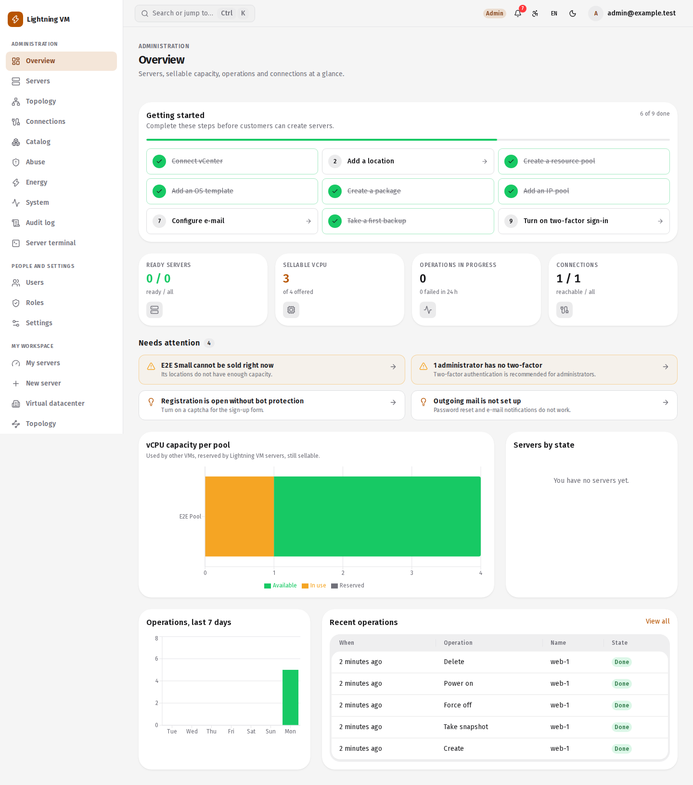
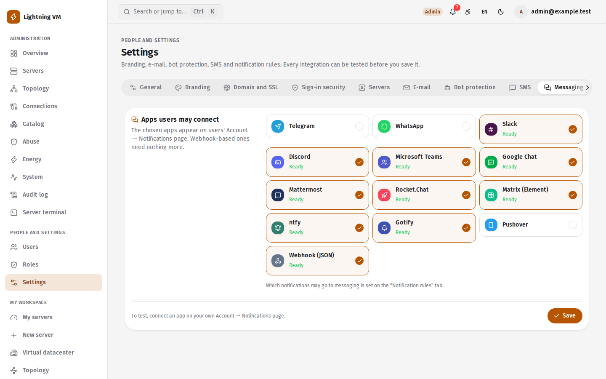
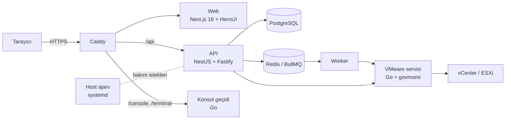

<div align="center">


# Lightning VM

**VMware, Proxmox VE, XCP-ng, oVirt, Hyper-V, KVM (libvirt) ve Incus / LXD için açık kaynak sunucu satış ve yönetim paneli**

Müşteriler sunucu sipariş eder, açar, kapatır, yeniden kurar; yönetici kapasiteyi, IP'leri, fiyatları,
bildirimleri ve sistemin kendisini tek panelden yönetir. Kurulumdan sonraki günlük işlerin çoğu için sunucuya SSH ile
girmeniz gerekmez. Özelliklerin tamamı yalnızca VMware'de vardır; diğer altı platformun neyi yapıp neyi yapmadığı
[Platform kapsamı](#-platform-kapsamı) tablosundadır.


[Özellikler](#-özellikler) · [Platform kapsamı](#-platform-kapsamı) · [Son eklenenler](#-son-eklenenler) · [Ekran görüntüleri](#-ekran-görüntüleri) · [Kurulum](#-kurulum) · [Kullanım](#-ilk-adımlar) ·
[Mimari](#-mimari) · [Geliştirme](#-geliştirme-ve-testler) · [Bilinen sınırlar](#-bilinen-sınırlar) · [English](#-english-summary)

</div>

---

> [!WARNING]
> **Bu proje "vibe coding" ile, yapay zekâ ile birlikte yazıldı.** Kodun neredeyse tamamı
> [Anthropic'in Claude Code](https://claude.com/claude-code) aracıyla, proje sahibinin yönlendirmesi, istekleri ve
> testleriyle üretildi. Her değişiklik birim, entegrasyon ve uçtan uca (Playwright) testlerden geçirilip bir
> demo sunucuda denendi; yine de **hatalar, eksikler ve güvenlik açıkları olabilir.** Bağımsız bir güvenlik
> denetiminden geçmedi; VMware tarafı gerçek vCenter/ESXi yerine çoğunlukla govmomi simülatörüyle test edildi.
> Üretimde, gerçek müşterilerle ve gerçek parayla kullanmadan önce kendi ortamınızda deneyin, yedek alın ve
> kodu inceleyin. Bulduğunuz hataları [issue](https://github.com/syildirim689/lightning-vm/issues) olarak
> bildirmeniz çok değerli.

## ✨ Özellikler

<table>
<tr><td valign="top" width="50%">

### Müşteri paneli
- **Akıllı sipariş:** paket veya özel kaynak, uygun olmayan paketler gerekçesiyle, en uygun paket, ad önerisi,
  canlı fiyat ve kota kontrolü
- **Sunucu yönetimi:** aç / kapat / yeniden başlat, silme onayı, işlem geçmişi, CPU-RAM-disk-ağ grafikleri
  (grafikler yalnız VMware ve Proxmox'ta dolar)
- **Yeniden kurulum, boyut değiştirme, kopyalama:** aynı adresler ve anahtarlarla başka imaj; paket ya da özel boyut
  (disk yalnızca büyür, fark gün hesabıyla faturalanır); bir sunucunun diskiyle birlikte kopyası
- **Tarayıcı konsolu** ve **ISO bağlama** (ikisi de yalnız VMware'de), root parolası, uygulama kurulumu (cPanel, Plesk…)
- **Anlık görüntüler** (snapshot), **ek diskler**, **güç zamanlaması**, etiketler ve notlar; **yedekler** ve geri
  yükleme ile **kişisel imajlar** (sunucuyu imaj olarak kaydedip ondan sipariş verme) yalnız VMware'de
- **Silmede bekleme süresi:** silinen sunucu önce kapatılır ve ayarlanan süre (varsayılan 24 saat) sonunda silinir;
  o zamana kadar geri alınabilir. **Sunucu kilidi** silmeyi, zorla kapatmayı, yeniden kurmayı, boyut değiştirmeyi ve
  geri yüklemeleri engeller. **Favoriler** sık kullanılan sunucuları işaretler
- **Sunucuyu başka hesaba devretme:** e-postayla teklif edilir, karşı taraf 7 gün içinde kabul ederse aboneliğiyle geçer
- **Trafik kotası:** günlük giriş-çıkış sayımı, %80 ve %100'de uyarı (sayım VMware ve Proxmox'ta); kota dolunca hız
  sınırlama yalnız VMware'de (dağıtık anahtar)
- **İşletim sistemi güncellemeleri:** sunucunun içindeki bekleyen ve güvenlik güncellemeleri, "yalnız haber ver / güvenliği kur /
  hepsini kur" politikası, seçilen saatte otomatik yeniden başlatma (Linux: apt, dnf, yum)
- Faturalar ve ödeme, **saatlik kullanım** (bakiyeden; bakiye bitince bekletme, ay sonunda kullanım faturası),
  **aylık bütçe uyarısı** (aylık gidiş bütçeyi aşınca ayda bir bildirim; siparişte önceden uyarı), destek talepleri
- **API anahtarları ve API belgeleri:** arama, süzgeçler, örnek istekler, OpenAPI ve PDF indirme (istekler tarayıcıdan
  çalıştırılamaz). **Webhook'lar:** imzalı, yeniden denenen, teslimat kaydı ve sınama düğmesiyle
- **Verilerimi indir:** hesabın panelde tutulan verileri tek JSON dosyası olarak (parola, oturum ve gizli anahtarlar hariç)
- **Özel ağlar** ve **firewall** şablonları (ikisi de yalnız VMware'de, dağıtık anahtarla), ters DNS (PTR), SSH
  anahtarları (GitHub'dan içe aktarma)
- **Sanal veri merkezi (VDC)** ve ağ topolojisi görünümü
- Sunucu sağlık puanı, aylık maliyet tahmini, hızlı bağlantı bilgileri

</td><td valign="top" width="50%">

### Yönetici paneli
- **Incus / LXD bağlantıları (ilk sürüm, gerçek Incus 6.0'da konteynerlerle denendi):** sanal makineler ve sistem konteynerleri, imaj deposundan; Incus'un kendi cloud-init desteğiyle ([docs/incus.md](docs/incus.md))
- **KVM (libvirt) bağlantıları (ilk sürüm):** düz bir Linux KVM hostu, SSH üzerinden `virsh` ile; hosta hiçbir şey kurulmaz ([docs/libvirt.md](docs/libvirt.md))
- **Microsoft Hyper-V bağlantıları (ilk sürüm):** WinRM üzerinden PowerShell ile; cloud-init yapılandırma diskiyle ([docs/hyperv.md](docs/hyperv.md))
- **oVirt / RHV bağlantıları (ilk sürüm):** Engine'in kendi cloud-init desteğiyle ([docs/ovirt.md](docs/ovirt.md))
- **XCP-ng / XenServer bağlantıları (ilk sürüm):** havuz ya da tek host; cloud-init'in tamamı yapılandırma diskiyle ([docs/xcpng.md](docs/xcpng.md))
- **Proxmox VE bağlantıları (ilk sürüm):** düğüm ya da küme; keşif, şablondan sunucu oluşturma, güç, boyut, anlık görüntü, ek disk ([docs/proxmox.md](docs/proxmox.md))
- **ESXi / vCenter bağlantıları:** envanter keşfi, kapasite, lisans ve yetki kontrolü; IP bloğu tarayarak ağdaki ESXi/vCenter'ları bulma, tek tıkla ekleme ve günlük/haftalık otomatik tarama
- **Katalog:** kaynak havuzları, fazla tahsis oranları, paketler, imajlar, konumlar (bakım modundaki konum yeni
  sunucu almaz), IPv4 havuzları. IPv6 ayrı bir havuz değildir: IPv4 havuzuna isteğe bağlı bir önek eklenir ve her
  sunucu o önekten **tek** adres alır
- **Mevcut VM'leri devralma:** panel dışında oluşturulmuş bir VM, bir müşterinin sunucusu olur (çalışmaya devam eder)
- **Taşıma ve host boşaltma** (yalnız VMware): sunucuyu çalışırken başka hosta ya da veri deposuna taşıma, bakım
  öncesi bir hosttaki tüm sunucuları taşıma
- **İçgörüler:** dolan havuz tahmini, azalan IP, boşta / büyük / küçük sunucular, takılan işler (boşta / büyük /
  küçük sunucu ve sağlık puanı işlemci ölçümüne dayanır; XCP-ng, oVirt, KVM ve Incus'ta işlemci ölçülmediği için
  oralarda anlamlı değildir)
- **Kullanıcılar ve roller:** izin tabanlı roller, kişiye özel izinler, kullanıcı adına giriş, yasaklama. **Rol
  sınırları:** kota, snapshot / firewall / SSH anahtarı sayısı, saatlik işlem sayısı, oturum süresi, iki adım
  zorunluluğu, izinli konumlar ve izinli IP adresleri. Kullanıcıya **ekip notları** (müşteri görmez, sabitlenebilir)
- **Kötüye kullanım:** açık riskli port taraması, madencilik şüphesi (uzun süreli tam CPU; işlemcinin ölçüldüğü
  platformlarda)
- **Enerji raporu:** kWh, maliyet ve karbon tahmini (işlemci kullanımından hesaplanır; XCP-ng, oVirt, KVM ve
  Incus'ta anlamlı değildir)
- **Genel bakışta özet:** son bakışınızdan beri yeni kullanıcı, sunucu, başarısız işlem, kötüye kullanım bulgusu,
  alarm ve reddedilen / başarısız giriş sayıları
- **Herkese açık durum sayfası** (`/status`): panelin parçalarının ve konumların durumu; yönetici olay (incident)
  açar ve güncelleme yazar
- **İstatistikler:** önceki döneme göre eğilimli KPI’lar, zaman serileri, konum/işletim sistemi/paket kırılımı, en büyük müşteriler ve gün × saat işlem haritası (animasyonlu)
- **Denetim kaydı**, duyuru bandı, toplu sunucu işlemleri
- **Destek sistemi:** öncelik ve SLA, departmanlar, iç notlar, değişkenli hazır yanıtlar, puanlama ve kapanışta memnuniyet isteği
- **Sunucu terminali** (iki adımlı doğrulama zorunlu) ve **panelden güncelleme**
- **Sunucu durumu:** panelin çalıştığı sunucunun canlı işlemci, bellek, yük ve disk grafikleri; servisler, dosya
  sistemleri, en çok kaynak kullanan süreçler ve her servisin günlükleri (arama, yalnız sorunlar, indirme)
- **İşletim sistemi güncellemeleri:** panel sunucusunda güvenlik / tüm güncellemeleri kurma, otomatik güvenlik
  güncellemeleri, yeniden başlatma; adım adım ilerleme penceresi. Tüm müşteri sunucularının güncelleme durumu tek listede
- **Kullanıcı ayrıntısı:** doğrulamalar, parola, iki adımlı doğrulama sıfırlama, geçiş anahtarları, bağlı hesaplar,
  oturumlar ve giriş geçmişi
- **Bayiler**, faturalama, kuponlar, itiraz yönetimi ve e-Fatura / e-Arşiv (yedi entegratörden yalnızca İzibiz ve
  Uyumsoft'a, kendi test ortamlarında gerçek e-Arşiv faturası gönderildi; diğer beşi belgelere göre yazıldı, denenmedi)
- **WHMCS / WISECP modülleri** (`integrations/`): satışı o sistem yapar, panel bu sunuculara fatura kesmez. WISECP
  modülü bir WISECP kurulumunda denenmedi

</td></tr>
<tr><td valign="top">

### Bildirimler
- Panel içi, tarayıcı (Web Push), e-posta, SMS ve **mesajlaşma uygulamaları:**
  Telegram, WhatsApp, Slack, Discord, Microsoft Teams, Google Chat, Mattermost, Rocket.Chat, Matrix, ntfy,
  Gotify, Pushover ve imzalı JSON webhook
- Önce yöneticinin kuralı, sonra kullanıcının seçimi; her kanal test edilebilir
- Prometheus/Alertmanager alarmları panel bildirimi olarak gelir

</td><td valign="top">

### Entegrasyonlar
- **E-posta:** SMTP ve 12 API sağlayıcısı (Resend, SendGrid, Mailgun, Postmark, Amazon SES, Brevo, Mailjet,
  SparkPost, MailerSend, SMTP2GO, Elastic Email, ZeptoMail)
- **SMS:** Türkiye'deki 18 sağlayıcı + Twilio, Vonage, Infobip, Plivo, Sinch, Telnyx, Clickatell, MessageBird
  ve özel HTTP API
- **Ödeme:** kartla tahsilat yalnızca **iyzico, PayTR, Craftgate, Param ve Stripe** ile (ve panelin kendi test
  sağlayıcısıyla) yapılır. Listedeki diğer 41 sağlayıcının (Türkiye'deki ödeme kuruluşları, banka sanal POS'ları,
  Papara, PayPal, Mollie, Adyen, Checkout.com, Razorpay, Square, Paddle) yalnızca hesap bilgileri kaydedilir ve çoğu
  para hareketi olmayan bir sorguyla sınanır; **bunlarla ödeme alınamaz** ([docs/payments.md](docs/payments.md))
- **CAPTCHA:** Cloudflare Turnstile, reCAPTCHA v2/v3, hCaptcha · **Ters DNS:** PowerDNS

</td></tr>
<tr><td valign="top">

### Güvenlik
- better-auth: parola, passkey, iki adımlı doğrulama (uygulama, SMS, e-posta, yedek kodlar)
- **Kurumsal giriş:** LDAP / Active Directory ve OpenID Connect ile tek oturum açma (Keycloak, Entra ID, Okta, Google, authentik); gruplardan rol
- CSRF koruması, hız sınırları, şifreli sırlar (ana anahtar), oturum yönetimi
- **Mükerrer işlem koruması:** Idempotency-Key, sunucu başına tek açık işlem ve çift tıklamada ikinci isteğin reddi
- Kullanıcının verdiği webhook adresleri yalnızca herkese açık HTTPS olabilir (iç ağa istek atılamaz)

</td><td valign="top">

### İşletim
- **Tek komutla kurulum**, otomatik HTTPS (alan adı veya `<ip>.sslip.io`)
- Şifreli yedek ve kontrollü geri yükleme, zamanlanmış yedek
- **Güncelleme:** önce yedek, migration uyumluluğu denetimi, başarısızlıkta container'ların geri dönüşü. Kendiliğinden
  yalnızca daha yeni sürüme geçer; açıkça bir sürüm verildiğinde eski bir sürüme dönüşü yalnızca migration denetimi durdurur
- İsteğe bağlı Prometheus, Grafana, Loki, Alertmanager. Kurulumda açılır; sonradan yalnızca komut satırından açılıp
  kapatılır (`install.sh monitoring on|off`). Panelde bunun düğmesi yalnız kurulum sihirbazında vardır
- Türkçe / İngilizce arayüz, koyu / açık tema, telefondan geniş ekrana tam uyumlu
- **Pencere mantığı:** tüm iletişim kutuları başlık çubuğundan taşınır, kenara alınır, büyütülür; sola / sağa / üste / alta yaslanır, köşelere yerleşir, ortalanır, kenarından ve köşesinden boyutlandırılır. Kenara sürüklerken yerleşeceği alan önizlenir; düzen menüsü (başlıkta sağ tık ya da düzen düğmesi) ve Ctrl+Alt+← → ↑ ↓ / C kısayolları (telefonda alttan açılan sayfa)
- **Erişilebilirlik:** %75–%200 yazı boyutu ve metin aralığı kaydırıcıları, yüksek kontrast, okunaklı yazı tipi, azaltılmış hareket
- **Türkçe duyarlı arama** ("sirket" → "Şirket", "istanbul" → "İstanbul") ve sağ altta arka plan görevleri paneli

</td></tr>
</table>

## 🧩 Platform kapsamı

Yedi platform aynı sözleşmeyi konuşur, ama hepsi her şeyi yapmaz. Aşağıdaki tablo adaptörlerin kendi yol
tablolarından çıkarıldı: "yok" yazan işlemde adaptör `PLATFORM_NOT_SUPPORTED` yanıtı verir ve işlem "bu platformda
desteklenmiyor" hatasıyla biter. ✓ işareti kodun var olduğunu söyler, gerçek donanımda denendiğini değil; son satıra
bakın.

| | VMware (vCenter) | Proxmox VE | XCP-ng | oVirt | Hyper-V | KVM (libvirt) | Incus / LXD |
|---|---|---|---|---|---|---|---|
| Keşif, kapasite, topoloji | ✓ | ✓ | ✓ | ✓ | ✓ | ✓ | ✓ |
| Şablondan / imajdan sunucu oluşturma, yeniden kurulum | ✓ | ✓ | ✓ | ✓ | ✓ | ✓ ¹ | ✓ |
| Aç, kapat, yeniden başlat, sil | ✓ | ✓ | ✓ | ✓ | ✓ | ✓ | ✓ |
| Boyut değiştirme | ✓ | ✓ | ✓ ² | ✓ | ✓ ² | ✓ ² | ✓ ² |
| Anlık görüntü (al, geri dön, sil) | ✓ | ✓ | ✓ | ✓ | ✓ | ✓ | ✓ |
| Ek disk (ekle, kaldır) | ✓ | ✓ | ✓ | ✓ | ✓ | ✓ | ✓ |
| Mevcut VM'i devralma, tutarlılık denetimi | ✓ | ✓ | ✓ | ✓ | ✓ | ✓ | ✓ |
| Root parolası, uygulama kurulumu, güncelleme bildiricisi (cloud-init) | ✓ | guest agent ile ³ | ✓ | ✓ | ✓ | ✓ | ✓ |
| Kullanım grafikleri (geçmiş) | ✓ | ✓ (dakikada bir) | yok (boş) | yok (boş) | yok (boş) | yok (boş) | yok (boş) |
| Trafik sayımı ve kota uyarısı | ✓ | ✓ | yok | yok | yok | yok | yok |
| Sunucu başına işlemci ölçümü ⁴ | ✓ | ✓ | yok | yok | ✓ | yok | yok |
| Tarayıcı konsolu | ✓ ⁵ | yok | yok | yok | yok | yok | yok |
| Firewall | ✓ ⁶ | yok | yok | yok | yok | yok | yok |
| Kota dolunca hız sınırlama | ✓ ⁶ | yok | yok | yok | yok | yok | yok |
| Özel ağlar | ✓ ⁶ | yok | yok | yok | yok | yok | yok |
| Yedek ve geri yükleme | ✓ | yok | yok | yok | yok | yok | yok |
| Kişisel imaj | ✓ | yok | yok | yok | yok | yok | yok |
| ISO kitaplığı, CD takma, kurtarma | ✓ | yok | yok | yok | yok | yok | yok |
| Taşıma ve host boşaltma | ✓ | yok | yok | yok | yok | yok | yok |
| Ağı tarayarak host bulma | ✓ | yok | yok | yok | yok | yok | yok |
| Gerçek sunucuda denendi mi | çoğunlukla simülatör | hayır | hayır | hayır | hayır | hayır | evet: Incus 6.0, yalnız konteyner |

¹ Hostta `virt-clone` ve `virt-xml` varsa; yoksa bağlantı yalnızca envanter ve güç işlemleri içindir.
² Sunucu kapalıyken; panel kapatıp açmayı kendisi yapar.
³ Proxmox'un kendi cloud-init'i yalnızca ağı ve SSH anahtarlarını taşır; kalanı sunucu açıldıktan sonra QEMU guest
agent ile uygulanır. Şablonda agent yoksa bunlar uygulanmaz.
⁴ Boşta / büyük / küçük sunucu, madencilik şüphesi, sağlık puanı ve enerji raporu bu ölçüme dayanır; "yok" yazan
platformlarda anlamlı sonuç vermezler. oVirt'te yalnızca host kullanımı okunur.
⁵ VMware HTML Console SDK depoda yoktur ve gerçek SDK ile denenmedi ([docs/console.md](docs/console.md)).
⁶ Dağıtık sanal anahtar (vSphere Distributed Switch) gerekir.

VMware'de sunucu oluşturmak vCenter ister; tek başına ESXi'de yalnızca okuma ve güç işlemleri vardır. oVirt'te bir
sunucunun kopyası çıkarılamaz (kopya yalnızca şablondan). Her platformun ayrıntısı kendi belgesindedir:
[vmware](docs/vmware.md), [proxmox](docs/proxmox.md), [xcpng](docs/xcpng.md), [ovirt](docs/ovirt.md),
[hyperv](docs/hyperv.md), [libvirt](docs/libvirt.md), [incus](docs/incus.md).

## 🆕 Son eklenenler

| Ne | Nerede |
|---|---|
| **Baştan sona denetim:** API, worker, web arayüzü, yedi adaptör ve kurulum betiği gözden geçirildi. İşletmeciyi etkileyen 49 davranış değişikliği var; en önemlileri faturalamada (otomatik yenilemesi kapalı aboneliklere artık fatura kesilir, ödenmeyen sipariş ve veri merkezi faturaları tahsilat adımlarına girer). **Yükseltmeden önce okuyun** | [docs/upgrade-notes.md](docs/upgrade-notes.md) |
| **Pencere düzenleri:** iletişim kutuları sola / sağa yaslanır, köşelere ve yarımlara yerleşir, ortalanır, kenarından boyutlandırılır; sürüklerken önizleme, düzen menüsü ve Ctrl+Alt+ok tuşları | Panelin tamamı |
| **Incus / LXD desteği (ilk sürüm):** aynı panelden sanal makine ve konteyner; istemci sertifikasıyla, küme desteğiyle. Gerçek bir Incus 6.0 sunucusunda konteynerlerle denendi | Yönetim → Bağlantılar → Incus / LXD · [docs/incus.md](docs/incus.md) |
| **KVM (libvirt) desteği (ilk sürüm):** vCenter ya da Proxmox olmadan, düz bir Linux KVM hostu; SSH ile, parola ya da anahtarla | Yönetim → Bağlantılar → KVM (libvirt) · [docs/libvirt.md](docs/libvirt.md) |
| **Microsoft Hyper-V desteği (ilk sürüm):** aynı panelden Hyper-V hostları | Yönetim → Bağlantılar → Hyper-V · [docs/hyperv.md](docs/hyperv.md) |
| **oVirt / RHV desteği (ilk sürüm):** aynı panelden oVirt Engine | Yönetim → Bağlantılar → oVirt · [docs/ovirt.md](docs/ovirt.md) |
| **XCP-ng / XenServer desteği (ilk sürüm):** aynı panelden XAPI havuzları | Yönetim → Bağlantılar → XCP-ng · [docs/xcpng.md](docs/xcpng.md) |
| **Proxmox VE desteği (ilk sürüm):** VMware ile aynı panelden Proxmox düğümleri ve kümeleri | Yönetim → Bağlantılar → Proxmox VE · [docs/proxmox.md](docs/proxmox.md) |
| Panel sunucusunun canlı durumu: işlemci, bellek, yük, disk, servisler, süreçler, günlükler | Yönetim → Sistem → Sunucu durumu |
| İşletim sistemi güncellemeleri (panel sunucusu): kurulum, otomatik güvenlik güncellemeleri, yeniden başlatma, ilerleme penceresi | Yönetim → Sistem |
| Müşteri sunucularının içindeki güncellemeler; yeni Linux sunuculara bildirici ilk açılışta kendiliğinden kurulur | Sunucu sayfası · Yönetim → Sunucular → Güncellemeler |
| Kullanıcının hesap ve giriş ayrıntıları, iki adımlı doğrulama sıfırlama, geçiş anahtarı ve bağlı hesap yönetimi | Yönetim → Kullanıcılar |
| Pencere gibi davranan iletişim kutuları (taşı, kenara al, büyüt, kapat) | Panelin tamamı |
| Yazı boyutu ve metin aralığı kaydırıcıları | Erişilebilirlik |
| Türkçe harflere duyarlı arama; zaman ve DNS sunucuları için önerilen varsayılanlar | Panelin tamamı · Yönetim → Sistem |

## 📸 Ekran görüntüleri

| Yönetici genel bakış | Müşteri sunucuları |
|---|---|
|  |  |
| **Akıllı sipariş** | **Topoloji** |
|  |  |
| **E-posta sağlayıcıları** | **Mesajlaşma uygulamaları** |
|  |  |

## 🚀 Kurulum

### Gereksinimler

| | En az | Önerilen |
|---|---|---|
| İşletim sistemi | Ubuntu 22.04 / 24.04 / 26.04 (amd64 veya arm64) | Ubuntu 24.04 LTS |
| Bellek / disk | 2 GB RAM, 10 GB boş disk | 4 GB RAM, 40 GB disk (izleme açıkken) |
| Ağ | 80 ve 443 portları dışarıya açık (HTTPS için) | Bir alan adı (A kaydı sunucuyu göstermeli) |
| Sanallaştırma | ESXi / vCenter 6.0 – 9.x, Proxmox VE 7.x – 9.x, XCP-ng 8.x, oVirt 4.4+, Hyper-V (Windows Server 2016+), libvirt'li bir Linux KVM hostu ya da Incus 6.x / LXD 5.x | Sunucu oluşturmak için **vCenter**, **Proxmox VE**, **XCP-ng**, **oVirt**, **Hyper-V**, **KVM (libvirt)** ya da **Incus / LXD** |

Docker kurulu değilse betik resmî deposundan kurar. Paneli VMware host'unun kendisine değil, ayrı bir Linux
sunucuya (sanal da olabilir) kurun.

### Tek komutla kurulum (önerilen)

Yeni bir sunucuda yalnızca bu satırı çalıştırın; `git clone` gerekmez:

```bash
curl -fsSL https://raw.githubusercontent.com/syildirim689/lightning-vm/main/scripts/get.sh | sudo sh
```

Komut kaynağı `/opt/lightning-vm` dizinine indirir, en yeni kararlı sürümü seçer ve kurulumu başlatır; panel
sonradan kendini bu dizinden günceller. Kendi alan adınızla:

```bash
curl -fsSL https://raw.githubusercontent.com/syildirim689/lightning-vm/main/scripts/get.sh | sudo sh -s -- -- --domain panel.example.com
```

| `get.sh` seçeneği | Ne yapar |
|---|---|
| `--version v1.2.0` | Belirli bir sürümü kurar (varsayılan: en yeni kararlı sürüm) |
| `--branch main` | Sürüm yerine bir dalı izler (test sunucuları) |
| `--dir /srv/lightning-vm` | Kaynağın duracağı dizin (varsayılan `/opt/lightning-vm`) |
| `--token TOKEN` | Özel (private) depo için salt okunur erişim anahtarı |
| `-- …` | `--` sonrasındaki her şey aşağıdaki kurulum seçenekleridir |

> [!NOTE]
> Bu adres, depo herkese açık (public) olduğunda doğrudan çalışır. Depo özelken komutu bir erişim anahtarıyla
> çalıştırın: [docs/updates.md](docs/updates.md).

### Elle kurulum

```bash
git clone https://github.com/syildirim689/lightning-vm.git
```

```bash
cd lightning-vm
```

```bash
sudo sh scripts/install.sh
```

Betik sırasıyla sistemi kontrol eder, Docker'ı kurar, sırları üretir, servisleri derleyip başlatır, HTTPS
sertifikasını alır, izlemeyi ve günlük yedeği ayarlar. Sonunda **panel adresini ve ilk yönetici bilgilerini**
yazar (parola `secrets/initial-admin.txt` dosyasında da durur; ilk girişten sonra değiştirip dosyayı silin).

Sık kullanılan seçenekler:

| Seçenek | Ne yapar |
|---|---|
| `--domain panel.example.com` | Kendi alan adınızla Let's Encrypt sertifikası |
| `--acme-staging` | Önce test sertifikasıyla dener (limitlere takılmamak için) |
| `--setup-wizard` | Yönetici hesabı yerine tarayıcıda kurulum sihirbazı açar |
| `--admin-email adres@ornek.com` | İlk yöneticinin e-postası |
| `--local` | Genel IP yoksa: panel yalnızca sunucuda, SSH tüneliyle açılır |
| `--no-monitoring` / `--no-schedule` | İzlemeyi / zamanlanmış yedeği kurmaz |
| `--lang en` | Kurulum çıktısı İngilizce |

Yalnızca kontrol etmek (hiçbir şeyi değiştirmez):

```bash
sh scripts/install.sh check
```

Kurulum yarıda kalırsa aynı komutu tekrar çalıştırın; mevcut sırlar, veriler ve hesaplar korunur.

<details>
<summary><b>Genel IP'si olmayan sunucu (<code>--local</code>)</summary>

Panel yalnızca sunucunun kendisinde açılır. Kendi bilgisayarınızdan SSH tüneliyle bağlanın:

```bash
ssh -L 8080:127.0.0.1:8080 KULLANICI@SUNUCU
```

Ardından tarayıcıda `http://127.0.0.1:8080` adresini açın. Paneli HTTPS olmadan internete açmayın:
parolalar düz metin gider.
</details>

<details>
<summary><b>Alan adını sonradan eklemek / değiştirmek, başka bir proxy arkasında çalıştırmak</b></summary>

Alan adı panelin Ayarlar → Alan adı ve SSL sekmesinden de değiştirilebilir. Komut satırından:

```bash
sudo sh scripts/install.sh domain panel.example.com --acme-staging
```

```bash
sudo sh scripts/install.sh domain panel.example.com
```

Mevcut bir Nginx / Caddy / Traefik arkasında çalıştırma: [docs/domain-https.md](docs/domain-https.md).
</details>

## 🧭 İlk adımlar

1. **Giriş yapın** ve parolanızı değiştirin; Hesap → Güvenlik'ten iki adımlı doğrulamayı açın.
2. **VMware bağlantısı ekleyin** (Yönetim → Bağlantılar): vCenter veya ESXi adresi, kullanıcı ve parola. Panel
   host'ları, datastore'ları, ağları ve VM'leri keşfeder; TLS sertifikası parmak iziyle doğrulanır.
3. **Kataloğu hazırlayın** (Yönetim → Katalog): konum, kaynak havuzu, IP havuzu, şablon imajı ve paketler.
4. **E-posta / SMS / ödeme / mesajlaşma** ayarlarını yapın (Yönetim → Ayarlar); her biri kaydetmeden önce test
   edilebilir.
5. **Bildirim kurallarını** belirleyin; kullanıcılar kendi kanallarını Hesap → Bildirimler'den seçer.
6. Müşteri hesabıyla **bir sunucu sipariş edip** uçtan uca deneyin.

Güncellemeler, yedekler ve terminal **panelden** yönetilir (Yönetim → Sistem). İzleme (Prometheus, Grafana, Loki,
Alertmanager) panelden yalnızca kurulum sihirbazında açılıp kapatılabilir; sonrasında komut satırından:

```bash
sudo sh scripts/install.sh monitoring on
```

Ayrıntılı kılavuz: [docs/setup.md](docs/setup.md).

## 🔄 Güncelleme ve yedek

Panelden: **Yönetim → Sistem → Güncellemeler**. Komut satırından:

```bash
sudo sh scripts/install.sh update
```

```bash
sudo sh scripts/install.sh backup
```

```bash
sudo sh scripts/install.sh restore backups/DOSYA.tar.enc --yes-replace-data
```

- Sürüm verilmeden çalışan güncelleme yalnızca çalışan sürümden **daha yeni** bir sürüme geçer. Açıkça bir sürüm
  verildiğinde (`update --to v1.2.0`, ya da panelin gönderdiği "bu sürüme geç" isteği) betik herhangi bir sürüm
  etiketini ya da commit'i kabul eder; eski bir sürüme dönüşü yalnızca migration denetimi durdurur (veritabanında
  uygulanmış bir migration o sürümde yoksa reddeder).
- Her güncelleme önce yedek alır ve başarısız olursa container'ları geri alır (veritabanı otomatik geri alınmaz;
  yedek oradadır).
- Yedekler `secrets/backup.key` ile şifrelenir. **Bu anahtarı sunucu dışında saklayın**; o olmadan yedek açılmaz.
- Parolasını unutan yönetici için: `sudo sh scripts/install.sh reset-password eposta@ornek.com`.
- **Yükseltmeden önce** [docs/upgrade-notes.md](docs/upgrade-notes.md) sayfasını okuyun: sürümler arasında değişen
  davranışları, mevcut veriye etkisini ve kimlerin etkileneceğini gösteren sorguları içerir.

Ayrıntılar: [docs/operations.md](docs/operations.md), [docs/updates.md](docs/updates.md).

## 🏗 Mimari



| Bileşen | Teknoloji | Görev |
|---|---|---|
| `apps/web` | Next.js 16, React, HeroUI v3, next-intl, React Query | Müşteri ve yönetici paneli |
| `apps/api` | NestJS (Fastify), better-auth, PostgreSQL, BullMQ | REST API, kimlik, ayarlar, bildirimler |
| `apps/worker` | Node.js, BullMQ | Sunucu oluşturma ve işlemler, adım adım ve kaldığı yerden |
| `services/vmware` | Go, govmomi | vCenter/ESXi ile konuşan adaptör |
| `services/proxmox` | Node.js (bağımlılıksız) | Aynı sözleşmeyle Proxmox VE ile konuşan adaptör ([sözleşme](docs/adapter-contract.md)) |
| `services/xcpng` | Node.js (bağımlılıksız) | Aynı sözleşmeyle XCP-ng / XenServer (XAPI) ile konuşan adaptör |
| `services/ovirt` | Node.js (bağımlılıksız) | Aynı sözleşmeyle oVirt Engine (REST) ile konuşan adaptör |
| `services/hyperv` | Node.js (bağımlılıksız) | Aynı sözleşmeyle Hyper-V'yi WinRM üzerinden PowerShell ile yöneten adaptör |
| `services/libvirt` | Node.js (bağımlılıksız) + OpenSSH istemcisi | Aynı sözleşmeyle bir KVM hostunu SSH üzerinden `virsh` ile yöneten adaptör |
| `services/incus` | Node.js (bağımlılıksız) | Aynı sözleşmeyle Incus / LXD (REST) ile konuşan adaptör |
| `services/console` | Go | Tarayıcı konsolu ve sunucu terminali için WebSocket geçidi |
| `scripts/install.sh` | POSIX sh, Docker Compose | Kurulum, güncelleme, yedek, host ajanı |

Daha fazlası: [docs/architecture.md](docs/architecture.md).

## 🧪 Geliştirme ve testler

```bash
docker compose -f compose.yaml -f compose.simulator.yaml up -d --build
```

Simülatör (govmomi `vcsim`) gerçek bir vCenter olmadan tüm akışı çalıştırır. Testler:

| Test | Komut |
|---|---|
| API birim testleri (122 test) | `cd apps/api && npm test` |
| API entegrasyon testleri (PostgreSQL + Redis) | `cd apps/api && npm run test:integration` |
| API entegrasyon testlerinin tamamı (PostgreSQL, Redis, vcsim, VMware adaptörü ve worker'ı Docker'da kendisi kurar; Docker'lı bir Linux sunucusunda çalıştırıldı: 130 testten 126'sı geçti, 4'ü PowerDNS, ISO deposu ya da konsol ağ geçidi istediği için atlandı) | `cd apps/api && npm run test:integration:full` |
| Go servisleri | `cd services/vmware && go test ./...` |
| Proxmox (23), XCP-ng (19), oVirt (15), Hyper-V (18), libvirt (19) ve Incus (11 test) adaptörleri | `cd services/proxmox && npm test` (aynısı `services/xcpng`, `services/ovirt`, `services/hyperv`, `services/libvirt` ve `services/incus` için; libvirt'in dört betik testi yalnızca Linux'ta çalışır, başka yerde atlanır) |
| Web birim testleri (44 test: çeviriler, simgeler, pencere düzenleri ve diğer hesaplar) | `cd apps/web && npm test` |
| Worker (sözdizimi denetimi ve 34 birim testi) | `cd apps/worker && npm run check` |
| Uçtan uca (Playwright, çalışan bir Compose kurulumuna karşı) | `cd apps/web && npx playwright test` |

Uçtan uca yolculuklar tek bir masaüstü boyutunda (1280 px) koşar; aralarında birkaç ekran ayrıca 390 ve 768 px'te
taşma için denetlenir. Ayrı bir döngü sayfaları 390 / 768 / 1920 px'te açar ve yalnızca sayfa başlığının göründüğüne
ve yana taşma olmadığına bakar; bu genişliklerde işlev sınanmaz.

CI (`.github/workflows/ci.yaml`): birim işleri (API, web, worker, altı Node adaptörü, Go servisleri) `main`'e her
gönderimde, pull request'lerde ve elle çalışır. Servis ya da bütün bir Compose kurulumu isteyen işler (API
entegrasyon testleri, imaj derlemeleri, kurulum + uçtan uca) yalnızca elle tetiklenir (GitHub Actions → *Run workflow*).
Adaptör testleri gerçek bir hipervizöre değil, platformu taklit eden sahte sunuculara karşı çalışır. Katkı kuralları:
[CONTRIBUTING.md](CONTRIBUTING.md).

## ⚠️ Bilinen sınırlar

- **Yapay zekâ ile yazıldı:** yukarıdaki uyarıya bakın. Hatalar olabilir; üretim öncesi inceleyin.
- **VMware:** testlerin çoğu govmomi simülatörüyle yapıldı. Gerçek vCenter/ESXi'de farklı davranışlar
  görülebilir. Sunucu oluşturma vCenter ister (standalone ESXi'de yalnızca okuma ve güç işlemleri).
- **Konsol:** tarayıcı konsolu **yalnız VMware'de** vardır. VMware HTML Console SDK (wmks) lisansı gereği depoda
  yok; kurulumu yapan kişi ekler. Geçit ve bilet akışı sınandı, ancak **bütün, gerçek SDK ile hiç denenmedi**: ekranın
  göründüğü, klavye ve farenin çalıştığı doğrulanmadı ([docs/console.md](docs/console.md)).
- **Ödeme:** kartla tahsilat yalnız iyzico, PayTR, Craftgate, Param ve Stripe ile; diğer 41 sağlayıcı yalnızca bilgi
  kaydıdır. Beşinden **hiçbiri gerçek bir üye işyeri hesabıyla denenmedi**. **Stripe:** webhook yok; müşteri ödedikten sonra
  sekmeyi kapatırsa ödeme, tahsilat çalıştırması Stripe'a yeniden sorduğunda işlenir (beş dakika sonra başlar, bir
  gün sürer; iyzico ve Craftgate'te de böyledir, PayTR ve Param'da yoktur). **Param:** dönüş, Param'a ayrıca sorularak
  doğrulanmaz ve bu akış **sağlayıcıyla teyit edilmedi**; sonuç yalnızca dönüşteki özet (hash), üye işyeri GUID'i ve
  işlem numarasına dayanır ([docs/payments.md](docs/payments.md)).
- **Gerçek hipervizör:** altı yeni adaptörden yalnızca Incus gerçek bir sunucuda çalıştırıldı, o da yalnızca
  konteynerlerle. Proxmox VE, XCP-ng, oVirt, Hyper-V ve KVM (libvirt) adaptörleri **gerçek bir hipervizörde hiç
  çalıştırılmadı**; testleri platformu taklit eden sahte sunuculara karşıdır.
- **Entegrasyon testleri:** bütün entegrasyon paketini Docker'da kendi kuran çalıştırıcı
  (`apps/api/test/integration/run.sh`) Docker'lı bir Linux sunucusunda çalıştırıldı (126 geçti, 4 atlandı). Bu turda
  değişen faturalama davranışlarının (otomatik yenileme, vadesi geçen faturalar, sanal veri merkezleri) çoğu için yeni
  entegrasyon testi **yazılmadı**: mevcut testler yalnız eski davranışın bozulmadığını gösterir.
- **e-Fatura / e-Arşiv:** yalnızca İzibiz ve Uyumsoft'a, yayımladıkları test kullanıcılarıyla e-Arşiv faturası
  gönderildi. Nilvera, EDM, QNB eFinans, BirFatura ve Paraşüt belgelere göre yazıldı ve denenmedi; e-Fatura (mükellef
  alıcı) gönderimi hiçbir gerçek entegratörde denenmedi ([docs/billing.md](docs/billing.md)).
- **IPv6:** ayrı IPv6 havuzu yoktur; IPv4 havuzuna eklenen önekten sunucu başına tek adres verilir.
- **İzleme:** kurulumdan sonra panelden açılıp kapatılamaz (`install.sh monitoring on|off`).
- **Küme (cluster):** birden çok sunucuda çalışma bir tasarımdır, yazılmadı ([docs/cluster.md](docs/cluster.md)).
- **E-posta adresi doğrulama yok:** kayıtla açılan hesabın e-posta adresi doğrulanmaz. (SSO, dizin ve bayi
  üzerinden gelen hesaplar doğrulanmış sayılır.)
- **WhatsApp:** Meta Cloud API ve onaylı bir mesaj şablonu gerekir. **Telegram:** botta webhook tanımlı olmamalı.
- **Incus / LXD:** ilk sürüm; **gerçek bir Incus 6.0 sunucusunda konteynerlerle uçtan uca denendi** (oluşturma, cloud-init, güç, snapshot, disk, boyut, devralma, silme). Sanal makineler, LXD ve kümeler denenmedi.
  Konsol, firewall, hız sınırlama, yedek, kişisel imaj, ISO, özel ağ, taşıma, grafikler, trafik sayımı ve işlemci
  ölçümü yok ([docs/incus.md](docs/incus.md)).
- **KVM (libvirt):** ilk sürüm; betikler sahte bir `virsh` ile ve gerçek bir SSH sunucusu üzerinden sınandı, **gerçek bir libvirt/KVM hostunda henüz denenmedi**.
  Bağlantı başına tek host, depolama yalnız klasör tipi havuz (qcow2), Windows misafir özelleştirmesi yok. Konsol,
  firewall, hız sınırlama, yedek, kişisel imaj, ISO, özel ağ, taşıma, grafikler, trafik sayımı ve işlemci ölçümü yok
  ([docs/libvirt.md](docs/libvirt.md)).
- **Microsoft Hyper-V:** ilk sürüm ve en az denenmiş adaptör; PowerShell betikleri gerçek bir Hyper-V hostunda hiç çalıştırılmadı. Yalnız
  HTTPS üzerinden WinRM, bağlantı başına tek host (Failover Cluster yok), Windows misafir özelleştirmesi yok. Konsol,
  firewall, hız sınırlama, yedek, kişisel imaj, ISO, özel ağ, taşıma, grafikler ve trafik sayımı yok
  ([docs/hyperv.md](docs/hyperv.md)).
- **oVirt / RHV:** ilk sürüm; gerçek bir Engine'de henüz denenmedi. Konsol, firewall, hız sınırlama, yedek, kişisel
  imaj, ISO, özel ağ, taşıma, grafikler, trafik sayımı ve sunucu başına işlemci ölçümü yok; sunucudan sunucu
  kopyalanmaz. **Misafirdeki ilk arayüzün adı `eth0` olmalı:** Engine ağ ayarlarını bu adla yazar, arayüzü başka adla
  gelen imaj adres alamaz (bağlantıda uyarı olarak görünür) ([docs/ovirt.md](docs/ovirt.md)).
- **XCP-ng / XenServer:** ilk sürüm; gerçek bir havuzda henüz denenmedi. Konsol, firewall, hız sınırlama, yedek,
  kişisel imaj, ISO, özel ağ, taşıma, grafikler, trafik sayımı ve işlemci ölçümü yok ([docs/xcpng.md](docs/xcpng.md)).
- **Proxmox VE:** ilk sürüm; gerçek bir Proxmox sunucusunda henüz denenmedi. Konsol, firewall, hız sınırlama, yedek,
  kişisel imaj, ISO, özel ağ ve taşıma yok; root parolası, sunucu adı ve uygulama kurulumu için şablonda guest agent
  gerekir. **Ek adresler:** sunucunun içinde yalnızca ilk IPv4 ve ilk IPv6 adresi yapılandırılır; fazlası için işlem
  uyarı taşır, adresleri elle eklemek gerekir ([docs/proxmox.md](docs/proxmox.md)).
- **İşletim sistemi güncellemeleri:** panel sunucusunda yalnızca Debian / Ubuntu (apt); müşteri sunucularında Linux
  (apt, dnf, yum), Windows yok. Otomatik kurulum cloud-init kullanan imajlarda çalışır.
- Sürümlü, imzalı kurulum paketi (GHCR imajlarıyla) henüz yok; kurulum ve güncelleme kaynak koddan derler.

Olmayanların listesi: [docs/roadmap.md](docs/roadmap.md).

## 🔒 Güvenlik

Bir güvenlik açığı bulursanız lütfen herkese açık issue açmayın; [SECURITY.md](SECURITY.md) dosyasındaki yolu
izleyin.

## 🤖 Bu proje nasıl yazıldı?

Lightning VM, **vibe coding** yaklaşımıyla geliştirildi: proje sahibi ne istediğini Türkçe anlattı, ekran
görüntüleriyle geri bildirim verdi; kodu, testleri, belgeleri ve kurulum betiklerini
[Claude Code](https://claude.com/claude-code) (Anthropic) yazdı. Her adımda şu kurallara uyuldu:

- Her özellik için birim / entegrasyon / uçtan uca test; her arayüz değişikliği telefon, tablet ve geniş ekranda
  ekran görüntüsüyle kontrol edildi.
- Her commit öncesi bağımlılık açıkları (npm audit, govulncheck, Dependabot) kontrol edildi.
- Kullanıcının sunucuya girmesi gerekmeyecek şekilde her işlem panelden yapılabilir tasarlandı.

Bu yöntem hızlıdır ama insan gözünden geçmemiş kod barındırır. Kodu okuyup katkı vermeniz, hata bildirmeniz
projeyi güvenilir kılacak olan şeydir.

## 📄 Lisans

[Apache License 2.0](LICENSE). Depoda ve derlenen imajlarda yer alan üçüncü taraf içerik (Lucide simgeleri, yazı
tipleri): [NOTICE](NOTICE).

---

## 🌍 English summary

**Lightning VM** is an open-source hosting panel for VMware (ESXi / vCenter 6.0–9.x) and, as first releases, Proxmox VE, XCP-ng / XenServer, oVirt / RHV, Microsoft Hyper-V, plain KVM hosts (libvirt over SSH) and Incus / LXD. Customers order and manage
virtual servers. Administrators manage capacity, IP pools, pricing, notifications and the panel
itself from the browser, including updates and backups. It ships with a one-command installer and
automatic HTTPS. The UI is in Turkish and English.

Highlights: smart ordering, reinstall, resize and clone, snapshots, extra disks, billing and invoices (monthly and
hourly), resellers, support desk, 17 notification channels (in-app, browser push, e-mail, SMS and 13 messaging
apps and webhooks), customer webhooks, LDAP / OIDC sign-in, passkeys and two-factor, live state of the panel host
(CPU, memory, disk, services, logs), operating system updates for the host and for customers' servers, window-style
dialogs (move, put aside, snap to halves and quarters, centre, resize, keyboard shortcuts), and accessibility controls.

What is not the same everywhere (the table under "Platform kapsamı" above has every platform):

- **Only on VMware:** browser console, firewalls, private networks, backups and restore, personal images, ISO
  library, live migration and host evacuation, throttling a server that used up its traffic allowance. The six newer
  adapters answer these with "not supported on this platform".
- **Usage graphs and traffic counting:** VMware and Proxmox VE only. **CPU usage per server** is not measured on
  XCP-ng, oVirt, KVM (libvirt) and Incus, so idle / oversized / mining findings, the health score and the energy
  report mean nothing there.
- **Browser console:** needs VMware's HTML Console SDK, which is not in this repository, and was never tried with
  the real SDK.
- **Payments:** only iyzico, PayTR, Craftgate, Param and Stripe (plus the built-in sandbox) can take a payment. The
  other 41 listed providers are credential forms, most with a check that moves no money. None was tried with a real
  merchant account. Stripe has no webhook: a payment whose customer never returns to the panel is settled when the
  billing run asks Stripe again (as for iyzico and Craftgate; not for PayTR and Param). Param's return is not
  confirmed with Param, and that flow was not confirmed with the provider.
- **e-Invoice (Turkey):** of seven integrators only İzibiz and Uyumsoft were sent a real e-Arşiv invoice, in their
  test systems.
- **IPv6:** an optional prefix on an IPv4 pool, one address per server; there are no separate IPv6 pools.
- **Monitoring** (Prometheus, Grafana, Loki, Alertmanager) can be switched from the panel only in the setup wizard;
  afterwards with `install.sh monitoring on|off`.
- **Real hardware:** only the Incus adapter (containers, Incus 6.0) ran against a real server. VMware was tested
  mostly against the govmomi simulator; Proxmox VE, XCP-ng, oVirt, Hyper-V and libvirt against imitations only.
- **Upgrading:** the last round was a full audit of the API, worker, web UI, adapters and installer. It changed 49
  behaviours an operator can notice, most of them in billing; read [docs/upgrade-notes.md](docs/upgrade-notes.md)
  (Turkish) before you update. The full integration test runner (`npm run test:integration:full`) was run on a Linux
  host with Docker: 126 of 130 tests pass, 4 are skipped (they need PowerDNS, an ISO storage or the console gateway).
  Most of the billing behaviour changed in this round has no integration test of its own yet.

> [!WARNING]
> This project was **vibe-coded**: almost all of the code was written by Anthropic's Claude Code, steered and
> tested by the maintainer. It has unit, integration and Playwright end-to-end tests and was tried on a demo
> server. It has **not** been independently audited, and the VMware side was mostly tested against the govmomi
> simulator. **Expect bugs.** Review it and test in your own environment before using it with real customers or
> money.

Quick start on Ubuntu 22.04 / 24.04 / 26.04:

```bash
curl -fsSL https://raw.githubusercontent.com/syildirim689/lightning-vm/main/scripts/get.sh | sudo sh -s -- -- --domain panel.example.com --lang en
```

The command downloads the source to `/opt/lightning-vm`, picks the latest stable release and runs the installer;
the panel later updates itself from there. Cloning the repository and running `sudo sh scripts/install.sh` works too.

Docs (mostly Turkish) are in [`docs/`](docs). Issues and pull requests are welcome.
